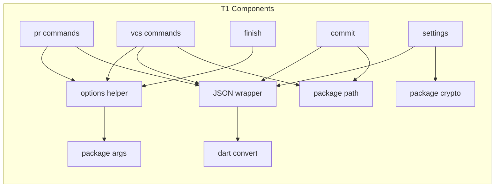
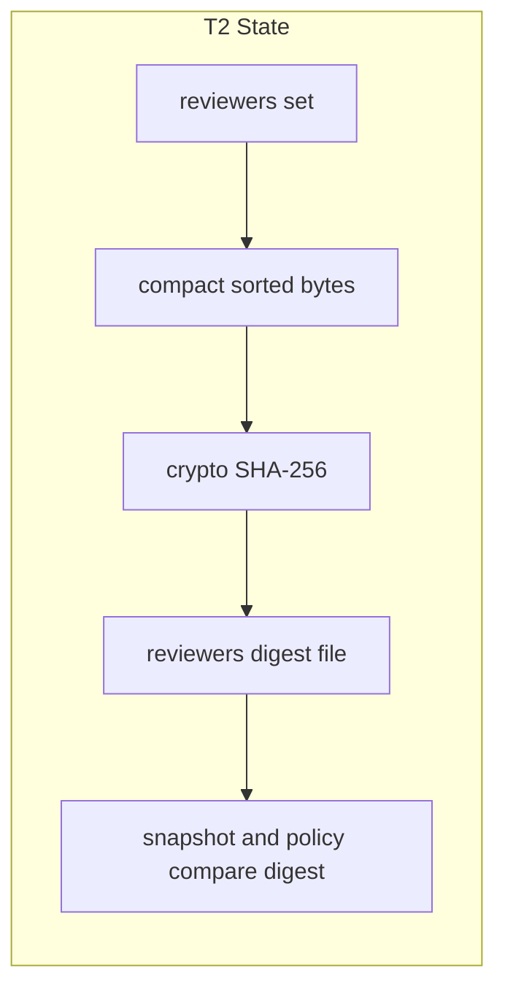
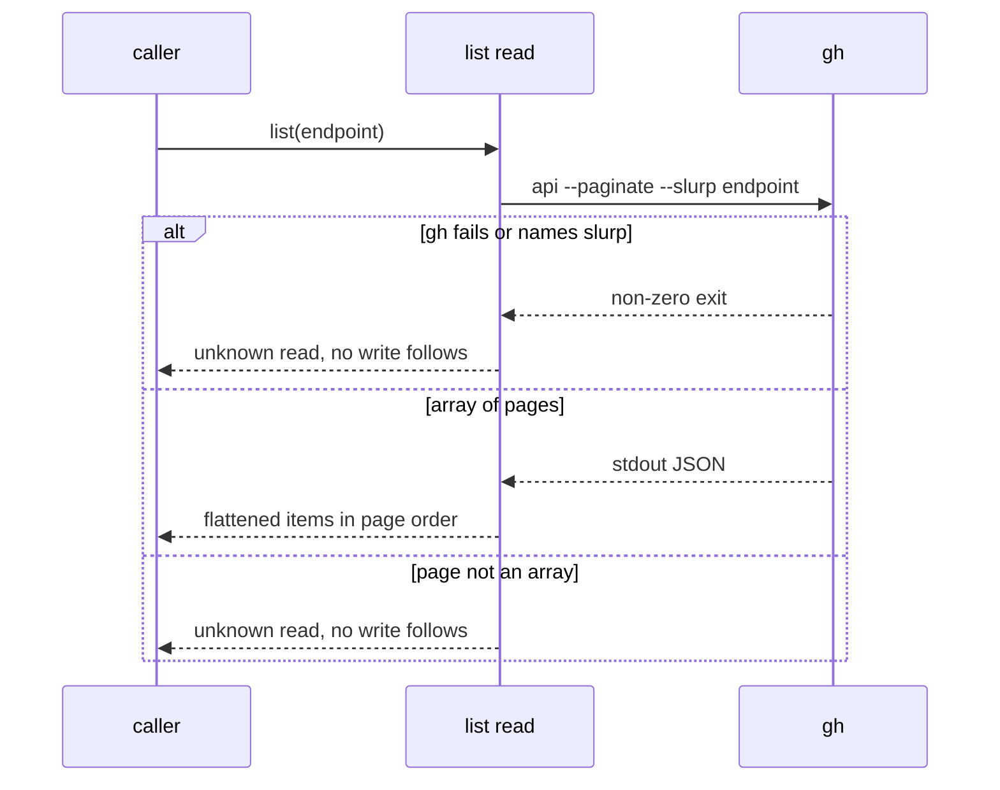

# Design

## Refresh before apply

Refreshed on 2026-11-10 against merged `main` at `3fc5454458addc6684116e856aed585fb7d51524` (PR #218, `native-cli-pr-pair-flow`, version 0.30.0). Source citations, JSON and option callers, notice delivery, MODIFIED requirements and existing test names were rechecked. The planned release remains 0.31.0. SDK/package experiments A1-A5 and A7 remain implementation preconditions, not passing checks.

The merged port adds `feedback_record.dart`, `feedback_pass.dart` and workflow file reads to the JSON migration. The shared `parsePairArgs` already serves all fourteen workflow commands. `cli/THIRD_PARTY_NOTICES.txt` exists and is delivered by `scripts/install-sw.sh:26-37`, `scripts/update.sh:3083-3093` and `.github/workflows/sw-build.yml:79`; extend it rather than create another delivery mechanism.

## Triage

| Trigger | Applies? | Evidence |
|---|---|---|
| T1 Components (new component, or 3+ with directed relationships) | yes | Two small modules (JSON wrapper, option helper) are used by `pr`, `vcs`, `commit`, `finish` and `settings`. |
| T2 State (persistent state, caches, 3+ state machine) | yes | Reviewer-config files are named by the digest of their bytes (`cli/lib/src/settings/reviewer_config.dart:64-74`, `:155-156`). The bytes must not move. |
| T3 Concurrency (background work, workers/isolates, async, retries) | no | Every replacement is a synchronous parse or a single existing `gh` call. |
| T4 Boundaries (data format, migration, shared interface, IPC, external) | yes | The stdout JSON form, the option grammar, the `gh` call form and the `gh` version floor all change. |
| T5 Volume (grows without a fixed bound) | no | Nothing accumulates: `gh` responses stop at the runner's limit, and D2 adds a size cap to direct JSON file reads, which have none today. |
| T6 Risk (security, money, data loss, unrecoverable user data) | yes | Merge policy reads JSON from GitHub and must still fail closed. |

TIER: FULL

## Context

- SHA-256 is written by hand, on the stated grounds that a package was not worth carrying (`cli/lib/src/settings/reviewer_config.dart:230-232`, code to `:288`).
- `settings/pyjson.dart` follows CPython's scanner so that `NaN`, integers of any size and lone surrogates read as Python read them (`cli/lib/src/settings/pyjson.dart:7-12`). It limits nesting to 2,000 levels (`:33`) and puts back a byte-order mark so that it is refused (`:58-69`).
- `vcs/document.dart` writes Python's separators and float form, escapes U+2028 and U+2029, and ends documents in CRLF on Windows (`cli/lib/src/vcs/document.dart:5-34`, `:39-40`, `:125`). Lone U+DC80..U+DCFF become raw bytes through `encodeEscaped` (`:45-55`).
- Reviewer-config bytes come from compact, sorted text with surrogates replaced (`cli/lib/src/settings/reviewer_config.dart:53-74`).
- Four parsers exist. `parsePairArgs` keeps words that do not start with `--` as positionals (`cli/lib/src/pr/pair.dart:44-67`). `_parseArgs` copies `argparse`, including prefixes (`cli/lib/src/pr/reviewers.dart:145-195`). `parseVcsArguments` refuses anything before `--` that is not a known option (`cli/lib/src/vcs/args.dart:141-163`) and checks options before the command name (`:164`). `_parseOptions` takes the next argument whatever it looks like and refuses positionals (`cli/lib/src/commands/finish.dart:33-52`). The merged pair-flow added two more `sw pr` parsers, in `pr/snapshot.dart` and `pr/reply.dart`; they are exact-match and follow the same rule after this change. `sw commit task-cover` keeps its exact-match parser, because the option rule covers `sw vcs`, `sw finish` and `sw pr` only.
- `PyPath` is `os.path` for `task-cover` (`cli/lib/src/commit/task_cover.dart:746-870`). `relpathText` is `os.path.relpath` over escaped strings (`cli/lib/src/vcs/walk.dart:196-219`).
- The `gh` floor is stated in the fence message (`cli/lib/src/fence/fence.dart:186`) and in the install text and tests (`README.md:56`, `:84`, `:484`, `skills/specwright-pr/SKILL.md:10`, `evals/git-workflow/test_instructions.py:614-628`).
- `sw`'s own `--check-config` and `--material` launches pass whole option names (`cli/lib/src/pr/snapshot.dart:222`, `:480`).
- ADR 0027 limits packages (`docs/adr/0027-shipped-tooling-is-one-dart-binary.md:14`); ADR 0033 adds to it.

## Decisions

### D1: One JSON wrapper

- **Choice:** Keep `documentText` and `documentBytes` in `vcs/document.dart`, reduced to a `JsonEncoder` call and `encodeEscaped`, with their flags removed. If task 2.1 disproves A3 or A7, retain a small string writer that emits lone surrogates raw and use `JsonEncoder` for everything else; this preserves raw name bytes and the canonical replacement of surrogates with `?`. Add a reading half with `decodeJson` and `readJsonFile`, which use `jsonDecode` and strict UTF-8, and throw a single `FormatException` subtype whose message starts with `<file>: `.
- **Rejected:** Call `dart:convert` directly at each reader and writer, because the non-UTF-8 name bytes and the file-name prefix would be repeated at every one.
- **Reversal cost:** low
- **Important:** yes, binds future changes (every later port writes documents through it).
- **Chosen by:** user, "behind a small wrapper".

### D2: Fail-closed input comes from existing type checks

- **Choice:** Keep the existing unreadable stops and `is int` / `is String` shape checks. Where `jsonDecode` turns a huge integer into a double, the field fails its `is int` check and the command stops. Tests pin this for reviewer-config `timeout` and feedback `round`. Reviewer timeout currently accepts `BigInt` (`cli/lib/src/pr/reviewers.dart:262-263`) and feedback uses `_integer` (`cli/lib/src/pr/feedback_pass.dart:33-38`); replace those acceptance paths with exact `int` checks before comparison, not rounded conversion. Today's direct file read has no size check (`cli/lib/src/settings/pyjson.dart:47`), so `readJsonFile` adds the boundary: it reads at most `defaultMaxBytes` (32 MiB, `cli/lib/src/process/limits.dart:10`) plus one byte, and a longer file is the same unreadable-input stop, naming the file. Every JSON file `sw` decodes goes through `readJsonFile`, so reviewer material, reviewer config, policy snapshots, workflow snapshots, feedback intent and feedback record reads share one bound; `gh` responses already stop at the same limit (`cli/lib/src/process/bounded_run.dart:162`). With input capped, nesting is capped too. A stack overflow while decoding deep input is caught and mapped to the same stop.
- **Rejected:** A pre-scan for digit runs or depth, because it is another parser, which is what this change removes. No size check, because the 2,000-level limit is the only protection today and removing it would leave none.
- **Reversal cost:** low
- **Important:** yes, weak evidence (A1 to A3 settle it before any reader changes).
- **Chosen by:** agent

### D8: Integers beyond 64 bits stop where they enter

- **Choice:** No `BigInt` may reach a document. The rules layer never returns a `BigInt`: `duration` (timeout and poll_interval), the `max_fix_rounds` read and `reviewersOf` turn an integer beyond signed 64-bit range into a `bad_setting` `SettingProblem` naming the key, substituting the corresponding default (timeout 1200, poll_interval 300, max_fix_rounds 2).
  - `context` stops with `bad_setting`, exit 2, before writing a reviewer config.
  - `workflowContexts` passes a problems list; its `rounds` and `pass` callers stop with `bad_setting`, exit 2.
  - Policy's main side stops through the existing `bads` path. Its head side lists the key in `invalid`, while `values`, `drift`, `pr.reviewers` and the reviewer config hold the default; policy exits 0 for that head-side invalid value.
  - Policy's raw `pr.merge_method` and `pr.delete_branch` values beyond 64 bits are echoed as `settingText`, never `BigInt`.
  - In `task-cover`, a task, commit subject or trailer with a group number beyond 64 bits is not a task, and such a numbered heading is ignored before insertion into `ParsedTasks.headings`. An unexpected `BigInt` at the encoder is still `internal_error`.
  - C1 holds for supported settings: bytes and digests remain unchanged within 64 bits, including lone-surrogate strings. Oversized settings are refused or represented by defaults as specified above, before config bytes are written.
- **Rejected:** Write `BigInt` digits through a custom encoder, because that keeps the custom writer for a timeout longer than the age of the universe. Convert only for canonical bytes, because two integer paths would remain.
- **Reversal cost:** low
- **Important:** yes, changes what users see (a setting that was accepted now stops).
- **Chosen by:** user, approved round 3 Required Changes on 2026-11-10 ("yes go ahead.").

| Integer producer | Citation | Reaches | Beyond 64 bits after this change |
|---|---|---|---|
| Settings integers and durations | `cli/lib/src/settings/rules.dart:99`, `:118`, `:377`, `:450` | `SettingsDoc.toJson`, canonical reviewer config (`cli/lib/src/settings/reviewer_config.dart:60`) | Problem plus default in the rules layer; caller-specific stop or invalid-head result above |
| JSON integer fields | `cli/lib/src/pr/reviewers.dart:261-265`, `cli/lib/src/pr/feedback_pass.dart:33-38` | Reviewer-config timeout and feedback round validation | Decodes to double, fails exact integer check, config error or invalid_intent |
| Policy raw YAML values | `cli/lib/src/pr/policy.dart:218-225`, `:256-257` | pr.merge_method and pr.delete_branch in values and comparisons | Oversized non-string/non-bool values use settingText, never BigInt |
| `task-cover` group numbers from tasks, subjects and trailers | `cli/lib/src/commit/task_cover.dart:275-289`, `:353-360`, `:598-646` | `groups`, `tasks` and cross-group entries in the document | Not a task; group numbers become `int` |
| `task-cover` numbered headings | `cli/lib/src/commit/task_cover.dart:308`, `:634` | `groups[].group`, even with no matching task | Heading ignored before it enters `ParsedTasks.headings` |
| Workflow feedback-round trailers | `cli/lib/src/pr/workflow.dart:1545-1592`, `:1628-1632` | `rounds` and per-repository `max_trailer` | Exact values within 64 bits become `int`; an oversized trailer stops as an unknown workflow read before any decision, never truncates or disappears |

`cfg.now` stays `num`-typed (jq `mktime`, `cli/lib/src/pr/queries.dart:340-341`); an oversized value stops as a material error in `_formatIso` (`cli/lib/src/pr/reviewers.dart:406-413`), not an integer type refusal. Policy snapshot comparisons use strings, not JSON integer fields (`cli/lib/src/pr/policy.dart:276-314`).

The merged `rounds` implementation emits `BigInt` even for zero. Convert representable counters before encoding; add zero, ordinary and oversized-trailer cases. The existing arbitrary-precision test in `evals/pr-pair/test_workflow_parity.py:395` becomes an explicit refusal difference from the oracle.

### Merged JSON reader boundaries

- `feedback_record.dart:232-247` reads through injected `RecordFiles.readBytes` (`feedback_record_files.dart:28`, `:73`). Extend that seam to bounded reads rather than bypass it: native reads stop at cap plus one, and fakes exercise the same bound. Missing files still mean absence; malformed, non-standard or oversized records remain `record_unreadable` and block replacement. Preserve exclusive publication, locks, legacy migration, raw paths, record identity and LF encoding.
- `feedback_pass.dart:157-173` reads intent and snapshots. Move these to the wrapper while preserving `invalid_intent`, `snapshot_unreadable` and their exit statuses. Its integer checks refuse rounded doubles.
- `workflow.dart:1733-1741` currently documents uncapped input. Replace that deliberate gap with the approved 32 MiB file policy and update its comment in apply; raw POSIX paths still resolve through `encodeEscaped`. Preserve each caller's existing unreadable/refusal mapping.
- `workflow.dart:314-321`, `:324-368`, `:452`, `:641`, `:748`, `:799`, `:1713` and `feedback_pass.dart:655` decode bounded GitHub output. Route these through the decoding half without adding deadlines or changing the transport's byte limits. Existing jj/GitButler JSON tool reads also use that decoder while retaining their stop types.

### D3: One helper over `ArgParser`

- **Choice:** Add `cli/lib/src/options.dart`: each command declares its `ArgParser`, and one function runs it and maps a parse failure to the command's own usage stop through a callback. `multiOption` uses `splitCommas: false`; flags are declared with `negatable: false`. `sw vcs` accepts paths only after `--`: it refuses `rest` unless `rest` is the tail of `argv` directly after a `--` token. `sw finish` refuses any `rest`. `sw pr` keeps `rest` as positionals.
- **Rejected:** A declarative table of commands and options shared by all four, because the four have different stop types and no command gains from sharing more than the failure mapping.
- **Reversal cost:** low
- **Important:** yes, changes what users see (`--opt=value`, no prefixes).
- **Chosen by:** user, "the existing args dependency replaces the parsers".

### D4: Slurp, not merge-on-pipe

- **Choice:** For list reads that decode whole pages, call `gh api --paginate --slurp`, decode through the wrapper, require an array of arrays and flatten it. Map a `gh` failure that names `--slurp` to the unknown-read stop naming `gh` 2.48. `item-issues` retains `--paginate --jq` per-page output and its existing unreadable-response refusal.
- **Rejected:** Rely on `gh` merging array pages when piped, because its documentation promises separate values per page and only its current source merges them.
- **Reversal cost:** low
- **Important:** yes, changes what users see (the floor).
- **Chosen by:** user, "gh api --paginate --slurp replaces the scanner".

### D5: path on escaped strings, with realpath kept

- **Choice:** `path.Context` for the two styles replaces `PyPath.abspath`, `normpath`, `relpath` and `dirname`, and `relpathText`. Symlink resolution stays in the existing raw-path call, which `path` does not offer. A cross-drive relative path remains an error in both callers.
- **Rejected:** Keep a Windows-only copy of `splitDrive`, because `path.Style.windows` covers drives and UNC roots.
- **Reversal cost:** low
- **Important:** no
- **Chosen by:** user, "path replaces PyPath ... and the relpath helpers" (A4 confirms cross-drive and surrogate behaviour).

### D6: Extend the shipped notice file

- **Choice:** Extend the existing `cli/THIRD_PARTY_NOTICES.txt` with `crypto` and its runtime closure. `path` is already a transitive runtime dependency of `html` and already has a notice; making it direct must not duplicate its notice. Preserve the install, update and release checksum delivery already merged with pair-flow. Add a check that every package in the runtime closure (`dart pub deps --no-dev`) has a notice.
- **Rejected:** A second notice file for this change, because two lists of the same closure drift.
- **Reversal cost:** low
- **Important:** yes, binds future changes.
- **Chosen by:** agent

### D7: Compact JSON and LF everywhere

- **Choice:** Stated in S5. Parsed-value tests replace byte comparisons except the temporary text readers (C12 snapshot regexes, C13 printed undo guards); pin the compact form they read until native-cli-internal-calls removes them.
- **Rejected:** Keep spaced text behind a flag, because the flag is the custom writer.
- **Reversal cost:** low
- **Important:** yes, changes what users see.
- **Chosen by:** user, chose "Plain JsonEncoder + LF".

### Decision summary

| # | Decision | Choice | Rejected | Reversal cost | Important | Chosen by |
|---|---|---|---|---|---|---|
| S1 | Libraries now | crypto, path, args, dart:convert | Two-package limit; yaml here | low | yes | user |
| S2 | What is preserved | Workflow guarantees | Byte parity | medium | yes | user |
| S3 | gh floor | 2.48 | Keep the scanner for 2.40 | low | yes | user |
| S4 | Custom code | Quoting and process control stay | Planned replacements | low | no | user |
| S5 | JSON form | Compact, LF, raw U+2028 | Spaced, CRLF | low | yes | user |
| S6 | Interface | Stays 1 | Bump to 2 | low | yes | user |
| S7 | Timing | Plan now, refresh after pair-flow | Wait for the merge | low | yes | user |
| D1 | JSON wrapper | Small wrapper with surrogate-string fallback if needed | dart:convert at each site | low | yes | user |
| D2 | Fail-closed input | Existing type checks and stops, 32 MiB file cap | Pre-scanner; no cap | low | yes | agent |
| D3 | Option helper | One function over `ArgParser` | Shared table | low | yes | user |
| D4 | Page reading | `--paginate --slurp` | Merge-on-pipe | low | yes | user |
| D5 | Paths | `path.Context`, realpath kept | Windows-only copy | low | no | user |
| D6 | Notice | Extend pair-flow's file, closure check | Second file | low | yes | agent |
| D7 | Compact JSON | Plain encoder with surrogate-string fallback if needed | Spaced flag | low | yes | user |
| D8 | Integers beyond 64 bits | Rules default plus caller-specific stop or invalid-head result | Custom BigInt writer | low | yes | user |

The vcs-backends delta retains the historical scenario title "Line separators stay escaped" alongside "Line separators parse back": strict validation forbids dropping a current scenario; both assert parsed characters, not escaped bytes.

The owner approved round 3 Required Changes on 2026-11-10 ("yes go ahead."): D1 permits the surrogate-string fallback; D7 retains C12 until internal-calls. On 2026-11-10, during apply, the owner chose C13 (compact-text printed undo guards) over parsing in the printed script. These refine S5 without changing compact output, LF or raw line separators.

## Assumptions

- **A1:** `jsonDecode` handles 100,000 nested levels without a crash, or fails in a form the wrapper can catch. Not checked because no package or SDK behaviour has been run for this plan. Depends on it: D2, task 2.1.
- **A2:** `jsonDecode` turns an integer beyond 64 bits into a `double`, so an `is int` check refuses it. Not checked because no behaviour has been run. Depends on it: D2, task 2.1.
- **A3:** `jsonDecode` keeps lone surrogate escapes in strings, and `JsonEncoder` writes them back so `encodeEscaped` still restores the bytes. Not checked because no behaviour has been run. Depends on it: D1, task 2.1.
- **A4:** `path` in `windows` style compares case-insensitively, reports another drive in a form both callers can refuse, and passes lone surrogates through. Not checked because no behaviour has been run. Depends on it: D5, task 5.1.
- **A5:** `ArgParser` keeps the last value of a repeated single option, accepts `--` as an option value, and rejects single-dash words. Not checked because no behaviour has been run. Depends on it: D3, task 3.1.
- **A6:** Verified on merged main `3fc5454`: `Workflow.list` and its scanner are at `cli/lib/src/pr/workflow.dart:324-368`. D4 replaces that scanner; tasks 1.1 and 4.1 use the merged implementation.
- **A7:** `reviewerConfigBytes` output equals `JsonEncoder` output for every value within 64 bits it holds, including strings holding lone surrogates (D8 handles larger integers), so digests are unchanged. Not checked because no behaviour has been run. Depends on it: task 2.1.
- **A8:** `crypto`, `path`, `args`, `yaml` and `html` declare no build hooks. Checked only by reading pub.dev and package sources on 2026-11-09. Depends on it: tasks 1.2 and 6.2.

## Carried constraints

- **C1:** Reviewer-config bytes and their digest must not change with a JSON library change. Kind: invariant. Destination: doc comment: cli/lib/src/settings/reviewer_config.dart reviewerConfigBytes
- **C2:** Consumers read `sw` documents by parsing them; C12 and C13 are the only temporary exceptions. Kind: invariant. Destination: spec: specs/native-cli/spec.md → Requirement: sw documents are compact JSON ending in one line feed
- **C3:** Non-UTF-8 name bytes survive documents until `native-cli-launcher` replaces the escaping. Kind: deliberate gap. Destination: doc comment: cli/lib/src/vcs/document.dart documentBytes
- **C4:** Fail-closed JSON depends on the callers' type checks; a new integer field must keep an `is int` check. Kind: invariant. Destination: doc comment: cli/lib/src/vcs/document.dart decodeJson
- **C5:** A list read that cannot prove every page decides nothing. Kind: invariant. Destination: spec: specs/pr-script-runtime/spec.md → Requirement: Paginated GitHub lists read every page or decide nothing
- **C6:** Focused packages need approval and no build hooks; workflow guarantees, not Python bytes, are what a port preserves. Kind: rejected alternative. Destination: ADR 0033
- **C7:** `sw vcs` treats words before `--` as an error, so a stray word never becomes a path to commit. Kind: invariant. Destination: doc comment: cli/lib/src/vcs/args.dart parseVcsArguments
- **C8:** `task-cover` resolves symbolic links through the raw-path call, which `path` does not offer, so task evidence is read from the right checkout. Kind: invariant. Destination: doc comment: cli/lib/src/commit/task_cover.dart realpath
- **C9:** A relative path across Windows drives stays an error and never becomes an accepted path. Kind: invariant. Destination: doc comment: cli/lib/src/vcs/walk.dart relpathText
- **C10:** Every JSON file `sw` decodes goes through `readJsonFile`, the only size bound on file input. Kind: invariant. Destination: doc comment: cli/lib/src/vcs/document.dart readJsonFile
- **C11:** No `BigInt` may reach a document, because `JsonEncoder` cannot write one; oversized integers use the caller-specific refusal, default or settingText rule in D8. Kind: invariant. Destination: spec: specs/native-cli/spec.md → Requirement: JSON input that is not plain JSON is refused

- **C12:** `sw pr snapshot` reads `sw pr reviewers` documents by regex (`cli/lib/src/pr/text.dart:29-102`, `cli/lib/src/pr/snapshot.dart:559-560`, `:593`, `:618`) until `native-cli-internal-calls` replaces that boundary. Keep the compact keys those readers require. Kind: deliberate gap. Destination: doc comment: cli/lib/src/pr/text.dart

- **C13:** The jj and GitButler guards that `sw finish undo-archive-plan` prints read the `vcs.sh state` document by text, matching the compact `"branch":"<name>"`, until `native-cli-internal-calls` replaces that boundary. Found during apply (2026-11-10): the printed guard still matched the spaced form and refused every jj and GitButler undo. Owner chose a compact-text match recorded as a gap over parsing in the printed script. The finish and GitButler parity evals list the guard text as the one `script` difference from the oracle. Kind: deliberate gap. Destination: comment at `branchPattern` in cli/lib/src/finish/undo_plan.dart

## Diagrams (FULL)

## State & Ownership (FULL)

| State | Owner (sole writer) | Lifetime | Invalidation / rebuild | Authoritative copy |
|---|---|---|---|---|
| Reviewer-config file | `writeReviewerConfig` | Until removed from the state or temp dir | Named by digest, so a change makes a new file | Bytes on disk |
| `cli/pubspec.lock` | `dart pub` under a reviewed change | Repository | A dependency change | The tracked file |
| Third-party notice | The change that alters the closure | Repository, then release | The closure check fails when stale | `cli/THIRD_PARTY_NOTICES.txt` |

## Failure & Visibility (FULL)

| Component | Fails / dies mid-operation → | Recovery | Retry safe? | Who finds out |
|---|---|---|---|---|
| JSON wrapper reading | Malformed, non-standard or over-long input → `FormatException` subtype | Existing unreadable stops in `policy`, `reviewers` and workflow reads | Yes, reads only | User: command's error and exit status |
| Options helper | Parse failure → the command's usage stop | User corrects the call | Yes | Agent or user: usage error, exit 2 |
| `--slurp` list | Non-zero exit, old `gh`, non-array page → unknown read | Upgrade `gh` or retry | Yes, reads only | User: message names `gh` 2.48 |
| Digest | A digest mismatch would look like a rules change | C1 test pins bytes and digest | n/a | CI |

## Resource Bounds (FULL)

| Queue / buffer / cache / transfer | Bound | At the bound | Timeout | At 10x / 100x |
|---|---|---|---|---|
| `gh` list response | The runner's existing response limit | `response_too_large` stop | Existing paged deadline | Slurp holds all pages in memory, as the scanner did; the byte limit caps it |
| JSON input from file (reviewer material/config, policy and workflow snapshots, feedback intent/records) | New: 32 MiB in `readJsonFile`; today nothing bounds it | The command's unreadable-input stop, naming the file | none added | A larger file stops before decoding; memory is at most the cap times the decoder's constant factor |

## Flow & State Gaps (FULL)

- **Upgrade with an old `gh`:** PR steps that list pages stop with the unknown-read error naming 2.48, and install reports `PR workflow not ready: gh 2.48+`.
- **Interrupted runs:** every replacement is a read or a parse, so restart repeats it. Existing feedback records are not touched.
- **A snapshot written by an earlier version:** digests are unchanged by C1, so it stays comparable.
- **Refresh timing:** the merged caller inventory above is the baseline; task 1.1 rechecks it if main moves again before apply.

## Mechanism Ledger (FULL)

| Mechanism | Built? | Why (harm nobody catches / expensive later) | Evidence that would change the call |
|---|---|---|---|
| Option-prefix compatibility | No | No shipped caller uses it, and a test proves that | A shipped caller needing one |
| Depth limit on JSON input | No, if A1 holds | The new 32 MiB read cap and the runner's response limit bound the input, so depth is bounded too; a separate limit is another parser | A1 shows a crash the wrapper cannot catch |
| Size cap on JSON file reads | Yes | Without it, removing the depth limit leaves a file read with no protection | none |
| Digit-run scanner for large integers | No | Type checks already refuse doubles | A2 disproved |
| Notice closure check | Yes | A new transitive package would ship with no notice and no one would notice | none |
| `gh` version probe before use | No | The first failing call already names the floor, at no cost to every run | Users report confusing failures |

## Risks / Trade-offs

- [A library changes behaviour on upgrade] → `pubspec.lock` is enforced, and each adoption has an outcome test.
- [An unseen text consumer of JSON] → the scan test in task 3.2 covers shipped skills and scripts, and CI runs every suite.
- [Main moves after this refresh] → task 1.1 rechecks the recorded baseline before changing code.
- [Python-only `NaN` rejected where a reviewer file used it] → GitHub does not emit it; the stop names the file.

## ADRs

- **In force, constraining this change:** 0014, 0027, 0028, 0029, 0030, 0031, 0032, 0033.
- **Already accepted:** ADR 0033 (2026-11-09) permits the focused libraries and defines product-level preservation. Do not edit its accepted file. ADRs 0031 and 0032 also constrain the merged feedback recovery and internal-call boundaries.

## Open Questions

None.
