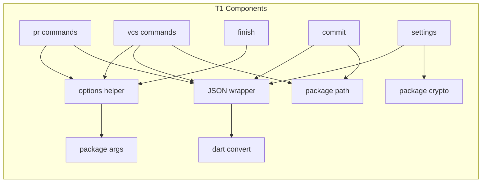
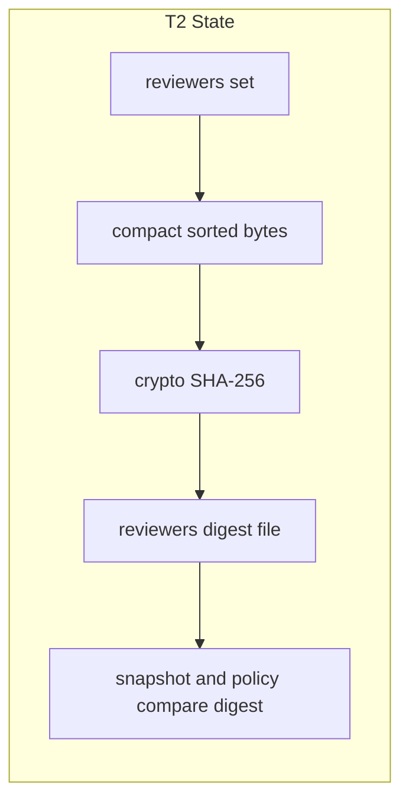
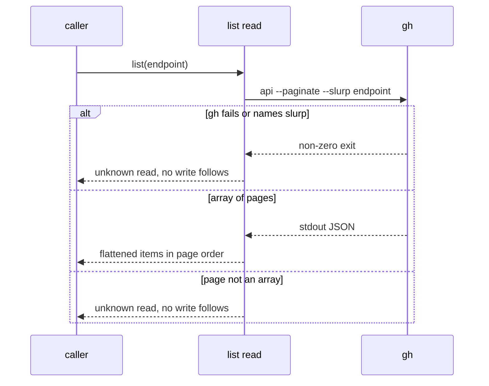

# Design

## Refresh before apply

This plan was written from `main` at `f5d61d2` and from the committed `feat/native-cli-pr-pair-flow` branch. That change is still rewriting `pr/workflow.dart` and the JSON callers, and it holds uncommitted edits. **Once `native-cli-pr-pair-flow` merges, refresh this design, the specs and the tasks against the merged code before apply** (task 1.1). The refresh rechecks every citation, the list of JSON and argument callers, the version number (this plan assumes pair-flow takes 0.30.0), the third-party notice, and the wording of the MODIFIED requirements.

## Triage

| Trigger | Applies? | Evidence |
|---|---|---|
| T1 Components (new component, or 3+ with directed relationships) | yes | Two small modules (JSON wrapper, option helper) are used by `pr`, `vcs`, `commit`, `finish` and `settings`. |
| T2 State (persistent state, caches, 3+ state machine) | yes | Reviewer-config files are named by the digest of their bytes (`cli/lib/src/settings/reviewer_config.dart:64-74`, `:155-156`). The bytes must not move. |
| T3 Concurrency (background work, workers/isolates, async, retries) | no | Every replacement is a synchronous parse or a single existing `gh` call. |
| T4 Boundaries (data format, migration, shared interface, IPC, external) | yes | The stdout JSON form, the option grammar, the `gh` call form and the `gh` version floor all change. |
| T5 Volume (grows without a fixed bound) | no | Nothing accumulates: `gh` responses stop at the runner's limit, and D2 adds a size cap to direct JSON file reads, which have none today. |
| T6 Risk (security, money, data loss, unrecoverable user data) | yes | Merge policy reads JSON from GitHub and must still fail closed. |

TIER: FULL

## Context

- SHA-256 is written by hand, on the stated grounds that a package was not worth carrying (`cli/lib/src/settings/reviewer_config.dart:230-232`, code to `:288`).
- `settings/pyjson.dart` follows CPython's scanner so that `NaN`, integers of any size and lone surrogates read as Python read them (`cli/lib/src/settings/pyjson.dart:7-12`). It limits nesting to 2,000 levels (`:33`) and puts back a byte-order mark so that it is refused (`:58-69`).
- `vcs/document.dart` writes Python's separators and float form, escapes U+2028 and U+2029, and ends documents in CRLF on Windows (`cli/lib/src/vcs/document.dart:5-34`, `:39-40`, `:125`). Lone U+DC80..U+DCFF become raw bytes through `encodeEscaped` (`:45-55`).
- Reviewer-config bytes come from compact, sorted text with surrogates replaced (`cli/lib/src/settings/reviewer_config.dart:53-74`).
- Four parsers exist. `parsePairArgs` keeps words that do not start with `--` as positionals (`cli/lib/src/pr/pair.dart:44-67`). `_parseArgs` copies `argparse`, including prefixes (`cli/lib/src/pr/reviewers.dart:145-195`). `parseVcsArguments` refuses anything before `--` that is not a known option (`cli/lib/src/vcs/args.dart:141-163`) and checks options before the command name (`:164`). `_parseOptions` takes the next argument whatever it looks like and refuses positionals (`cli/lib/src/commands/finish.dart:33-52`).
- `PyPath` is `os.path` for `task-cover` (`cli/lib/src/commit/task_cover.dart:746-870`). `relpathText` is `os.path.relpath` over escaped strings (`cli/lib/src/vcs/walk.dart:196-219`).
- The `gh` floor is stated in the fence message (`cli/lib/src/fence/fence.dart:186`) and in the install text and tests (`README.md:56`, `:84`, `:480`, `skills/specwright-pr/SKILL.md:10`, `evals/git-workflow/test_instructions.py:614-628`).
- `sw`'s own `--check-config` and `--material` launches pass whole option names (`cli/lib/src/pr/snapshot.dart:222`, `:480`).
- ADR 0027 limits packages (`docs/adr/0027-shipped-tooling-is-one-dart-binary.md:14`); ADR 0033 adds to it.

## Decisions

### D1: One JSON wrapper

- **Choice:** Keep `documentText` and `documentBytes` in `vcs/document.dart`, reduced to a `JsonEncoder` call and `encodeEscaped`, with their flags removed. Add a reading half with `decodeJson` and `readJsonFile`, which use `jsonDecode` and strict UTF-8, and throw a single `FormatException` subtype whose message starts with `<file>: `.
- **Rejected:** Call `dart:convert` directly at each of the 15 call sites, because the non-UTF-8 name bytes and the file-name prefix would be repeated at every one.
- **Reversal cost:** low
- **Important:** yes, binds future changes (every later port writes documents through it).
- **Chosen by:** user, "behind a small wrapper".

### D2: Fail-closed input comes from existing type checks

- **Choice:** Keep the existing unreadable stops and `is int` / `is String` shape checks. Where `jsonDecode` turns a huge integer into a double, the field fails its `is int` check and the command stops. A test pins this for the policy and reviewer fields. Today's direct file read has no size check (`cli/lib/src/settings/pyjson.dart:47`), so `readJsonFile` adds the boundary: it reads at most `defaultMaxBytes` (32 MiB, `cli/lib/src/process/limits.dart:10`) plus one byte, and a longer file is the same unreadable-input stop, naming the file. Every JSON file `sw` decodes goes through `readJsonFile`, so reviewer material, reviewer config and policy snapshot reads share one bound; `gh` responses already stop at the same limit (`cli/lib/src/process/bounded_run.dart:162`). With input capped, nesting is capped too. A stack overflow while decoding deep input is caught and mapped to the same stop.
- **Rejected:** A pre-scan for digit runs or depth, because it is another parser, which is what this change removes. No size check, because the 2,000-level limit is the only protection today and removing it would leave none.
- **Reversal cost:** low
- **Important:** yes, weak evidence (A1 to A3 settle it before any reader changes).
- **Chosen by:** agent

### D8: Integers beyond 64 bits stop where they enter

- **Choice:** `JsonEncoder` cannot write a `BigInt`, so none may reach a document. Integer settings beyond 64 bits (`timeout`, `max_fix_rounds`, `poll_interval`, see the producer table) stop with the existing `SettingProblem` (`bad_setting`, reported as `settings_problem`) when the rules read them. In `task-cover`, a task id, commit subject or trailer whose group number is beyond 64 bits is not a task, like the non-ASCII digits today, and a numbered heading with such a number is ignored before it enters `ParsedTasks.headings`. If a `BigInt` still reaches the encoder, the command prints `internal_error`. C1 holds for every value that can be configured: bytes and digests are unchanged for values within 64 bits, and a larger value now stops before any config is written.
- **Rejected:** Write `BigInt` digits through a custom encoder, because that keeps the custom writer for a timeout longer than the age of the universe. Convert only for canonical bytes, because two integer paths would remain.
- **Reversal cost:** low
- **Important:** yes, changes what users see (a setting that was accepted now stops).
- **Chosen by:** agent

| Integer producer | Citation | Reaches | Beyond 64 bits after this change |
|---|---|---|---|
| Settings integers and durations | `cli/lib/src/settings/rules.dart:99`, `:118`, `:377`, `:450` | `SettingsDoc.toJson`, canonical reviewer config (`cli/lib/src/settings/reviewer_config.dart:60`) | `bad_setting` stop |
| JSON input (reviewer material, config, GitHub) | `cli/lib/src/pr/reviewers.dart:66`, `:263`, `:597` | Reviewer evaluation and policy comparison | Decodes to `double`, fails `is int`, unreadable-input stop |
| `task-cover` group numbers from tasks, subjects and trailers | `cli/lib/src/commit/task_cover.dart:275-289`, `:353-360`, `:598-646` | `groups`, `tasks` and cross-group entries in the document | Not a task; group numbers become `int` |
| `task-cover` numbered headings | `cli/lib/src/commit/task_cover.dart:308`, `:634` | `groups[].group`, even with no matching task | Heading ignored before it enters `ParsedTasks.headings` |

### D3: One helper over `ArgParser`

- **Choice:** Add `cli/lib/src/options.dart`: each command declares its `ArgParser`, and one function runs it and maps a parse failure to the command's own usage stop through a callback. `multiOption` uses `splitCommas: false`. `sw vcs` accepts paths only after `--`: it refuses `rest` unless `rest` is the tail of `argv` directly after a `--` token. `sw finish` refuses any `rest`. `sw pr` keeps `rest` as positionals.
- **Rejected:** A declarative table of commands and options shared by all four, because the four have different stop types and no command gains from sharing more than the failure mapping.
- **Reversal cost:** low
- **Important:** yes, changes what users see (`--opt=value`, no prefixes).
- **Chosen by:** user, "the existing args dependency replaces the parsers".

### D4: Slurp, not merge-on-pipe

- **Choice:** Call `gh api --paginate --slurp`, decode through the wrapper, require an array of arrays and flatten it. Map a `gh` failure that names `--slurp` to the unknown-read stop naming `gh` 2.48.
- **Rejected:** Rely on `gh` merging array pages when piped, because its documentation promises separate values per page and only its current source merges them.
- **Reversal cost:** low
- **Important:** yes, changes what users see (the floor).
- **Chosen by:** user, "gh api --paginate --slurp replaces the scanner".

### D5: path on escaped strings, with realpath kept

- **Choice:** `path.Context` for the two styles replaces `PyPath.abspath`, `normpath`, `relpath` and `dirname`, and `relpathText`. Symlink resolution stays in the existing raw-path call, which `path` does not offer. A cross-drive relative path remains an error in both callers.
- **Rejected:** Keep a Windows-only copy of `splitDrive`, because `path.Style.windows` covers drives and UNC roots.
- **Reversal cost:** low
- **Important:** no
- **Chosen by:** user, "path replaces PyPath ... and the relpath helpers" (A4 confirms cross-drive and surrogate behaviour).

### D6: Extend the notice file pair-flow creates

- **Choice:** The notice's location, delivery and checksum belong to `native-cli-pr-pair-flow`'s uncommitted D7, `cli/THIRD_PARTY_NOTICES.txt`. This change adds entries for `crypto` and its own closure, and adds a check that the notice names every package in the runtime closure of `pubspec.lock`. If pair-flow does not land that file, this change creates it at that path with the same content rule, and delivery follows at the refresh.
- **Rejected:** A second notice file for this change, because two lists of the same closure drift.
- **Reversal cost:** low
- **Important:** yes, binds future changes.
- **Chosen by:** agent

### D7: Compact JSON and LF everywhere

- **Choice:** Stated in S5. Nothing else in the design depends on spacing; parsed-value tests replace byte comparisons.
- **Rejected:** Keep spaced text behind a flag, because the flag is the custom writer.
- **Reversal cost:** low
- **Important:** yes, changes what users see.
- **Chosen by:** user, chose "Plain JsonEncoder + LF".

### Decision summary

| # | Decision | Choice | Rejected | Reversal cost | Important | Chosen by |
|---|---|---|---|---|---|---|
| S1 | Libraries now | crypto, path, args, dart:convert | Two-package limit; yaml here | low | yes | user |
| S2 | What is preserved | Workflow guarantees | Byte parity | medium | yes | user |
| S3 | gh floor | 2.48 | Keep the scanner for 2.40 | low | yes | user |
| S4 | Custom code | Quoting and process control stay | Planned replacements | low | no | user |
| S5 | JSON form | Compact, LF, raw U+2028 | Spaced, CRLF | low | yes | user |
| S6 | Interface | Stays 1 | Bump to 2 | low | yes | user |
| S7 | Timing | Plan now, refresh after pair-flow | Wait for the merge | low | yes | user |
| D1 | JSON wrapper | Small wrapper in `vcs/document.dart` | dart:convert at each site | low | yes | user |
| D2 | Fail-closed input | Existing type checks and stops, 32 MiB file cap | Pre-scanner; no cap | low | yes | agent |
| D3 | Option helper | One function over `ArgParser` | Shared table | low | yes | user |
| D4 | Page reading | `--paginate --slurp` | Merge-on-pipe | low | yes | user |
| D5 | Paths | `path.Context`, realpath kept | Windows-only copy | low | no | user |
| D6 | Notice | Extend pair-flow's file, closure check | Second file | low | yes | agent |
| D7 | Compact JSON | Plain encoder | Spaced flag | low | yes | user |
| D8 | Integers beyond 64 bits | Stop where they enter | Custom BigInt writer | low | yes | agent |

## Assumptions

- **A1:** `jsonDecode` handles 100,000 nested levels without a crash, or fails in a form the wrapper can catch. Not checked because no package or SDK behaviour has been run for this plan. Depends on it: D2, task 2.1.
- **A2:** `jsonDecode` turns an integer beyond 64 bits into a `double`, so an `is int` check refuses it. Not checked because no behaviour has been run. Depends on it: D2, task 2.1.
- **A3:** `jsonDecode` keeps lone surrogate escapes in strings, and `JsonEncoder` writes them back so `encodeEscaped` still restores the bytes. Not checked because no behaviour has been run. Depends on it: D1, task 2.1.
- **A4:** `path` in `windows` style compares case-insensitively, reports another drive in a form both callers can refuse, and passes lone surrogates through. Not checked because no behaviour has been run. Depends on it: D5, task 5.1.
- **A5:** `ArgParser` keeps the last value of a repeated single option, accepts `--` as an option value, and rejects single-dash words. Not checked because no behaviour has been run. Depends on it: D3, task 3.1.
- **A6:** The list scanner is at `cli/lib/src/pr/workflow.dart:271-311` on `feat/native-cli-pr-pair-flow`, and that file is not on this tree. Not checked against merged code because pair-flow has not merged. Depends on it: D4, tasks 1.1 and 4.1.
- **A7:** `reviewerConfigBytes` output equals `JsonEncoder` output for every value within 64 bits it holds (D8 stops larger ones), so digests are unchanged. Not checked because no behaviour has been run. Depends on it: task 2.1.
- **A8:** `crypto`, `path`, `args`, `yaml` and `html` declare no build hooks. Checked only by reading pub.dev and package sources on 2026-11-09. Depends on it: tasks 1.2 and 6.2.

## Carried constraints

- **C1:** Reviewer-config bytes and their digest must not change with a JSON library change. Kind: invariant. Destination: doc comment: cli/lib/src/settings/reviewer_config.dart reviewerConfigBytes
- **C2:** Consumers read `sw` documents by parsing them; text matching on a document is a defect. Kind: invariant. Destination: spec: specs/native-cli/spec.md → Requirement: sw documents are compact JSON ending in one line feed
- **C3:** Non-UTF-8 name bytes survive documents until `native-cli-launcher` replaces the escaping. Kind: deliberate gap. Destination: doc comment: cli/lib/src/vcs/document.dart documentBytes
- **C4:** Fail-closed JSON depends on the callers' type checks; a new integer field must keep an `is int` check. Kind: invariant. Destination: doc comment: cli/lib/src/vcs/document.dart decodeJson
- **C5:** A list read that cannot prove every page decides nothing. Kind: invariant. Destination: spec: specs/pr-script-runtime/spec.md → Requirement: Paginated GitHub lists read every page or decide nothing
- **C6:** Focused packages need approval and no build hooks; workflow guarantees, not Python bytes, are what a port preserves. Kind: rejected alternative. Destination: ADR 0033
- **C7:** `sw vcs` treats words before `--` as an error, so a stray word never becomes a path to commit. Kind: invariant. Destination: doc comment: cli/lib/src/vcs/args.dart parseVcsArguments
- **C8:** `task-cover` resolves symbolic links through the raw-path call, which `path` does not offer, so task evidence is read from the right checkout. Kind: invariant. Destination: doc comment: cli/lib/src/commit/task_cover.dart realpath
- **C9:** A relative path across Windows drives stays an error and never becomes an accepted path. Kind: invariant. Destination: doc comment: cli/lib/src/vcs/walk.dart relpathText
- **C10:** Every JSON file `sw` decodes goes through `readJsonFile`, the only size bound on file input. Kind: invariant. Destination: doc comment: cli/lib/src/vcs/document.dart readJsonFile
- **C11:** No `BigInt` may reach a document, because `JsonEncoder` cannot write one; integers beyond 64 bits stop where they enter. Kind: invariant. Destination: spec: specs/native-cli/spec.md → Requirement: JSON input that is not plain JSON is refused

## Diagrams (FULL)

## State & Ownership (FULL)

| State | Owner (sole writer) | Lifetime | Invalidation / rebuild | Authoritative copy |
|---|---|---|---|---|
| Reviewer-config file | `writeReviewerConfig` | Until removed from the state or temp dir | Named by digest, so a change makes a new file | Bytes on disk |
| `cli/pubspec.lock` | `dart pub` under a reviewed change | Repository | A dependency change | The tracked file |
| Third-party notice | The change that alters the closure | Repository, then release | The closure check fails when stale | `cli/THIRD_PARTY_NOTICES.txt` |

## Failure & Visibility (FULL)

| Component | Fails / dies mid-operation → | Recovery | Retry safe? | Who finds out |
|---|---|---|---|---|
| JSON wrapper reading | Malformed, non-standard or over-long input → `FormatException` subtype | Existing unreadable stops in `policy`, `reviewers` and workflow reads | Yes, reads only | User: command's error and exit status |
| Options helper | Parse failure → the command's usage stop | User corrects the call | Yes | Agent or user: usage error, exit 2 |
| `--slurp` list | Non-zero exit, old `gh`, non-array page → unknown read | Upgrade `gh` or retry | Yes, reads only | User: message names `gh` 2.48 |
| Digest | A digest mismatch would look like a rules change | C1 test pins bytes and digest | n/a | CI |

## Resource Bounds (FULL)

| Queue / buffer / cache / transfer | Bound | At the bound | Timeout | At 10x / 100x |
|---|---|---|---|---|
| `gh` list response | The runner's existing response limit | `response_too_large` stop | Existing paged deadline | Slurp holds all pages in memory, as the scanner did; the byte limit caps it |
| JSON input from file (reviewer material, reviewer config, policy snapshots) | New: 32 MiB in `readJsonFile`; today nothing bounds it | The command's unreadable-input stop, naming the file | none added | A larger file stops before decoding; memory is at most the cap times the decoder's constant factor |

## Flow & State Gaps (FULL)

- **Upgrade with an old `gh`:** PR steps that list pages stop with the unknown-read error naming 2.48, and install reports `PR workflow not ready: gh 2.48+`.
- **Interrupted runs:** every replacement is a read or a parse, so restart repeats it. Existing feedback records are not touched.
- **A snapshot written by an earlier version:** digests are unchanged by C1, so it stays comparable.
- **Refresh timing:** if pair-flow changes the shape of a JSON caller, task 1.1 updates this plan before any code changes.

## Mechanism Ledger (FULL)

| Mechanism | Built? | Why (harm nobody catches / expensive later) | Evidence that would change the call |
|---|---|---|---|
| Option-prefix compatibility | No | No shipped caller uses it, and a test proves that | A shipped caller needing one |
| Depth limit on JSON input | No, if A1 holds | The new 32 MiB read cap and the runner's response limit bound the input, so depth is bounded too; a separate limit is another parser | A1 shows a crash the wrapper cannot catch |
| Size cap on JSON file reads | Yes | Without it, removing the depth limit leaves a file read with no protection | none |
| Digit-run scanner for large integers | No | Type checks already refuse doubles | A2 disproved |
| Notice closure check | Yes | A new transitive package would ship with no notice and no one would notice | none |
| `gh` version probe before use | No | The first failing call already names the floor, at no cost to every run | Users report confusing failures |

## Risks / Trade-offs

- [A library changes behaviour on upgrade] → `pubspec.lock` is enforced, and each adoption has an outcome test.
- [An unseen text consumer of JSON] → the scan test in task 3.2 covers shipped skills and scripts, and CI runs every suite.
- [A rebase conflict with pair-flow] → task 1.1 refreshes the plan first, and this change is sequenced after it.
- [Python-only `NaN` rejected where a reviewer file used it] → GitHub does not emit it; the stop names the file.

## ADRs

- **In force, constraining this change:** 0014, 0027, 0028, 0029, 0030.
- **To record during apply:** none new. ADR 0033 is written on this planning branch and accepted once this design passes review.

## Open Questions

None.
