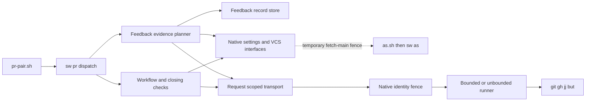
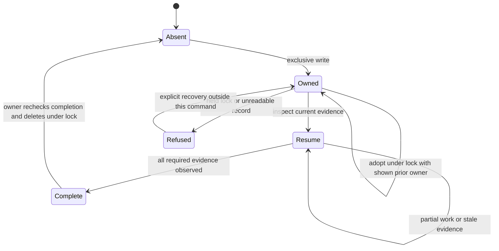
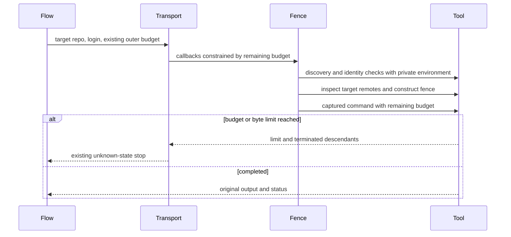
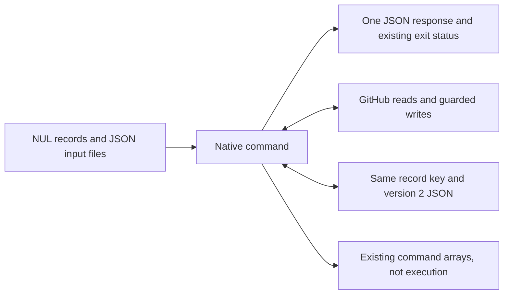

# Design

## Triage

| Trigger | Applies? | Evidence |
|---|---|---|
| T1 Components | yes | The remaining dispatch crosses GitHub, records and VCS: `skills/specwright-pr/scripts/pr-pair.sh:3017-3021`, `2634-2676`. |
| T2 State | yes | Feedback records include heads, marker and owner: `skills/specwright-pr/scripts/pr-pair.sh:2160-2186`. |
| T3 Concurrency | yes | Exclusive publication and record locks: `skills/specwright-pr/scripts/pr-pair.sh:1930-1955`, `2013-2030`. |
| T4 Boundaries | yes | Shim handoff and native dispatch: `cli/lib/src/commands/pr.dart:11-24`, `48-75`; merge read-back: `skills/specwright-pr/scripts/pr-pair.sh:2743-2766`. |
| T5 Volume | yes | Paged issue read and marker index: `skills/specwright-pr/scripts/pr-pair.sh:2996-3014`. |
| T6 Risk | yes | Per-login credentials: `skills/specwright-pr/scripts/pr-pair.sh:357-371`; remote deletion: `2954-2984`. |

TIER: FULL

## Context

Scope and milestone boundaries are in proposal.md. The five settings/policy commands already dispatch natively in `cli/lib/src/commands/pr.dart:67-74`; the other commands remain in the Python dispatch at `skills/specwright-pr/scripts/pr-pair.sh:3017-3021`.

`PairStop`, argument parsing and the single-JSON error boundary are reusable (`cli/lib/src/pr/pair.dart:9-25`, `44-77`, `81-114`). VCS exposes its handlers, session and state document (`cli/lib/src/commands/vcs.dart:43-56`, `74-100`). The fence exposes injected GitHub, Git and launch callbacks (`cli/lib/src/fence/fence.dart:22-38`) and the credential/remote/launch sequence (`536-577`). These are the integration points; the sole temporary indirect VCS fence exception is D5.

The old `git_net` wraps a target-repository `as.sh` invocation in `net`, then maps a fence-prefixed exit 3 separately (`skills/specwright-pr/scripts/pr-pair.sh:309-328`). `net` returns unknown on a limit, except mutation callers using `limit_ok` (`256-267`). Plain local Git reads use `run` rather than `net` (`245-254`). Native fence Git reads and its launched command are deliberately unbounded outside a caller-supplied budget (`cli/lib/src/fence/fence.dart:435-438`). Preserve that distinction.

Feedback keys include a truncated readable prefix and identity hash (`skills/specwright-pr/scripts/pr-pair.sh:1916-1927`). Legacy migration is identity-aware and refuses unreadable sole legacy records (`1968-2002`). Write publishes exclusively from a sibling temporary file (`2172-2186`); adopt uses a record lock and atomic replacement (`2534-2562`); failed lock cleanup is reported as `lock_left` (`2013-2030`, `3027-3034`). Pass-plan derives completion from current snapshots and repository evidence, including incomplete edits after a trailer commit (`2315-2359`, `2498-2507`).

Closing checks derive prose from GitHub-rendered HTML rather than scanning Markdown source (`skills/specwright-pr/scripts/pr-pair.sh:1436-1492`). Merge sends one PUT and always reads back (`2743-2766`). Cleanup returns commands without executing them (`2679-2728`). These boundaries stay intact.

## Decisions

### D1: Direct calls with caller-owned execution budgets

- **Choice:** A request-scoped workflow context calls existing native settings functions, the fence logic and `vcsHandlers`, with the temporary indirect VCS fence exception in D5. Reuse `verifyIdentity`, remote checking and fenced-environment construction. For captured PR reads, supply runner callbacks tied to the target directory and remaining caller budget. Keep typed refusal/limit results until the PR command maps them to its existing JSON. Record the direct-call, explicit project selection and allowed-isolation rules in ADR 0031 during apply.
- **Rejected:** Run `as.sh`, `vcs.sh` or another `sw` for ordinary internal work. Each adds transport and can reset the deadline. Changing global `Directory.current` or process environment would make concurrent requests inspect the wrong repository or inherit a token.
- **Reversal cost:** medium
- **Important:** yes, binds the boundary used by following ports.
- **Chosen by:** user, "Use direct native calls, preserving deadline boundaries" and the approved M8 amendment.

### D2: Preserve the feedback storage protocol

- **Choice:** Keep the keys, version 2, owner fields, timestamps, record JSON semantics, LF bytes, exclusive create, atomic replacement and existing legacy migration. Implement private filesystem adapters using POSIX link/mkdir/open-with-O_EXCL/rename and Windows CreateHardLinkW/CreateDirectoryW/CreateFileW-with-CREATE_NEW/MoveFileExW-with-replacement. Distinguish an existing destination from another hard-link failure; only the latter enables exclusive-create fallback. Lock acquisition uses one OS directory-create operation, never Directory.exists followed by Directory.create. Keep write's publication path separate from adopt/done's locked mutations. Reuse the existing codec/JSON helpers where they match the protocol; retain Python ordering and escaping when the stored bytes are observable.
- **Rejected:** A new database, record version or lock protocol. They would make an interrupted pass depend on a migration unrelated to the port.
- **Reversal cost:** low for implementation, high for changing the stored protocol.
- **Important:** yes, the stored protocol binds future changes; the user already chose preservation in S2. The private OS adapter is an implementation of that choice.
- **Chosen by:** user, through S2 and the approved M8 preservation requirement.

### D3: Cohesive workflow collaborators

- **Choice:** Extend `commands/pr.dart` and keep request-scoped logic in proposed `pr/workflow.dart`, `pr/workflow_transport.dart`, `pr/closing.dart`, `pr/feedback_record.dart` and `pr/feedback_pass.dart`. Keep discovery/creation/linking/state/rounds in workflow code, rendering and closing references in closing code, and record persistence separate from evidence planning. Factor further only when a cohesive tested responsibility needs it. No new package or public settings key is needed.
- **Rejected:** One translated multi-thousand-line dispatch, or a subprocess adapter per old function. Both retain the old coupling and make byte, ownership and budget tests harder to target.
- **Reversal cost:** low, internal file layout and private interfaces.
- **Important:** no, tactical organization without a new public contract.
- **Chosen by:** agent

### D4: Complete shim dispatch and explicit project selection

- **Choice:** Add the fourteen `sw pr <subcommand> --args-stdin` entries alongside the existing five. An internal `sw pr pair --args-stdin` entry handles missing/unknown script commands using their original records. Both shims accept one optional leading `--project <code-checkout>` pair, consumed before dispatch. A relative project path is resolved against the caller's directory without changing that directory. An explicit selector wins over pr-pair's existing --code/cwd discovery. It must select a usable code project with its own installed VERSION; never search a store registry or select another binary on failure. Keep the Python probe first. A malformed selector (missing/empty value or a repeated leading selector) is usage exit 2 before resolution or authenticated work; an unusable selected project is sw_missing exit 1. Tokens never enter the selector or handoff. Without the prefix, retain current discovery. Preserve the five native entries, stdin/file handoffs and command arguments. Resolution precedes native missing/unknown-command usage. Update store-caller instructions and cleanup arrays to include the prefix on both as.sh and a nested pr-pair.sh when both resolve a binary; retain all other arguments and cwd exactly.
- **Rejected:** Infer a project from a shared store, move store calls to code cwd, keep Python usage fallback, or define general direct argv now. Each either selects ambiguous state, checks the wrong repository or preempts the later entry contract.
- **Reversal cost:** medium
- **Important:** yes, shared CLI and command-array compatibility; S4 supplies the owner's choice.
- **Chosen by:** user, through S4. The private invalid-command dispatch is a tactical implementation of S1.

### D5: Retain the nested VCS fetch fence until the immediate retrofit

- **Choice:** Call native VCS fetch-main from non-Git branch-check, but keep its existing nested as.sh/sw-as fence hop until native-cli-internal-calls. The nested hop's project is branch-check's own `--code`, in the absolute form VCS resolved for its session, since fetch-main is reached only with `--code`; no handoff record is added. Both as.sh calls in that hop, login resolution when no `--login` was given and the fenced fetch, carry `--project <that directory>` without changing the target repository or login. This is selector plumbing, not removal of the hop. Other workflow fence calls, VCS state and VCS plan calls use D1 directly. Test the exception by observing the permitted nested fence hop, including its login-resolution call when no `--login` is given, and its project selector, target and login.
- **Rejected:** Fold all earlier VCS fencing retrofits into this port, or claim the nested path is already direct.
- **Reversal cost:** low
- **Important:** yes, a deliberate exception to the cross-module rule.
- **Chosen by:** user, "Keep that existing nested path until the next retrofit; document and test the temporary exception".

### Decision summary

| # | Decision | Choice | Rejected | Reversal cost | Important | Chosen by |
|---|---|---|---|---|---|---|
| S1 | Workflow scope | All fourteen commands, four pass operations | Another split | low | yes | user |
| S2 | Parity | Exact structured values/effects, stable message prefixes | Unrelated fixes; exact Python prose | low | yes | user |
| S3 | Milestone boundaries | Retrofit, launcher and remaining ports stay separate | Whole migration in this PR | low | yes | user |
| S4 | Store binary selection | Leading --project; preserve store cwd and nested hop | Store inference; move cwd | medium | yes | user |
| D1 | Internal integration | Direct calls, explicit target and caller budget | Shims/self-launch; global cwd/env | medium | yes | user |
| D2 | Feedback persistence | Existing protocol, publication and locked mutation | New store/version/lock protocol | low implementation; high protocol | yes | user |
| D3 | Organization | Cohesive native workflow collaborators | One translation or subprocess per function | low | no | agent |
| D4 | Shim dispatch/project | Explicit selector, existing handoff and native dispatch | Inference; moved cwd; Python fallback; direct argv now | medium | yes | user |
| D5 | Nested VCS fence | Retain fetch-main hop; resolved --code selects project for login resolution and fetch | Pull retrofit into this port | low | yes | user |

## Assumptions

None. The new interfaces and modules above are proposed additions, not claims that they already exist.

## Carried constraints

- **C1:** Ported operations call Dart interfaces, with D5's named temporary nested VCS fetch fence exception; helper isolation, reviewer evaluation and checks of another installed/downloaded binary remain allowed. Kind: invariant. Destination: ADR 0031.
- **C2:** Caller-owned budgets must not become a fresh timeout per identity check, and unbounded VCS operations stay unbounded. Kind: invariant. Destination: spec: specs/pr-script-runtime/spec.md → Requirement: Native workflow integration preserves caller boundaries.
- **C3:** Feedback keys, ownership, exclusive publication, legacy migration and atomic replacement remain interoperable. Kind: invariant. Destination: spec: specs/pr-script-runtime/spec.md → Requirement: Feedback records interoperate across the port.
- **C4:** Printed cleanup commands remain script-based until retirement; add only the explicit project-selector prefixes required by S4, preserving all other arguments and cwd. Kind: deliberate gap. Destination: doc comment: cli/lib/src/pr/workflow.dart cleanupPlan.
- **C5:** Each native transport receives its target directory explicitly and never mutates global cwd/environment; preserve distinct fence refusal and command exit 3. Kind: invariant. Destination: doc comment: cli/lib/src/pr/workflow_transport.dart WorkflowTransport.
- **C6:** Existing shim handoff and compatibility prerequisites remain until their named M8 removals. Kind: deliberate gap. Destination: ADR 0031.
- **C7:** Whole-file inputs, feedback records and derived rows retain their existing uncapped behavior until a separate change defines a size policy. Kind: deliberate gap. Destination: doc comment: cli/lib/src/pr/workflow.dart readWorkflowJson.
- **C8:** Exclusive-create publication fallback preserves its current interruption window; an interrupted partial record is refused as unreadable, never treated as absent or silently replaced. Kind: deliberate gap. Destination: doc comment: cli/lib/src/pr/feedback_record.dart FeedbackRecordStore.
- **C9:** Non-Git branch-check retains the nested VCS fetch-main fence hop only until native-cli-internal-calls, forwarding the code-project selector while preserving target cwd and login. Kind: deliberate gap. Destination: ADR 0031.
- **C10:** Explicit binary project selection does not select the target repo or login and never changes cwd; store callers and nested resolver invocations must name it. Kind: invariant. Destination: ADR 0031.
- **C11:** Network operations run through `sw vcs` on a GitHub-origin store other than D5's branch-check fetch-main, including the `vcs.sh pull` that cleanup-plan prints for a jj store, keep their existing as.sh hop without a project selector, so they still stop with sw_missing from the store until native-cli-internal-calls. Kind: deliberate gap. Destination: ADR 0031.

## Diagrams (FULL)

T1, proposed component relationships:

T2, record lifecycle. Resume/complete are computed results, not new persisted states:

T3, bounded fenced read:

T4, persistent and external contracts:

## State & Ownership (FULL)

| State | Owner (sole writer) | Lifetime | Invalidation / rebuild | Authoritative copy |
|---|---|---|---|---|
| Request target, settings and transport | One command context | Invocation | Re-read on new invocation | Explicit input and current repo |
| Verified credentials | Request-scoped identity service, keyed by exact login | Invocation | Discard on exit; never persist or print | Verified lookup result |
| Feedback record | Successful exclusive publisher; then current owner under lock for adopt/done | Across invocations | Evidence-based completion or explicit adoption | Record file, not cached plan |
| Record lock | Call that created the directory | One locked mutation | Remove only own lock; report cleanup failure | Lock directory |
| Sibling temp record / render request | Call that created it | One operation | Finally cleanup; interrupted leftovers never treated as a live record | Published record / GitHub response |
| Reviewer config | Existing content-addressed settings writer | Shared immutable content | Different config gives a different digest | Existing format-2 bytes |
| GitHub PRs, comments, issues and refs | GitHub, with other actors allowed | External | Read-back and next snapshot | Current GitHub state |
| Resume plan / rounds / cleanup plan | One command, read-only derived result | Invocation | Recompute; never replay stale results as proof | Current snapshots, history and refs |

## Failure & Visibility (FULL)

| Component | Fails / dies mid-operation | Recovery | Retry safe? | Who finds out |
|---|---|---|---|---|
| Shim/dispatch | Missing binary, invalid handoff or command | Resolver refusal or native usage | Read-only retry after correction | Agent sees JSON/status |
| Transport/fence | Limit, wrong identity, unsafe target or failed lookup | Structured stop, no guessed evidence | Reads may repeat; writes follow command-specific read-back | Agent sees existing error and unknown fields |
| PR create/link | Side effect may precede lost response | Re-discover existing PR/own marker | Preserve original rerun behavior; no blind loop | Agent sees result/failure |
| Closing parser | Render read fails | Unknown result; no closing proof | Read may repeat | Agent sees exit 3 |
| Record publisher | Concurrent write or failed publication | Exclusive refusal; cleanup own incomplete fallback/temp file | Retry only after observing record | Agent sees record_exists/internal_error |
| Locked record mutation | Held lock or cleanup failure | Refuse held lock; report lock_left without replacing primary outcome | Never delete another owner's lock | Agent sees owner/lock fields |
| Pass planner | Partial edit/commit/push/reply or stale snapshot | Return resume, ask or stop rows from evidence | Plan is repeatable; actions follow plan | Agent sees rows and needs_user |
| Merge/delete | Server accepted write but answer lost | Existing read-back/unknown sequencing | Never add a second merge PUT or speculative delete | Agent sees merged/refused/unknown or retained branch |

## Resource Bounds (FULL)

This section owns the proposed execution-budget policy. Reuse the configured defaults and override parser in `cli/lib/src/process/limits.dart:3-16`, `48-78`: ordinary/paginated network limits, per-stream byte bounds and stop grace stay unchanged. The Python `net` and reaction paging behavior being preserved is in `skills/specwright-pr/scripts/pr-pair.sh:256-267`, `2285-2312`.

| Work / transfer | Bound | At bound | Timeout / 10x and 100x behavior |
|---|---|---|---|
| Network output | Existing 32 MiB per stream, lowered by existing overrides | Stop tree; retain named unknown result | Existing ordinary/paginated deadline; growth fails instead of returning partial proof |
| One fenced Git read previously wrapped in net | One monotonic outer deadline beginning at the old wrapper boundary; each nested lookup also keeps its own smaller applicable limit | Stop active runner and descendants; map outer limit to PR error | No resetting the outer budget between lookup, target checks and command. Existing preflight token lookup outside that wrapper keeps its own bound |
| Secret lookups | Existing secret-mode bounds; memory only | Refuse without outputting captured credentials | No token in files, diagnostics, parent environment or unrelated login |
| Manual reaction paging | Existing 50-page limit | response_too_large, never absence | Network limits apply to every read |
| Local Git/VCS state and plan | Existing unbounded calls | No new cap | Deliberate parity constraint; history can increase memory/time at 10x/100x |
| Input snapshots, intent, record and derived rows | Existing whole-file/whole-result reads, no new cap | Preserve current validation and errors | Deliberately unchanged; 10x/100x consumes proportional memory and may fail. Do not silently introduce truncation or a new size policy |
| Request token, repo-identity caches | One entry per identity/repo touched by the invocation | No cross-request retention | Grows only with this invocation's inputs |
| PR lists and issue-marker index | Bounded by network response bytes; retain original ordering and duplicate selection | Fail limited reads before using partial data | Paged calls retain configured deadline; no extra business-level retry |
| Record locks and temporary files | One record operation's own lock/temp files; no wait queue or automatic lock stealing | Refuse busy record; report cleanup failure | Finally cleanup on ordinary exits. SIGKILL can leave state, handled by the existing explicit recovery protocol |

Cancellation uses bounded runner callbacks for every external step inside an outer budget, including the fence's own Git reads. Pure native checks consult the same monotonic deadline before continuing. Do not replace cancellation with a Future timeout that leaves the child alive. Outside that outer budget, fence Git reads and VCS operations retain their unbounded mode. Share runner infrastructure, not deadlines across unrelated operations.

## Flow & State Gaps (FULL)

- Preserve the old sequence rather than parallelizing GitHub reads/writes. A head change or stale snapshot returns the same refresh/stop decision. Differential tests cover the ordering.
- Preserve pass-write's exclusive publish and native/script interoperability. For unsupported hard links, reproduce exclusive-create fallback behavior and cleanup on ordinary failure; do not silently strengthen its documented crash behavior.
- An adopt request names the owner it saw; recheck under the lock. A done request re-plans completion under the lock before deleting. A held or abandoned lock stays the owner's recovery decision.
- Resume rechecks file content even when a fix trailer exists. A partially committed edit, unreadable snapshot or unreachable recorded head cannot count as complete. Keep GitButler unassigned-path separation.
- Keep `AS_SH_ORIG_*` restoration for non-GitHub reads and verify repository B in B's explicit directory. Do not let a code token become a store token or leak through an ambient environment map.
- Classify outer expiry separately from a nested lookup reaching its own smaller limit. Outer net expiry maps to the PR limit stop. Pass-plan propagates that stop; rounds catches non-refusal stops and reports remote_unreadable with ok true. An inner fence lookup limit that occurs before the outer budget expires retains the old as.sh-prefixed exit-3 mapping to fence_refused, which rounds propagates. A normal command exit 3 without the fence prefix remains a command failure. These existing distinctions come from `skills/specwright-pr/scripts/pr-pair.sh:325-328`, `1888-1896` and `cli/lib/src/fence/fence.dart:151-159`. On simultaneous limits, expiry of the enclosing budget takes precedence as it did when the outer runner stopped the fence process.
- Direct VCS adapters preserve each old wrapper's mapping: vcs_json returns exit 3 only for a VCS exit 3 and otherwise exit 1, retaining only error/message; vcs_plan and vcs_branch map failures to exit 1. Do not leak native VcsStop extras or exit 2. The old mappings are at `skills/specwright-pr/scripts/pr-pair.sh:2641-2646`, `2650-2658`, `2667-2675`.
- Keep failed lock-cleanup paths in a request-owned list. The outer JSON boundary appends `lock_left` to either a successful document or a structured/unexpected error, preserving the original outcome rather than replacing it with a cleanup failure.
- Keep merge's single mutation and read-back, deletion's head/base guards and creation/link marker discovery. No generic retry engine is added.
- Cleanup plans may still name scripts and native VCS plans may still print shell commands; these are output data until retirement, not proof of an internal launch.
- Compare the frozen oracle with project selectors stripped only from the exact approved shim positions in emitted command arrays; assert the removed values equal the code project and every remaining argument/cwd matches. For random owner ids, timestamps and temp names, bind generated values consistently across output, record and later reads, assert their formats/relationships, and compare stable fields exactly rather than ignoring those fields wholesale.

## Mechanism Ledger (FULL)

| Mechanism | Built? | Concrete reason | Evidence that would change the call |
|---|---|---|---|
| Explicit target and private environment | yes | Existing target-repo fence would otherwise inspect cwd or inherit another token | Removed only if external identity/repo model changes |
| Caller-budget adapter | yes | Replacing one bounded script with separately timed callbacks can exceed the prior deadline | New owner-approved runtime contract |
| Exclusive publication and owned locks | yes | Concurrent writers and interrupted pass recovery already exist | New owner-approved storage protocol |
| Private filesystem primitive adapter | yes | Hard-link destination-exists must differ from fallback failure; lock acquisition must be one exclusive OS operation | Concurrent adopt/done and fallback failure tests disprove parity; fix before proceeding |
| Leading project selector and forwarding | yes | Store has no project VERSION; resolving from store cwd otherwise blocks workflow dispatch | Store-started fenced and unfenced command tests |
| Native closing-text parser | yes | Closing checks must preserve code spans, rendered entities and line boundaries | Existing corpus/oracle disproves proposed parser; fix before implementation proceeds |
| Frozen oracle and black-box native dispatch tests | yes | Port can match common outputs yet change calls, persistence or failure sequencing | Retire only after every port proves parity |
| New persistent cache, record schema, background worker or automatic lock recovery | no | No requirement needs it; each would alter storage or recovery | Separately approved feature |
| All-port retrofit, native shell replacement, new direct CLI argv protocol | no, named later changes | Already approved milestone boundaries | User amendment of M8 |

## Risks / Trade-offs

- Python Unicode matching, HTML entity decoding, newline handling and shell command splitting can differ from Dart. Use the existing rendered-body corpus (`evals/pr-pair/closing_bodies.py:1-42`) and differential cases with non-ASCII, malformed markup and printed command arrays. No new regex dialect change is authorized for internal parsers.
- Filesystem atomicity and byte-preserving paths differ by OS. Use native filesystem adapters, concurrent-process tests and cross-implementation record fixtures on all CI platforms. Local success alone does not prove the matrix.
- Sharing fence logic must not change the standalone `sw as` contract. Add a captured, budget-aware native adapter without changing its inherited-stdio/default unbounded mode, and run existing fence/VCS coverage in CI.

## ADRs

- **In force:** 0008 (identity), 0014 (bounds), 0018 and its applicable additions (VCS interfaces), 0020 (trusted merge policy), 0022/0030 (reviewer evidence), 0025/0026 (grounding and carried constraints), 0027/0028/0029 (native runner and shim handoff). These are preserved, not superseded by this port.
- **To record during apply:** ADR 0031, direct native calls, explicit shim project selection and retained isolation boundaries/temporary nested VCS exception, adding to 0027/0028/0029. Update the architecture's native component, Script I/O and identity boundary. The accepted ADRs stay immutable.

## Open Questions

None that changes this change's scope or approach. The shell-free launcher and direct CLI byte-entry contract are explicitly scheduled later in M8.
