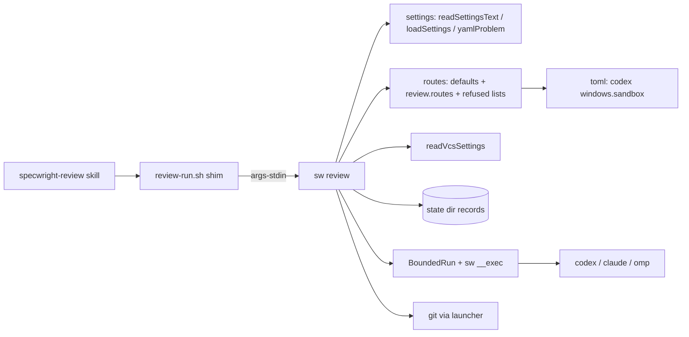
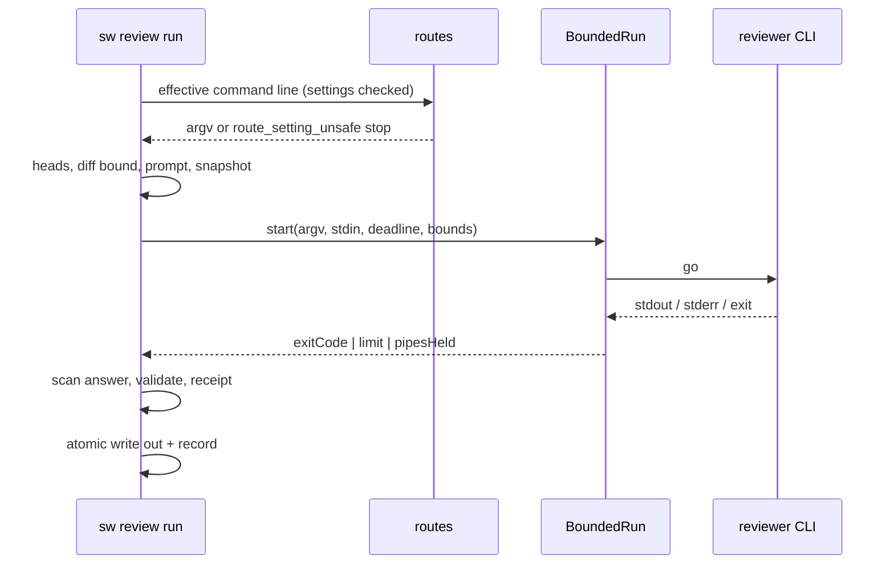
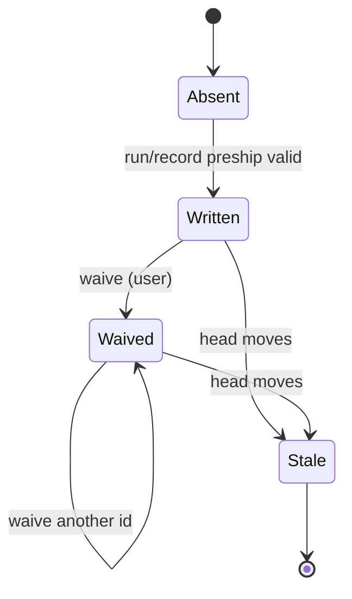

# Design

## Triage

| Trigger | Applies? | Evidence |
|---|---|---|
| T1 Components (new component, or 3+ with directed relationships) | yes | A new `sw review` component. It uses the shim, the settings reader, the VCS settings, BoundedRun and the launcher, and it starts three reviewer CLIs and `git`. |
| T2 State (persistent state, caches, 3+ state machine) | yes | Pre-ship records under the state directory (`review-run.sh:825-867`) must stay readable across the port. Receipts gain fields. |
| T3 Concurrency (background work, workers/isolates, async, retries) | yes | Reviewer runs race a deadline against stream readers and an exit, and stop a process tree (`review-run.sh:382-392`). |
| T4 Boundaries (data format, migration, shared interface, IPC, external) | yes | A new `review.routes` settings key, the shim's stdin contract (ADR 0028), the record format, and the command lines of three external CLIs. |
| T5 Volume (grows without a fixed bound) | yes | Event streams up to 64 MiB, the diff, and the tip snapshot, which today reads every blob of the tree into memory at once (`review-run.sh:963`). |
| T6 Risk (security, money, data loss, unrecoverable user data) | yes | Reviewer isolation: today's defaults let OMP and Codex reviewers write outside the checkout, reach the network and make paid calls (proposal.md, Why). |

TIER: FULL

## Context

- **What is ported.** `review-run.sh` is a bash wrapper around embedded Python (`review-run.sh:47-59`). It has eight subcommands (`review-run.sh:6-36`) and its own YAML reader (`review-run.sh:162-321`). It loads the `bounded.py` copy beside it by path (`review-run.sh:103-117`).
- **How the VCS backend is read.** It starts `bash pr-pair.sh vcs` (`review-run.sh:504-530`). `sw` already reads this in process through `readVcsSettings` (`cli/lib/src/pr/settings_commands.dart:221-248`).
- **How settings are read.** `review-run.sh` searches the cwd and its toplevel (`review-run.sh:580-590`) and reads leniently: `yes` and `no` become booleans (`review-run.sh:220-223`). The `review.*` defaults are at `review-run.sh:593-627`.
  - `sw` has the same lenient read, `readSettingsText` and `loadSettings` (`cli/lib/src/settings/rules.dart:567-581`), and a strict check, `yamlProblem` (`cli/lib/src/settings/yaml.dart:668-675`).
  - `policy` uses `yamlProblem` to refuse a file the lenient read would misread (`cli/lib/src/pr/policy.dart:163-164`). `context` computes the same problem (`cli/lib/src/pr/settings_commands.dart:344-346`) but still returns `ok: true`, reporting it as `settings_problem` (`cli/lib/src/pr/settings_commands.dart:378-385`).
- **Command lines.** Each route's command line is fixed in `command_line` (`review-run.sh:1035-1070`):
  - Codex: `exec -s read-only --ephemeral --ignore-rules --ignore-user-config` (`review-run.sh:1041`).
  - Claude: `--safe-mode --disable-slash-commands --tools Read,Grep,Glob --restricted` (`review-run.sh:1055`).
  - OMP: `--tools read,grep,find,glob` (`review-run.sh:1066`).
  - On Windows, Codex's `windows.sandbox` is read from `config.toml` with `tomllib` and passed on when it is a plain name (`review-run.sh:1014-1032`, `review-run.sh:1051-1052`).
- **Capture.** `capture` streams stdout and stderr to temp files under per-stream bounds and fails a run whose child still holds a pipe 2 s after the exit (`review-run.sh:382-392`, `review-run.sh:1283-1284`). The bounds are at `review-run.sh:79-86`. The receipt records how the tree was held together (`review-run.sh:1158-1167`).
- **BoundedRun.** `sw`'s `BoundedRun` counts output per stream in memory (`cli/lib/src/process/bounded_run.dart:66-68`). It reports a missing job object through its note callback (`cli/lib/src/process/bounded_run.dart:317-318`).
  - When a child still holds a pipe after the exit, it stops the tree but keeps the command's result, with no flag saying so (`cli/lib/src/process/bounded_run.dart:371-392`, `BoundedResult` fields at `cli/lib/src/process/bounded_run.dart:14-44`).
  - The launcher already starts Windows batch commands through `BoundedRun` (`cli/lib/src/process/launch.dart:153-164`).
- **Records.** A record lives at `<state>/reviews/<sha256(common dir)[:16]>/<change>/<code>[+<store>].json` (`review-run.sh:825-836`). It is written atomically as indented JSON (`review-run.sh:839-867`).
- **Tip snapshot.** On GitButler the reviewer reads a copy of the tip. `snapshot_tip` reads the output of `git cat-file --batch` for the whole tree into memory before it writes any file (`review-run.sh:944-995`).
- **Shims.** Shims follow ADR 0028: resolve `sw` through `sw-path.sh`, hand the scripts directory, bash and the arguments as NUL records on stdin, and print `sw_missing` on failure (`docs/adr/0028-ported-scripts-are-shims-that-resolve-the-projects-sw.md:13-18`). The snapshot shim formats that JSON with Python (`skills/specwright-pr/scripts/pr-snapshot.sh`, last lines).
- **ADR 0007 conflict.** It records "fixed, isolated command lines ... never assembled by the agent" (`docs/adr/0007-reviewer-routes-with-a-specwright-owned-contract.md`, Decision). `review.routes` changes the first half, which is why a new ADR is planned below.
- **Packages.** ADR 0033 allows a focused package only with the user's approval for that package (`docs/adr/0033-sw-may-ship-focused-hook-free-packages.md:14`). `cli/pubspec.yaml` depends today on `args`, `crypto`, `ffi`, `html` and `path`.
- **Observed CLI behaviour (2026-11-12, this machine).** OMP 18.19.0, Codex 0.166.0 and Claude Code 2.1.319, described in proposal.md:
  - OMP: `find` is a semantic search that makes model calls. A `--config` overlay setting `autolearn.enabled` and `memories.enabled` to false removed `learn` and `manage_skill`.
  - Codex: `--disable` with an unknown feature exits 1 (`Error: Unknown feature flag`) before any model call. `--disable goals` and `--disable sleep_tool` removed those tools. `collaboration.*` stayed with `--disable multi_agent`.

## Decisions

### D1: Reviewers run through an extended BoundedRun

- **Choice:** `sw review run` starts each reviewer CLI through `BoundedRun` (the `sw __exec` helper, job object or session, deadline, per-stream bounds). `BoundedResult` gains `pipesHeld`, set when the tree had to be stopped after the exit because a pipe was still held. The review run treats that as `status: failed`, as `review-run.sh` does. Output stays in memory under the existing bounds. The no-job-object reason is taken from the note callback into the receipt.
- **Rejected:** A separate reviewer runner that streams to temp files like the Python, because it would be a second process-tree implementation to keep correct on three OSes. The memory it saves (72 MiB of combined stream payload, plus chunk overshoot, buffer copies, decoding and parsing; not measured) does not matter for a CLI run once per review.
- **Reversal cost:** low (one added result field; other callers ignore it)
- **Important:** yes: binds future changes (a shared interface used by `sw run`, `gh` calls and the launcher)
- **Chosen by:** user

### D2: Isolation is guarded by per-route refused lists

- **Choice:** Each route has a refused-tools list and a refused-flags list in `sw`, and a `review.routes` value that hits either is a `route_setting_unsafe` stop. Tool names are compared case-insensitively. A flag matches when an argument equals it, starts with `<flag>=`, or, for a single-letter flag, starts with it (`-sread-only`). A `-c`/`--config` value counts as an argument for key matching: its key is the text before the first `=`, trimmed, with each dotted segment unquoted (`"features"."apps"` is `features.apps`). A key is refused when it equals a protected key, lies under one, or is an ancestor table of one (`features={...}`, `windows={...}`, `sandbox_workspace_write={...}`). The lists:
  - **claude**
    - Refused tools: `Bash`, `PowerShell`, `Edit`, `MultiEdit`, `Write`, `NotebookEdit`, `WebFetch`, `WebSearch`, `Task`, `Agent`, and any `mcp__` name.
    - Refused flags: `-p`, `--print`, `--tools`, `--allowedTools`, `--allowed-tools`, `--disallowedTools`, `--disallowed-tools`, `--permission-mode`, `--dangerously-skip-permissions`, `--add-dir`, `--settings`, `--setting-sources`, `--mcp-config`, `--plugin-dir`, `--agents`, `--restricted`, `--safe-mode`, `--disable-slash-commands`, `--output-format`, `--json-schema`, `--model`, `--effort`, `-c`, `--continue`, `-r`, `--resume`, `--fork-session`.
  - **omp**
    - Refused tools: `bash`, `edit`, `write`, `python`, `notebook`, `browser`, `computer`, `task`, `web_search`, `ask`, `learn`, `manage_skill`, `find`.
    - Refused flags: `-p`, `--print`, `--tools`, `--no-tools`, `--session-dir`, `--no-session`, `-c`, `--continue`, `-r`, `--resume`, `--restore`, `-e`, `--extension`, `--hook`, `--skills`, `--config`, `--profile`, `--mode`, `--model`, `--thinking`, `--goal`, `--plan-yolo`, `--prewalk`, `--prewalk-into`.
  - **codex**
    - Refused flags: `-s`, `--sandbox`, `--dangerously-bypass-approvals-and-sandbox`, `--dangerously-bypass-hook-trust`, `--approve-for-me`, `--full-auto`, `--enable`, `-p`, `--profile`, `--add-dir`, `-C`, `--cd`, `--worktree`, `--ephemeral`, `--ignore-rules`, `--ignore-user-config`, `--output-schema`, `-o`, `--output-last-message`, `--json`, `-m`, `--model`.
    - Refused `-c` keys: `sandbox_mode`, `sandbox_workspace_write.*`, `approval_policy`, `permissions*`, `features.*`, `tools.*`, `web_search`, `mcp_servers.*`, `hooks*`, `model`, `model_reasoning_effort`, `windows.sandbox`.
    - Codex has no `tools` key, and `disable` values are accepted as given, since they only remove features.

  The refused list for each flag that has a setting of its own names that setting in the message: `review.models`, `review.thinking` or `review.routes.<route>.tools`.
- **Rejected:** An allowlist of tools and flags, because every CLI rename (`find` → `glob`) would again need a Specwright release, the failure the user hit.
- **Reversal cost:** medium (users will write values against these lists)
- **Important:** yes: security, and binds future changes (it decides which settings are valid)
- **Chosen by:** user

### D3: Codex's Windows sandbox value is read with the `toml` package

- **Choice:** Add `toml` (pub.dev 0.18.0, `petitparser`, `collection`, `meta` and `web` with it) under ADR 0033 after the hook-free, licence and notice checks. Only `[windows] sandbox` is read, and only on Windows, with the same plain-name check as today. An unreadable file or a parse error yields no value, as now.
- **Rejected:** Dropping the read for an explicit `review.routes.codex` setting, because Windows users who rely on the forward would lose it without warning. A hand reader for one line, because it is custom parsing of the kind ADR 0033 removes.
- **Reversal cost:** low (behind one function)
- **Important:** yes: binds future changes (a shipped dependency)
- **Chosen by:** user

### D4: Settings come from the shared reader, refused when `yamlProblem` finds a line

- **Choice:** `sw review` reads `openspec/specwright.yaml` (or `--settings`) with `readSettingsText` and `loadSettings`, searching the cwd and then its toplevel as now. Before any probe, it stops with `bad_settings` naming the line when `yamlProblem` reports one, as `policy` does. This is a deliberate change for reviews: `review-run.sh` read such a file leniently, and `context` only reports the problem. `review.routes` is checked against its schema at the same point.
- **Rejected:** Keeping a lenient read for review settings alone, because it would be a second reader with its own quirks, which `native-cli-yaml-settings` would have to remove again.
- **Reversal cost:** low
- **Important:** yes: changes what users see (a malformed settings file now stops `select` and `run`)
- **Chosen by:** user

### D5: OMP memory and auto-learn are turned off by a per-run config overlay

- **Choice:** `run` writes `omp-overlay.yml` in its private work directory, holding `autolearn: {enabled: false}`, `memories: {enabled: false}` and `find: {enabled: false}`, and passes `--config <file>`. The user's OMP files are not touched. The receipt lists the overlay's keys. Because an older OMP may ignore unknown keys, the OMP probe also requires `omp --version` at or above 18.19.0, the version the overlay was verified on (Context). Below it OMP is unavailable at `select`, and `run --route omp` stops with `omp_too_old`. The floor moves only after a newer check, recorded as evidence.
- **Rejected:** `--profile <fresh>`, because a new profile also isolates OMP's authentication, so the reviewer could not reach a model. Disabling the tools by name alone, because `--tools` did not remove `learn` or `manage_skill` (Context). Trusting any OMP version, because an OMP that ignores the overlay would run with memory on (review round 2, C1).
- **Reversal cost:** low
- **Important:** yes: changes what users see (an older OMP is skipped)
- **Chosen by:** user (the version floor, after the round-2 escalation); the overlay itself by the agent

### D6: Codex features are turned off by a list in `sw`, with web search set by `-c`

- **Choice:** The default disable list is `apps`, `browser_use`, `browser_use_external`, `computer_use`, `in_app_browser`, `image_generation`, `memories`, `hooks`, `plugins`, `remote_plugin`, `tool_suggest`, `skill_search`, `skill_mcp_dependency_install`, `goals` and `sleep_tool`. Each is passed as `--disable <name>`, followed by `-c web_search="disabled"`. `review.routes.codex.disable` adds to the list and never removes from it. An unknown name makes Codex exit 1, so the run fails closed (spec scenario "Codex version without a listed feature"). The `specwright-review` skill lists the defaults.
- **Rejected:** A Specwright-made `CODEX_HOME` with its own config, because Codex reads authentication from `CODEX_HOME` (`codex exec --help`, `--ignore-user-config`), so the reviewer would lose its login.
- **Reversal cost:** low
- **Important:** no (the user chose closing the gaps in S2; the list is how)
- **Chosen by:** agent

### D7: `review-run.sh` becomes an ADR 0028 shim that needs no Python

- **Choice:** The shim resolves `sw` through `sw-path.sh` and runs `sw review --args-stdin` with the ADR 0028 records. On a failed resolution it prints `sw_missing` with the resolver's text escaped in bash (backslash, quote and control characters), not through Python as `pr-snapshot.sh` does.
- **Rejected:** Keeping the Python formatter of the other shims, because this would be the one review step that still needs Python, against the M8 exit criteria.
- **Reversal cost:** low (`native-cli-retire-scripts` removes every shim)
- **Important:** no
- **Chosen by:** agent

### D8: The existing black-box evals are the contract, with no frozen oracle

- **Choice:** `evals/review-routes/test_review_run.py` keeps testing through the script path, now a shim, on the three CI platforms. Records the Python wrote (a fixture captured once before the switch) must pass `gate` after it. New cases cover `review.routes`, the refused lists, the defaults, and runs with Python and bash absent.
- **Rejected:** A frozen copy of the Python as a test oracle, as `pr-pair` has. The evals already pin outcomes through fake CLIs, and an oracle would keep 1,600 lines of Python in the tests for no extra coverage.
- **Reversal cost:** low
- **Important:** no
- **Chosen by:** agent

### D9: The tip snapshot streams one object at a time

- **Choice:** `snapshot` reads `git cat-file --batch` incrementally and copies each blob's content to its file in 64 KiB chunks, using the size from the object header, so no blob is held whole in memory. The list of tree entries (path, mode, object id) and of link targets is kept in memory; it grows with the number of files, as `ls-tree` output already does. A path that is not valid UTF-8 is a named stop, as the launcher change made it everywhere else. Link handling is unchanged.
- **Rejected:** Porting the whole-tree read as is, because memory then grows with the repository size and nothing bounds it (T5). Reading one blob at a time whole, because a single large blob would still be one allocation of its size (review round 2, M2).
- **Reversal cost:** low
- **Important:** no
- **Chosen by:** agent

### D10: `review.routes` is an additive replacement for part of ADR 0007

- **Choice:** Record ADR 0035, "Reviewer command lines are a fixed isolating core plus checked user settings". It replaces only ADR 0007's "Fixed, isolated command lines" point. Command lines are still never assembled by the agent: they come from code and from `specwright.yaml`, which the user writes. ADR 0007 stays unedited, and the architecture index marks it as amended by 0035.
- **Rejected:** Superseding ADR 0007 whole, because its routes, input bound, fail-closed rule and record exception all stand.
- **Reversal cost:** medium
- **Important:** yes: binds future changes (it records a contract)
- **Chosen by:** agent

### Decision summary

| # | Decision | Choice | Rejected | Reversal cost | Important | Chosen by |
|---|---|---|---|---|---|---|
| S1 | How per-reviewer parameters are configured | Typed `review.routes.<route>` keys within fixed isolation | Free-form args; no settings | medium | yes | user |
| S2 | Isolation gaps | Closed in this change | Separate issue | low | yes | user |
| S3 | Tool discovery | Defaults plus settings, no runtime probe | Parse CLI help at select | low | yes | user |
| S4 | Scope | Settings land with the port | Separate change | low | yes | user |
| D1 | Reviewer run engine | Extend BoundedRun with `pipesHeld`, in memory | Separate disk-backed runner | low | yes | user |
| D2 | Refusal of weakening values | Per-route refused lists | Allowlist | medium | yes | user |
| D3 | Codex `windows.sandbox` read | `toml` package | Explicit setting; hand reader | low | yes | user |
| D4 | Settings reader | Shared reader plus `yamlProblem` stop | Lenient review-only reader | low | yes | user |
| D5 | OMP memory off | Per-run `--config` overlay plus OMP ≥ 18.19.0 | Fresh `--profile`; tools only; any version | low | yes | user (floor) / agent (overlay) |
| D6 | Codex features off | `--disable` list plus `-c web_search` | Own `CODEX_HOME` | low | no | agent |
| D7 | Shim | ADR 0028 shim, bash-escaped `sw_missing` | Python formatter | low | no | agent |
| D8 | Evals | Black-box evals plus a pre-port record fixture | Frozen Python oracle | low | no | agent |
| D9 | Tip snapshot | Copy each blob in 64 KiB chunks | Whole-tree read; whole-blob read | low | no | agent |
| D10 | ADR | ADR 0035 amends ADR 0007's command-line point | Supersede 0007 whole | medium | yes | agent |

## Assumptions

- **A1:** The tool lists in Context come from each reviewer model's own answer to "list your tools", not from a CLI listing, so a model could omit or invent a name. Not checked because neither OMP nor Codex prints its effective tool set. Depends on it: D5, D6, task 1.1 (the evidence run repeats the check with a tool call to each name).
- **A2:** Codex's `collaboration.*` agents run under the parent's read-only sandbox. Not checked because it needs an agent-spawning run under a write probe. Depends on it: the spec's defaults requirement, task 1.1.
- **A3:** OMP 18.19.0 and later honour the overlay keys `autolearn.enabled` and `memories.enabled` as observed on 18.19.0 (Context). Not checked on later releases. Depends on it: D5, task 1.1, which repeats the check on the version installed at apply.
- **A4:** `toml` 0.18.0 and its closure have no build hooks and licences ADR 0033 accepts. Not checked: that is task 2.1's evidence. Depends on it: D3.

## Carried constraints

- **C1:** Pre-ship record paths and JSON fields stay readable by `gate`, `waive` and `rounds` across the port. A record written by the Python passes `gate` under `sw`. Kind: invariant. Destination: doc comment: cli/lib/src/review/records.dart recordPath
- **C2:** A `review.routes` value never removes a fixed isolating flag. New CLI tools that write, run code, reach the network, start agents or keep memory are added to the route's refused list when found. Kind: invariant. Destination: ADR 0035
- **C3:** Codex's `collaboration.*` agent tools have no known switch in 0.166 and stay under the read-only sandbox. Kind: deliberate gap. Destination: doc comment: cli/lib/src/review/routes.dart codexDefaultDisable
- **C4:** A pipe held after the reviewer's exit fails the review even though BoundedRun keeps the command's exit code. Callers that pass output on must check `pipesHeld`. Kind: invariant. Destination: doc comment: cli/lib/src/process/bounded_run.dart BoundedResult.pipesHeld
- **C5:** Runtime discovery of tool lists was rejected because CLI help text is not a contract. Kind: rejected alternative. Destination: ADR 0035
- **C6:** A `sw` killed by SIGKILL or a task kill can leave the reviewer running (ADR 0027 Consequences): the job has no kill-on-close and the POSIX session is independent. The review accepts this limitation and does not claim cleanup after its own death. Kind: deliberate gap. Destination: doc comment: cli/lib/src/review/run.dart runReviewer
- **C7:** Reviewer output is held in memory under the stream bounds; disk-backed capture was rejected (D1). Kind: rejected alternative. Destination: doc comment: cli/lib/src/review/run.dart runReviewer
- **C8:** The review evals are black-box tests through the shim with a pre-port record fixture; a frozen Python oracle was rejected (D8). Kind: rejected alternative. Destination: doc comment: evals/review-routes/test_review_run.py module docstring
- **C9:** The tip snapshot has no deadline, as before the port, and copies blobs in chunks (D9). Kind: deliberate gap. Destination: doc comment: cli/lib/src/review/snapshot.dart snapshotTip
- **C10:** OMP below 18.19.0 is unavailable because the memory overlay was verified only from that version (D5). Kind: invariant. Destination: doc comment: cli/lib/src/review/routes.dart ompMinVersion

## Diagrams (FULL)

Components (T1):

Run sequence (T3, T4):

Record lifecycle (T2):

## State & Ownership (FULL)

| State | Owner (sole writer) | Lifetime | Invalidation / rebuild | Authoritative copy |
|---|---|---|---|---|
| Pre-ship record `<state>/reviews/<key>/<change>/<heads>.json` | `sw review run`, `record` and `waive` | Until removed by the user | Ignored once heads move; a new review writes a new record | The file |
| Design review file (`review.md`) | `sw review run` and `record --out` (atomic) | In the change | Replaced each round | The file |
| Run work directory (prompt, overlay, schema, snapshot) | `sw review run` | One run | Removed at the end of the run | n/a |
| OMP session directory | OMP, created by `run` | One run; kept on failure and named in the output | Removed on success | n/a |
| `review.routes` settings | The user | Project | Read on each call | `openspec/specwright.yaml` |

## Failure & Visibility (FULL)

| Component | Fails / dies mid-operation → | Recovery | Retry safe? | Who finds out |
|---|---|---|---|---|
| Shim | `sw` unresolved → `sw_missing`, exit 1 | Install or update `sw` | yes | The agent, then the user |
| Settings check | `bad_settings`, `bad_route_setting` or `route_setting_unsafe`, exit 1, before any probe | Fix `specwright.yaml` | yes | The user, through the message |
| Reviewer CLI | Timeout, bound, held pipe or non-zero exit → exit 3, tree stopped, no record | The caller stops; rerun after the cause is fixed | yes (no record written) | The agent and the user; the receipt is in the output |
| Unknown Codex feature or rejected flag | Codex exits non-zero → exit 3 `failed` with Codex's message | Update the settings or the CLI | yes | The user |
| Record write | `record_failed`, exit 1 | Free the state directory | yes (atomic rename) | The user |
| `sw` killed mid-run (SIGKILL, task kill) | The reviewer and its helper can keep running, since the job has no kill-on-close and the POSIX session is independent (ADR 0027 Consequences, accepted); the work directory remains; no record or review file is written, because both are written only after a validated answer | The user stops the orphaned CLI; the next run uses a new work directory | yes | The user, through the still-running CLI or its spend. Accepted limitation, carried as C6 |

## Resource Bounds (FULL)

| Queue / buffer / cache / transfer | Bound | At the bound | Timeout | At 10x / 100x |
|---|---|---|---|---|
| Reviewer stdout | 2 MiB on claude, 64 MiB on codex and OMP | Tree stopped, `invalid`, `output too large` | `review.timeout` (default 20m) | Bounded: 72 MiB combined stream payload, plus chunk overshoot, buffer copies, decoding and parsing (not measured) |
| Reviewer stderr | 8 MiB | Same as stdout | Same | Same |
| One event line | 16 MiB | `invalid`, `output too large` | n/a | Same |
| Answer | 2 MiB | `invalid`, `output too large` | n/a | Same |
| Diff | `review.max_diff_kb` (default 1024) | `diff_too_large` before any reviewer starts | n/a | Same |
| Probe streams | 1 MiB each | Probe failed, route skipped | 10 s | Same |
| Tip snapshot | 64 KiB copy buffer per blob; entry list grows with the file count (D9) | n/a | No deadline (unchanged, C9) | Disk grows with the tree, as before. Memory grows only with the number of paths |
| Findings | 100 per document | `invalid` | n/a | Same |

## Flow & State Gaps (FULL)

- **Head moves during a run.** Heads are captured before the reviewer starts, and the record is keyed by them. A later `gate` sees a stale record and reports `missing`, unchanged.
- **Two runs for one change at once.** Each has its own work and session directories. Record writes are atomic renames, so the last one wins on the same heads.
- **A Python install and an `sw` install both present mid-update.** The shim is replaced in the same install step as the binary pin. Records are compatible in both directions (C1).
- **A user's earlier hand edit of `review-run.sh`.** The update replaces the file. The upgrade note says to move the edit into `review.routes`.

## Mechanism Ledger (FULL)

| Mechanism | Built? | Why (harm nobody catches / expensive later) | Evidence that would change the call |
|---|---|---|---|
| Refused lists for `review.routes` | yes | Without them a pasted flag removes read-only isolation and nobody sees it (T6) | — |
| Receipt fields for effective tools, overlay and extra arguments | yes | They are the only record of what a reviewer could do | — |
| Runtime tool discovery | no | Rejected (S3, C5) | A CLI that prints its effective tool set in a stable format |
| `pipesHeld` flag | yes | Without it a reviewer's orphan could cut the answer and pass | — |
| Disk-backed capture | no | Bounded memory is enough (D1) | Memory pressure reports on CI or user machines |
| Frozen Python oracle | no | The black-box evals cover outcomes (D8) | A parity defect the evals miss |
| Version floor for the OMP overlay | yes | An OMP that ignores the overlay would run with memory on, and nobody would see it (round 2, C1) | — |

## Risks / Trade-offs

- [The refused lists fall behind a new risky CLI tool] → C2 requires adding it when found. The documented check procedure (task 5.2) tells users how to look.
- [The model-reported tool lists (A1) are wrong] → Task 1.1 confirms them by calling each tool name, and the defaults are adjusted before the group closes.
- [`toml` brings four transitive packages] → The ADR 0033 checks and notices (task 2.1). Reversal is low.
- [A strict settings read stops reviews in projects with sloppy YAML] → The stop names the line. `policy` already refuses the same files; `context` only reports them, so a project can see `settings_problem` there first. The refusal in reviews is new and listed in the release notes.

## ADRs

- **In force, constraining this change:** 0007 (reviewer routes), 0022 (the reviewer evaluator stays a separate process), 0027 (one Dart binary; `sw __exec`), 0028 (shims), 0031 (direct calls), 0033 (focused packages; what a port preserves), 0034 (no shell launches).
- **To record during apply:** 0035, "Reviewer command lines are a fixed isolating core plus checked user settings". It amends ADR 0007's command-line point and carries C2 and C5.

## Open Questions

- Whether OMP's `lsp` tool belongs in the default list. It is read-only but starts language servers. It stays out of the defaults and is allowed in `review.routes.omp.tools`.
