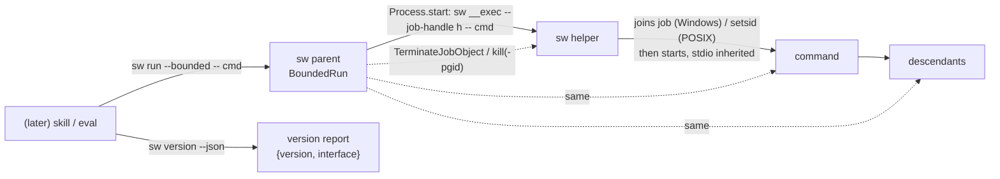
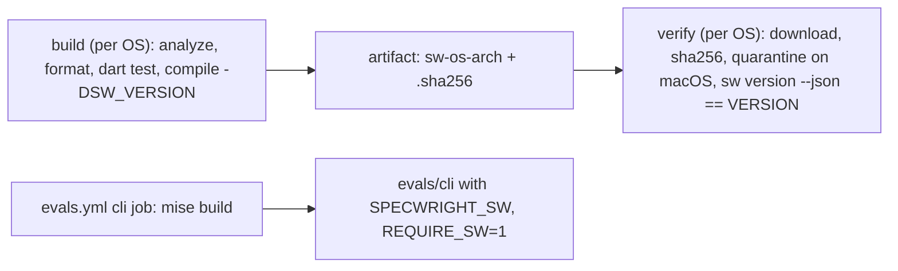

# Design

## Triage

| Trigger | Applies? | Evidence |
|---|---|---|
| T1 Components (new component, or 3+ with directed relationships) | yes | A new executable `sw` (`cli/`), its Windows helper mode, a new CI workflow and a new eval suite: parent `sw` → helper `sw` → command; CI build → artifact → download job. |
| T2 State (persistent state, caches, 3+ state machine) | yes | A bounded run is a state machine (running → exited / limit → draining → stopped); CI artifacts and their checksums are persisted per run. No project-side state. |
| T3 Concurrency (background work, workers/isolates, async, retries) | yes | Two output streams, the exit future, the deadline timer and the held-pipe grace run concurrently; the helper and the parent are separate processes. |
| T4 Boundaries (data format, migration, shared interface, IPC, external) | yes | `sw version --json` and the `sw run --bounded` command line are contracts skills will call; the parent-helper handoff is IPC; the binary is a new distributed artifact. |
| T5 Volume (grows without a fixed bound) | yes | Command output is unbounded at the source; the byte bound is this design's job. |
| T6 Risk (security, money, data loss, unrecoverable user data) | yes | Secret mode carries credentials; an unsigned binary that starts processes and handles tokens meets Gatekeeper and antivirus. |

TIER: FULL

## Context

The scope decisions S1–S8 are in proposal.md. What exists today:

- **Bounded runs are one Python module, copied three times.** `bounded.py` has the limits and env names (`skills/specwright-pr/scripts/bounded.py:6-11`) and the defaults (`skills/specwright-pr/scripts/bounded.py:60-64`). Its CLI prints `bounded: <limit>: <cmd> <arg>` and exits 124 or 125 on a limit, or 2 on bad usage (`skills/specwright-pr/scripts/bounded.py:381-403`). ADR 0014 keeps the copies identical by test (`docs/adr/0014-bounded-runs-share-one-process-module.md:13`).
- **Windows argument transport.** For `bash -c script $0 args...` on Windows, `bounded.py` sends the arguments after `$0` on stdin, NUL-separated with an end marker, because Git Bash cuts a command-line argument at 8,186 characters. A missing marker exits 126 (`skills/specwright-pr/scripts/bounded.py:28-31`, `skills/specwright-pr/scripts/bounded.py:289-295`).
- **The eval runner sweeps nested POSIX sessions.** It gives each test file a spawn-record directory and, on stop, kills every recorded group, because `start_new_session` groups lie outside the file's own group (`evals/run.py:226-244`).
- **Windows holding is "suspend, assign, resume".** `spawn` sets `CREATE_SUSPENDED`, creates a job without kill-on-close, assigns the process and resumes it with the undocumented `NtResumeProcess` (`skills/specwright-pr/scripts/bounded.py:112-132`, `skills/specwright-pr/scripts/bounded.py:150-180`). A failed job writes `bounded: no job object: <reason>` and goes on (`skills/specwright-pr/scripts/bounded.py:164-168`). ADR 0014 rejects assigning after an unsuspended spawn, and rejects kill-on-close (`docs/adr/0014-bounded-runs-share-one-process-module.md:21`).
- **Regression tests exist as black-box Python.** `evals/pr-pair/test_bounded.py` covers deadlines, bounds, overrides, held pipes, the no-job fallback, secret mode and the CLI exit codes (`evals/pr-pair/test_bounded.py:94-269`, `evals/pr-pair/test_bounded.py:326-416`). Its grandchild test keeps the middle process alive and checks the grandchild only when its PID was recorded (`evals/pr-pair/test_bounded.py:223-241`). The true orphan topology from #116, where the middle process exits first, has no test, so this change adds one.
- **Shipped tooling assumes bash and Python** (`docs/adr/0002-agent-instructions-with-thin-scripts.md:9-16`; `README.md:56`).
- **The update script already reports an interface,** now `2` (`scripts/update.sh:30`).
- **CI.** `evals.yml` takes suites from `run.py --list-suites` (`.github/workflows/evals.yml:26`) and runs a matrix on three OSes. It installs pinned tools by checksum and sets a `SPECWRIGHT_REQUIRE_*` flag (`.github/workflows/evals.yml:83-115`). Every tracked path needs a rule in `evals/suites.json` (`evals/suites.json:1-30`).
- **No Dart toolchain in this repo.** `git ls-files` on main `e6e17e0` lists no `mise.toml` and nothing under `cli/`. The owner's other Dart projects provide prior art outside this repository (A6). That code is studied for ideas, not copied.
- **Version files.** `VERSION` reads `0.22.0` (`VERSION:1`) and is a release version file (`openspec/specwright.yaml:136-137`).

## Decisions

### D1: Windows trees through a self-spawned helper that joins the job first

- **Choice:** the parent `sw` creates an unnamed job object without kill-on-close, then starts itself as `sw __exec --job-handle <h> -- <cmd...>` with the job handle inheritable. The helper's first act is `AssignProcessToJobObject(job, GetCurrentProcess())`. Only after the go signal (the startup protocol below) does it start the command with inherited stdout and stderr, wait, and exit with the command's status. A limit after the go makes the parent call `TerminateJobObject`, which stops the helper and every descendant. If the helper cannot join the job, the command still runs, the parent writes `bounded: no job object: <reason>`, and a limit stops the tree by PID (`taskkill /T /F`).
- **Startup protocol (both OSes):**
  1. The helper sets up containment: it joins the job on Windows and calls `setsid()` on POSIX (D6).
  2. It writes exactly one ready frame as the first bytes on its stderr: `\x00sw-ready ok\n` or `\x00sw-ready nojob <reason>\n`. The NUL prefix keeps it from matching any text a command could have written, since the command has not started yet.
  3. It blocks reading one byte from its stdin, a pipe only the parent holds.
  4. The parent reads and strips the ready frame before it counts or passes on any stderr bytes, so the frame never reaches the caller and never uses the byte allowance.
  5. If no limit has hit, the parent writes `g`, then D8's transport bytes when there are any, and closes the pipe. The helper starts the command with all three streams inherited, so the command's stdin is the rest of that pipe: the transport bytes, then end-of-file. That is equivalent to `bounded.py`'s null stdin for a command that reads nothing.
  6. If a limit hits before the go is written (before or after the frame), the parent closes the pipe without writing `g`, then kills the helper by its PID and waits for its exit, whether or not the frame has arrived. Cancellation never depends on the helper reaching its stdin read: a helper stuck before that read is stopped the same way. A helper that does read end-of-file instead of `g` exits 125 without starting anything, which only makes the kill a no-op. Before go the helper is the whole tree, so stopping it by PID is complete.
  7. A frame that is missing or malformed (the helper died, or another binary answered) is a spawn failure: exit 127, with the reason on stderr.
- **Rejected:** `CreateProcessW` with `CREATE_SUSPENDED` plus `ResumeThread` (#148's Option B). It means owning pipe creation, `ReadFile` loops and Windows command-line quoting in FFI: far more native code for the same guarantee. Assigning the job after a normal `Process.start` was also rejected, because a child started before the assignment escapes (ADR 0014).
- **Reversal cost:** medium (contained in one module; Option B can replace it behind the same runner interface).
- **Important:** yes (weak evidence until the nested-job and orphan tests pass on a Windows runner)
- **Chosen by:** user (stated in #148 as "Option A, preferred, try first")

### D2: One single-file executable from `dart compile exe`

- **Choice:** each platform's `sw` is one self-contained file built with `dart compile exe`. `cli/` depends on no package with build hooks: Win32 calls are its own `kernel32` lookups over `package:ffi`, plus `package:args`. A test fails when a dependency with a `hooks` section enters `pubspec.lock`.
- **Rejected:** `dart build cli` bundles, as yagurad uses. They allow native-asset packages, but the install would swap a directory, not a file, and the download is a bundle instead of a single binary.
- **Reversal cost:** medium (distribution and install handle a file; a bundle later changes both).
- **Important:** yes (binds future changes: distribution shape)
- **Chosen by:** user

### D3: Installed at `~/.specwright/bin/<version>/sw[.exe]`

- **Choice:** the ADR fixes the install root as `<home>/.specwright/bin/<version>/` on every OS (`%USERPROFILE%` on Windows), overridable by `SPECWRIGHT_HOME` for tests. Versions sit side by side. A skill derives the path from the project's installed `openspec/.specwright/VERSION`. Nothing in this change installs there. `native-cli-distribution` builds the install.
- **Rejected:** OS-specific data directories (three rules to document and test); a per-project gitignored binary (S1).
- **Reversal cost:** high (every skill will call this path), settled now by the owner.
- **Important:** yes (binds future changes)
- **Chosen by:** user

### D4: Skills require the exact version and interface

- **Choice:** `sw version --json` returns `{"version": "<x.y.z>", "interface": <n>}`. A skill runs only the binary at its project's installed version, and only when the reported `version` equals it and `interface` equals the interface the skills were written for. Otherwise it stops with `sw missing or mismatched: rerun the install prompt`. The ADR states the rule. The skill check itself lands with `native-cli-distribution`, and this change only provides the report.
- **Rejected:** accepting any installed binary with a matching interface (newest wins). Same-interface versions can differ in behaviour, and the evals prove only the version they ran on.
- **Reversal cost:** low (relaxing the check later is easy; tightening it is not)
- **Important:** yes (binds future changes: the contract)
- **Chosen by:** user

### D5: The version is compiled in from `VERSION`

- **Choice:** the build passes `--define=SW_VERSION=<VERSION>` from a mise task. A binary built without it reports `"version": "0.0.0-dev"`, which the CI download-and-run check rejects as a mismatch. `interface` is a constant in the source.
- **Rejected:** reading `VERSION` at run time next to the binary. The installed binary has no repo beside it, and the report must describe the binary itself.
- **Reversal cost:** low
- **Important:** no
- **Chosen by:** agent

### D6: POSIX trees through a new session and group kill

- **Choice:** on Linux and macOS, `sw` starts the command through `setsid` semantics, so it leads its own process group and session. The process ID is the group ID, and a limit sends `SIGKILL` to the group. Dart's `Process.start` has no session flag, so `sw` reuses its helper mode: `sw __exec` calls `setsid()` through `package:ffi` (libc), writes the ready frame, and waits for the go before it starts the command (D1's protocol). This is the same shape as Windows, with one code path. When `SPECWRIGHT_TEST_SPAWN_DIR` is set, the parent creates an empty file named after the helper's PID (the group ID) there, after the ready frame and before the go. That way the eval runner's existing sweep (`evals/run.py:226-244`) stops an `sw` session when a test file is interrupted. A failed write is ignored, and nothing is written without the variable.
- **Rejected:** `Process.start('setsid', ...)`. `setsid(1)` is not on macOS by default. A double-fork shell wrapper was also rejected: it puts a shell back between us and the command.
- **Reversal cost:** low
- **Important:** no
- **Chosen by:** agent

### D7: The runner is a Dart state machine over stream subscriptions and the exit future

- **Choice:** one `BoundedRun` owns the helper process. It counts bytes on each of the stdout and stderr subscriptions into in-memory buffers. Past the bound it cancels both and stops the tree (`response_too_large`). It races `exitCode` against a deadline `Timer`, recording the exit time from the future's completion. After an exit it gives the readers `GRACE` (2 s), then stops the tree and returns the command's own result. After a stop it waits at most 5 s for the pipes to close and then lets them go. Nothing touches disk in either mode, so secret mode differs only in never echoing output on a limit.
- **Rejected:** porting `bounded.py`'s poll loop with a watcher thread. Dart already delivers exit and data as events, and a poll reintroduces the #114 window.
- **Reversal cost:** low
- **Important:** no
- **Chosen by:** agent

### D8: Command lookup and argument handling per executable kind

- **Choice:** `sw` resolves `cmd` itself. A name with a path separator is used as given. Otherwise it walks `PATH`, and on Windows each `PATHEXT` extension in order (default `.COM;.EXE;.BAT;.CMD`). Not found exits 127. Arguments are handled by the kind of executable resolved:
  - **Native executable:** started directly, with no shell. Dart's Windows argument quoting carries each argument intact up to the 32,767-unit command-line limit.
  - **`bash -c script name args...` on Windows:** `bounded.py`'s transport is kept. The arguments after `name` go on the command's stdin, NUL-separated with an end marker, behind a prelude that reads them back into `"$@"`. A missing marker exits 126. The parent writes the bytes right after the go byte, on the same pipe (D1 step 5).
  - **`.cmd` or `.bat` on Windows:** run as `cmd.exe /d /s /c "<line>"`, where `<line>` is the quoted batch path followed by each argument enclosed in double quotes (`""` for an empty one), separated by spaces, with no caret escaping. `/s` strips only the outer pair of quotes. Inside double quotes `cmd.exe` treats `&|<>()^` and spaces as literal. The line must survive two parsers: `cmd.exe`, and the native program a shim hands `%*` to, which splits its command line under the Windows (CRT) rules, where backslashes before a closing quote escape it. So a run of backslashes at the end of an argument is doubled inside its quotes (`C:\x\` → `"C:\x\\"`); backslashes elsewhere are left alone, since with `"` refused no other backslash can precede a quote. The guarantee is stated for the forwarding case: the native program reads the original value. A shim that reads `%1` itself sees the doubled form, which Windows path APIs treat as the same path. The characters that quotes cannot protect (`%`, `!`, and `"` itself, which would close the quoting) are the refused set, in arguments and in the resolved batch path alike, because `cmd.exe` expands `%VAR%` in the path it is given as well. The `/d` flag skips AutoRun, and delayed expansion stays off by default. An argument containing `%`, `!`, `"`, CR, LF or NUL, a resolved batch path containing `%` or `!`, or an escaped line over 8,191 characters, is refused before any process starts: `bounded: unsafe batch argument: <cmd>`, exit 2.
- **Rejected:** best-effort escaping without refusal. `cmd.exe` expands `%VAR%` in ways no quoting fully prevents, so an argument could silently change meaning or run something else. Dropping batch shims altogether was also rejected: the eval fakes and npm-installed CLIs are `.cmd` files. So was `runInShell: true` everywhere, which hands every argument to a shell.
- **Reversal cost:** low (loosening the refusal later is possible; the refusal list is the contract)
- **Important:** yes (binds future changes: which arguments `sw` accepts)
- **Chosen by:** user (batch policy; asked after review round 1)

### D9: Parity tests are a new black-box suite, `evals/cli`

- **Choice:** `evals/cli/test_sw_run.py` and `evals/cli/test_sw_version.py` drive the binary named by `SPECWRIGHT_SW`, case for case against `test_bounded.py`'s CLI, process-tree and argument-transport cases, with fresh fixtures written here. Beyond those, the suite adds:
  - **A true orphan fixture:** child → grandchild. The child records the grandchild's PID, then exits, and the fixture waits until both facts are on disk before the limit triggers. It then asserts unconditionally that every recorded PID is gone.
  - **Held-startup fixtures:** a test-only `SPECWRIGHT_TEST_HOLD_START` names a file the helper polls for. With `before`, the helper waits before it joins the job or calls `setsid()`. With `after`, it waits after writing its ready frame and before reading the go byte. For the `after` case the parent also needs a test-only `SPECWRIGHT_TEST_PRE_GO` file: once it has consumed the ready frame and before it writes `g`, the parent writes a marker next to that file and defers writing `g` while the file exists (its deadline timer keeps running), so the test knows the frame was read, the helper is held before its stdin read and `g` was never written. The test lets the deadline expire while the helper waits, asserts exit 124 and that no helper survives, and only then releases the hold (removes the file). It finally asserts that no command-start marker appeared, not even after the release. The test runs for both hold points on Windows with a job, on Windows with `SPECWRIGHT_TEST_NO_JOB=1`, and on POSIX. Like the other `SPECWRIGHT_TEST_*` overrides, it can only delay, never loosen a limit.
  - **Batch quoting** is tested with a `.cmd` shim that forwards `%*` to a native argument recorder. The test asserts exact values and boundaries for empty strings, spaces, `&|<>()^`, arguments ending in one and two backslashes (one with spaces) followed by an ordinary and an empty argument, and combinations. An injection-shaped argument (`x & echo pwned`) must run no second command. A shim resolved from a `PATH` directory literally named with `%SW_SLOT%`, with `SW_SLOT` pointing at a decoy shim, must be refused with neither shim running.
  - **Shell-wrapper attribution:** the limit line for `bash -c 'exec gh "$@"' gh api` must read `gh api` (`skills/specwright-pr/scripts/bounded.py:394-396`; `evals/pr-pair/test_bounded.py:392-399`), with and without the Windows transport.
  - **Batch-shim round trips** for metacharacters, plus refusals for `%`, `!`, `"` and the length limit. They skip as `sw not built` when it is unset, and fail when `SPECWRIGHT_REQUIRE_SW=1`. Dart unit tests in `cli/test/` cover limit resolution, PATHEXT lookup and the state machine. Process tests carry the `process` tag.
- **Rejected:** parameterising `evals/pr-pair/test_bounded.py` over both runners. Its Python-API classes (`SpawnRecord`, `ArgumentTransport`) have no `sw` counterpart, and the suite would then depend on a Dart build.
- **Reversal cost:** low
- **Important:** no
- **Chosen by:** agent

### D10: A separate `cli.yml` workflow for build, artifact and download-and-run

- **Choice:** `.github/workflows/cli.yml` runs on pull requests that touch `cli/**`, `mise.toml`, `VERSION` or itself, and on dispatch. A `build` job per OS (`ubuntu-24.04`, `windows-latest`, `macos-latest`) installs Dart through `jdx/mise-action` pinned to mise `2026.10.12`, then runs `dart analyze`, `dart format --set-exit-if-changed` and `dart test`. It compiles with the version define, writes `sw-<os>-<arch>[.exe]` and `.sha256`, and uploads them. A `verify` job per OS, needing `build`, downloads the artifact, checks the SHA-256, sets `com.apple.quarantine` on macOS, and runs `sw version --json` against `VERSION`. In `evals.yml`, the `cli` suite's job builds `sw` through the same mise task before running and sets `SPECWRIGHT_SW` and `SPECWRIGHT_REQUIRE_SW=1`.
- **Rejected:** one combined workflow. `evals.yml` runs every suite on every PR, so adding the artifact jobs there costs macOS minutes on PRs that do not touch `cli/`.
- **Reversal cost:** low
- **Important:** no
- **Chosen by:** agent

### D11: macOS quarantine handled by an explicit, logged step

- **Choice:** the documented install step on macOS is `xattr -d com.apple.quarantine <sw>`, run by the install on the file it just checked by checksum. The verify job records whether the quarantined binary ran before the step (A2), then requires success after it.
- **Rejected:** ad-hoc `codesign -s -` in the install, which needs Xcode tools on the user's machine. Notarisation was also rejected for now (S3). Both are named in the ADR as the next step if the step fails.
- **Reversal cost:** low
- **Important:** no
- **Chosen by:** agent

### D12: Own `kernel32`/libc bindings, no `package:win32`

- **Choice:** the about eight foreign functions `sw` needs (create, assign and terminate job; set handle information; current process; close handle; `setsid`; `kill`) are declared in one `cli/lib/src/native/` file per OS, over `package:ffi`.
- **Rejected:** `package:win32`. It is a large generated surface for eight calls, its release cadence becomes ours, and D2 needs any dependency to stay hook-free.
- **Reversal cost:** low
- **Important:** no
- **Chosen by:** agent

### Decision summary

| # | Decision | Choice | Rejected | Reversal cost | Important | Chosen by |
|---|---|---|---|---|---|---|
| S1 | Install location | User-level, by version | Per project; defer | high | yes | user |
| S2 | Spike code | Foundation, kept | Throwaway | low | yes | user |
| S3 | Signing | Unsigned, measured | Sign from day one | medium | yes | user |
| S4 | Toolchain | Pure Dart through mise | Flutter pin; setup-dart | low | yes | user |
| S5 | Shape | Straight port | Engine-shaped | medium | yes | user |
| S6 | Publishing | CI artifacts only | Release assets now | low | no | agent |
| S7 | Targets | Runner-native arch on 3 OSes | Full target matrix | low | no | agent |
| S8 | Release | 0.23.0 minor | Patch | low | no | agent |
| D1 | Tree holding and startup | Self-spawned helper joins job (or `setsid`), ready frame, go byte | CreateProcessW suspended; assign after spawn | medium | yes | user |
| D2 | Build form | `dart compile exe`, one file | `dart build cli` bundle | medium | yes | user |
| D3 | Install root | `~/.specwright/bin/<version>/` | OS data dirs; per project | high | yes | user |
| D4 | Version check | Exact version and interface | Interface only | low | yes | user |
| D5 | Version source | Compiled-in define from `VERSION` | Read at run time | low | no | agent |
| D6 | POSIX trees | `setsid` in the helper, group kill, spawn record for the eval sweep | `setsid(1)`; shell double fork | low | no | agent |
| D7 | Runner core | Event-driven state machine | Ported poll loop | low | no | agent |
| D8 | Command lookup and arguments | PATH + PATHEXT; native direct; `bash -c` stdin transport; batch args double-quoted, trailing backslashes doubled, unsafe args and paths refused | Escape without refusal; no batch shims; shell everywhere | low | yes | user |
| D9 | Parity tests | New `evals/cli` suite (+ orphan, held-startup, batch cases) + Dart unit tests | Parameterise `test_bounded.py` | low | no | agent |
| D10 | CI | Separate `cli.yml` + `cli` suite build | One workflow | low | no | agent |
| D11 | macOS quarantine | Logged `xattr -d` step | Ad-hoc codesign; notarise | low | no | agent |
| D12 | Native bindings | Own over `package:ffi` | `package:win32` | low | no | agent |

## Assumptions

- **A1:** an AOT-compiled `sw` started by itself can open an inherited job handle and join the job, also when `sw` already runs inside the caller's job (nested jobs, Windows 8+). Not checked because no Dart code exists yet. Depends on it: D1, task group 2.
- **A2:** a CI-downloaded macOS arm64 binary from `dart compile exe` is ad-hoc signed by the Dart toolchain, so it runs once `com.apple.quarantine` is removed. Not checked because it needs a macOS runner. Depends on it: D11, the verify job.
- **A3:** `package:ffi` and `package:args` have no build hooks, so `dart compile exe` accepts `cli/`. Not checked because there is no `pubspec.lock` yet (yagurad's reason for `dart build cli` came from another package). Depends on it: D2.
- **A4:** `jdx/mise-action` with mise `2026.10.12` installs pure `dart` (not Flutter) on all three runners, including macOS, which the owner's other projects never ran. Not checked because it needs a CI run. Depends on it: D10.
- **A5:** Dart's `Process.start` with `ProcessStartMode.inheritStdio` in the helper hands the parent's three pipes to the command. The parent then sees the command's own output, and end-of-file only when every holder closes, and the command reads the rest of the control pipe as its stdin. The helper's one-byte read must not buffer past the `g`, so the transport bytes stay in the pipe for the command. Not checked because no code exists yet. Depends on it: D1, D7, D8.
- **A6:** in the owner's project yagura, `yagurad` binds the job-object calls through its own `kernel32` lookups with only `package:ffi`, and runs itself as its own helper process. It builds with `dart build cli` only because another workspace package declares build hooks. The owner's projects pin the SDK through mise, with Dart 3.13.7 installed here, and run CI through `jdx/mise-action` pinned to mise 2026.10.12. Not checked against this repository because that code lives outside it: it was read on the owner's machine on 2026-11-05 and is not citable here. Depends on it: D1, D2, D10, D12 (each still proven by its own verify task).

## Carried constraints

- **C1:** The bounded limits (120 s, 300 s paged, 32 MiB per stream; env lowers only; `SPECWRIGHT_NET_DEADLINE_AT` caps), the limit line (naming the wrapped command for a `sh`/`bash -c` wrapper, `skills/specwright-pr/scripts/bounded.py:394-396`) and exit codes 124, 125, 2 and 127 are `sw run --bounded`'s contract, identical to `bounded.py`'s. Kind: invariant. Destination: spec: specs/native-cli/spec.md → Requirement: sw run --bounded keeps bounded.py's command-line contract
- **C2:** On Windows the command must already be inside the job object when it starts. Kill-on-close is never set, and the PID fallback announces itself. Kind: invariant. Destination: doc comment: cli/lib/src/process/windows_tree.dart WindowsTree
- **C3:** `cli/` must not depend on any package with build hooks, because the distribution is one `dart compile exe` file. Kind: invariant. Destination: doc comment: cli/pubspec.yaml dependencies
- **C4:** Shipped tooling becomes one Dart binary: installed at `~/.specwright/bin/<version>/`, run only at the project's exact version and interface, unsigned until a measured block, superseding ADR 0002 and 0014's Python-specific parts. Kind: rejected alternative (per-project binary, interface-only matching, `dart build cli`, signing first). Destination: ADR 0027
- **C5:** Skills keep calling the bash and Python scripts until each port's own change switches them; `bounded.py` and its three copies stay until M8 removes them. Kind: deliberate gap. Destination: ADR 0027
- **C6:** A parent `sw` killed by SIGKILL or task kill can leave its helper and command running (no kill-on-close), as ADR 0012/0014 accepted for `bounded.py`; the eval harness closes this for tests through the spawn record, not production. Kind: deliberate gap. Destination: ADR 0027
- **C7:** `sw` never retries a command that ended in a limit; a cut-off write is decided by the caller's read-back. Kind: invariant. Destination: spec: specs/native-cli/spec.md → Requirement: sw run --bounded keeps bounded.py's command-line contract
- **C8:** This change publishes CI artifacts only, for linux-x64, windows-x64 and macos-arm64; release assets, linux-arm64 and macOS x64 are `native-cli-distribution`'s. Kind: deliberate gap. Destination: ADR 0027
- **C9:** Batch-shim arguments holding `%`, `!`, `"`, CR, LF or NUL, a resolved batch path holding `%` or `!`, or a line over 8,191 characters, are refused, never best-effort escaped. Kind: rejected alternative. Destination: spec: specs/native-cli/spec.md → Requirement: Batch shims get escaped arguments or none
- **C10:** The helper's ready frame (`\x00sw-ready ...\n`) is internal: the parent strips it before counting or passing on stderr, and the command starts only after the go byte. Kind: invariant. Destination: doc comment: cli/lib/src/process/bounded_run.dart BoundedRun

## Diagrams (FULL)

**T1 Components and T4 boundaries:**



**T3 Bounded run on Windows (sequence):**

```mermaid
sequenceDiagram
  participant P as sw parent
  participant H as sw helper
  participant C as command
  P->>P: CreateJobObjectW (no kill-on-close), handle inheritable
  P->>H: Process.start(sw __exec --job-handle h -- cmd), stdin = control pipe
  alt limit before the ready frame
    P->>H: kill helper by PID (it has started nothing)
  end
  H->>H: AssignProcessToJobObject(h, self)
  alt joined
    H-->>P: stderr frame NUL "sw-ready ok"
  else failed
    H-->>P: stderr frame NUL "sw-ready nojob reason"
    P->>P: write "bounded: no job object: reason" on own stderr
  end
  P->>P: strip the frame (not counted, not passed on)
  alt limit after the frame, before go
    P->>H: close control pipe without "g"
    P->>H: kill helper by PID, wait for its exit
    Note over H: never starts cmd (EOF or killed, whichever comes first)
  else no limit
    P->>H: "g" + transport bytes, then close
    H->>C: start cmd (inheritStdio; stdin = rest of control pipe)
  end
  C-->>P: stdout / stderr bytes (counted)
  alt exit before deadline
    C-->>H: exit rc
    H-->>P: exit rc (exitCode future)
    P->>P: 2 s grace for readers, then stop tree if pipes held
  else deadline or byte bound
    P->>P: TerminateJobObject (or taskkill /T by PID)
    P->>P: wait ≤ 5 s for pipes, then let go
  end
```

**T2 Run state machine:**

```mermaid
stateDiagram-v2
  [*] --> Starting
  Starting --> Running: ready frame read, go written
  Starting --> Stopping: limit before go (pipe closed without go; helper killed by PID)
  Starting --> Done: frame missing or malformed (exit 127)
  Running --> Exited: exit before deadline
  Running --> Limited: deadline or byte bound
  Exited --> Done: pipes closed within 2 s
  Exited --> Stopping: pipes held after 2 s
  Limited --> Stopping
  Stopping --> Done: pipes closed, or 5 s passed
  Done --> [*]
```



**T4 CI data flow:**



## State & Ownership (FULL)

| State | Owner (sole writer) | Lifetime | Invalidation / rebuild | Authoritative copy |
|---|---|---|---|---|
| Job object handle | parent `sw` (`BoundedRun`) | one bounded run | closed after the normal end or after terminate | the parent's handle; the helper's inherited copy is used once, then closed |
| Output buffers (stdout, stderr) | parent `BoundedRun` | one run, memory only | discarded on exit | memory; never disk |
| Run state (running/exited/limited/stopping/done) | parent `BoundedRun` | one run | none | memory |
| Compiled version and interface | build (define) / source constant | per binary | rebuild | the binary |
| CI artifact + `.sha256` | `cli.yml` build job | one workflow run (retention default) | rebuilt per run | the build job's upload |

## Failure & Visibility (FULL)

| Component | Fails / dies mid-operation → | Recovery | Retry safe? | Who finds out |
|---|---|---|---|---|
| Parent `sw` killed (SIGKILL / task kill) | helper and command keep running; on Windows the job handle closes without killing (no kill-on-close) | none in-process; ADR 0012/0014 accepted this | the caller decides | caller sees its own kill; a hung child is the accepted gap |
| Helper dies or answers without a valid ready frame | no command started | none | yes | exit 127 with the reason |
| Limit while starting (before go) | parent closes the control pipe without `g` and kills the helper by PID, with or without its frame; the helper never starts the command | none needed | n/a | exit 124 or 125 as usual |
| Helper fails to join job | runs command with PID fallback | `taskkill /T /F` by PID on a limit | yes | stderr `bounded: no job object: <reason>` |
| Helper fails to start command | exits 127 | none | yes | stderr names the command; exit 127 |
| Job creation fails in parent | helper started without job handle; PID fallback | as above | yes | same stderr line |
| Command holds pipes after exit | 2 s grace, tree stopped | stop | n/a | command's own result stands |
| Survivor after stop holds pipes | let go after 5 s | none | n/a | nothing more is read; documented |
| CI build/verify job | job fails | rerun | yes | PR check red, error names file/version |
| Quarantine step ineffective | verify fails | signing decision (ADR) | n/a | PR check red with the macOS error |

## Resource Bounds (FULL)

| Queue / buffer / cache / transfer | Bound | At the bound | Timeout | At 10x / 100x |
|---|---|---|---|---|
| stdout buffer | 32 MiB (env may lower) | cancel both subscriptions, stop tree, exit 125 | run deadline | bound holds; memory ≤ 2 × bound + one chunk |
| stderr buffer | 32 MiB (env may lower) | same | run deadline | same |
| Run duration | 120 s, 300 s paged, capped by `DEADLINE_AT` | stop tree, exit 124 | — | unchanged |
| Post-exit reader grace | 2 s | stop tree, keep result | — | — |
| Post-stop pipe wait | 5 s | let go | — | — |
| Argument length | OS limit (32,767 chars Windows command line) | process start fails, exit 127 with reason | — | — |
| CI artifacts | 3 binaries of about 10 MB per run | GitHub retention | job timeouts 15–25 min | — |

## Flow & State Gaps (FULL)

- **Exit and limit race:** whichever event the state machine handles first wins. An exit whose future completed before the deadline timer fired keeps its result, even if the handler runs later. The exit time is taken when the future completes, compared with the deadline instant.
- **Byte bound hit after exit:** if stderr passes the bound during the 2 s grace, the run is `response_too_large`, matching `bounded.py`'s "stderr over the bound after a quick exit" case (`evals/pr-pair/test_bounded.py:113-115`).
- **Limit during startup:** handled by D1's startup protocol. The command starts only after the go byte. Before the go, a limit ends the run with the helper as the whole tree, and the helper exits on end-of-file or is killed by PID. A deadline already passed at start (`DEADLINE_AT`) takes this path.
- **Restart mid-run:** none. A run is one process lifetime and nothing persists.
- **Concurrent runs:** each `sw run` owns its own job or group. Several `sw` processes never share one.
- **Parent already in a job:** nested jobs (A1). If assignment still fails, the PID fallback applies with its message.
- **Clock jumps:** deadlines use a monotonic `Stopwatch`. `DEADLINE_AT` is converted once, at start, from wall time to a monotonic remainder.

## Mechanism Ledger (FULL)

| Mechanism | Built? | Why (harm nobody catches / expensive later) | Evidence that would change the call |
|---|---|---|---|
| Job object via self-spawn helper | yes | without it, orphans survive kills on Windows (#116) | A1 fails → Option B |
| PID fallback with message | yes | a silent loss of tree holding would go unnoticed | — |
| Handshake line from helper | yes | the parent must know whether the job holds, to pick the stop method and report | — |
| `setsid` through helper on POSIX | yes | without its own group, a kill misses grandchildren | — |
| Hook-free dependency test | yes | a hook package would silently break the one-file build | — |
| Checksum verify job | yes | a corrupted or swapped artifact would pass unnoticed | — |
| Kill-on-job-close | no | it would kill legitimate detached helpers (ADR 0014) | — |
| Retries of a limited command | no | a cut-off write is decided by read-back, never retried in a script (ADR 0012) | — |
| Code signing / notarisation | no | S3: measure first | verify job or Malwarebytes check shows a block |
| linux-arm64 / macOS x64 builds | no | S7 | `native-cli-distribution` |
| `SPECWRIGHT_TEST_SPAWN_DIR` record (POSIX) | yes | an interrupted test file would leave `sw` sessions alive: the runner's sweep (`evals/run.py:226-244`) only reaches recorded groups | — |
| Ready frame and go byte | yes | without them a limit during startup can leave a helper that starts the command after `sw` reported a timeout | — |
| Batch argument refusal | yes | `cmd.exe` expansion could change an argument's meaning or run another command | — |

## Risks / Trade-offs

- [Malwarebytes or SmartScreen flags an unsigned exe that starts processes and reads tokens] → a `[user]` task runs the CI-built Windows binary under Malwarebytes. A block makes signing the next decision (ADR 0027). We never ask for an exclusion.
- [Nested-job or inherited-handle behaviour differs on Windows runners] → the A1 verify task comes first in group 2, and Option B is the documented fallback.
- [macOS runner minutes] → `cli.yml` runs only on paths that touch the CLI.
- [mise-action breaks on a runner] → mise is pinned to 2026.10.12, the owner's known-good version (A4 verify task).
- [Contract drift from `bounded.py`] → the `evals/cli` cases mirror `test_bounded.py`'s CLI cases one to one, and C1 records the contract in the spec.

## ADRs

- **In force, constraining this change:** 0002 (being superseded), 0012/0014 (bounds and process rules carried over), 0003 (no new persistent workflow state), 0010 (release tags; this change still releases through `release.sh`), 0011 (install model; `native-cli-distribution` extends it), 0021 (install location is the user's to manage; a user-level `sw` is consistent with it).
- **To record during apply:** **0027 — Shipped tooling is one Dart binary, installed per user by version.** It covers the language (fixed by #148), `dart compile exe` with one file and no hook dependencies, the root `~/.specwright/bin/<version>/` (`SPECWRIGHT_HOME`), the exact version-and-interface check, the unsigned-first stance with the quarantine step and the signing trigger, the self-spawned helper for Windows job objects (replacing `NtResumeProcess`), and the target set for distribution. Supersedes 0002. Adds to 0014: the bounds and rules stay, but the "copied Python module" and `NtResumeProcess` parts end once M8 removes the scripts, and until then both runners keep the same contract (C5).

## Open Questions

- Which `PATHEXT` default applies when the variable is unset on a stripped environment: `.COM;.EXE;.BAT;.CMD`, matching `cmd.exe`'s default, unless a runner shows otherwise.
