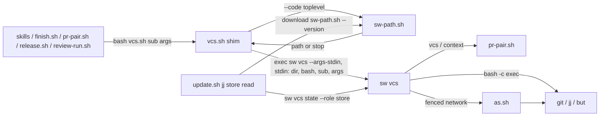
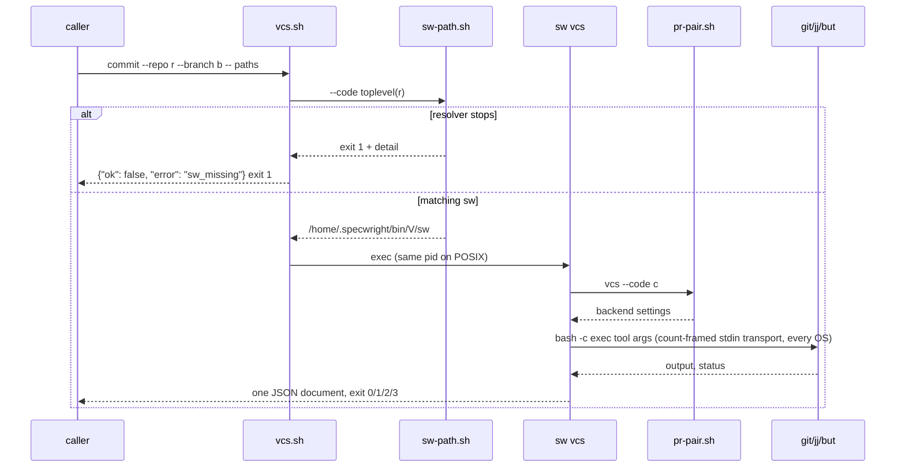

# Design

## Triage

| Trigger | Applies? | Evidence |
|---|---|---|
| T1 Components (new component, or 3+ with directed relationships) | yes | A new `sw vcs` component, with the shim `vcs.sh`, `sw-path.sh`, `pr-pair.sh`, `as.sh` and the tools (`git`, `jj`, `but`) in directed calls (`skills/specwright-pr/scripts/vcs.sh:29-30`, `:121`, `:139`, `:631`, `:801-805`) |
| T2 State (persistent state, caches, 3+ state machine) | no | `sw vcs` keeps no state of its own. The repos' refs and work trees are written as before, by the same tool commands |
| T3 Concurrency (background work, workers/isolates, async, retries) | yes | Dart `Process` I/O is asynchronous. The `but` output cap kills a running child mid-read (`vcs.sh:387-405`) |
| T4 Boundaries (data format, migration, shared interface, IPC, external) | yes | The JSON and exit-code contract of `vcs.sh` is shared by the skills and five scripts (`skills/specwright-finish/scripts/finish.sh:76`, `skills/specwright-pr/scripts/pr-pair.sh:2598-2625`). A new shim-to-`sw` handoff. `update.sh` reads a jj store's branch through it (`scripts/update.sh:1609-1624`) |
| T5 Volume (grows without a fixed bound) | yes | Tool output read into memory (`vcs.sh:66-72`) and named paths on a command line (`vcs.sh:919-931`) |
| T6 Risk (security, money, data loss, unrecoverable user data) | yes | Every branch, commit, merge, push and delete in user repos goes through this boundary, and network calls carry the gh identity fence |

TIER: FULL

## Context

- `vcs.sh` is a bash wrapper that finds Python 3.8+ and execs one heredoc program (`skills/specwright-pr/scripts/vcs.sh:5-14`). It parses `<command>` plus `--repo`, `--role`, `--code` and the other options, rejects unknown commands, and defaults `--code` to `--repo` (`vcs.sh:233-272`). It then probes the backend and dispatches to Git, jj or GitButler (`vcs.sh:1266-1287`). Every run prints one JSON document with `ensure_ascii=False`, with U+2028 and U+2029 escaped (`vcs.sh:43-45`). A `Stop` carries its own exit code, and any other exception becomes `internal_error` with exit 1 (`vcs.sh:1290-1297`).
- Every tool runs as `bash -c 'exec "$@"' vcs <tool> ...` (`vcs.sh:75-88`), so PATH lookup is Git Bash's, which is how the evals' extensionless fakes resolve. On Windows each argument is wrapped in double quotes first, because MSYS expands unquoted braces and wildcards (`vcs.sh:52-63`). Output is decoded as UTF-8 with `surrogateescape` (`vcs.sh:66-72`). No tool call has a deadline. The only bound is `but`'s output cap, which kills the child past `cap` bytes (`vcs.sh:387-405`). A jj commit stops with `too_many_paths` when the argv exceeds 32,000 bytes on Windows, or `SC_ARG_MAX` less the environment on POSIX (`vcs.sh:919-931`).
- Settings come from `pr-pair.sh vcs --code` and `pr-pair.sh context` (`vcs.sh:121`, `:139`). GitButler push pinning uses `context --only repos --branch` (`vcs.sh:679`). Network commands against github.com go through `as.sh <login> <tool> ...`, with `as.sh --resolve` when no login was handed (`vcs.sh:797-815`, `:1056-1069`). `but pull` is fenced the same way (`vcs.sh:631`).
- `plan` does not run anything. It prints the `bash <VCS_DIR>/vcs.sh  ...` command lines, shell-quoted (`vcs.sh:1245-1263`), and `pr-pair.sh` runs them (`pr-pair.sh:2598-2625`).
- `sw` today has `version` and `run` only (`cli/lib/src/cli.dart:11-16`, `:36-65`). Its dependencies are `args` and `ffi` (`cli/pubspec.yaml`, ADR 0027). `interfaceVersion` is 1 and changes only on an incompatible change, together with `SW_INTERFACE` in `sw-path.sh` (`cli/lib/src/commands/version.dart`). The bounded runner already carries the arguments of `bash -c` on stdin on Windows, so Git Bash's command-line cut cannot shorten them (`openspec/specs/native-cli/spec.md:131`).
- `sw-path.sh --code <toplevel>` prints the checked binary path, or exits 1 with `sw missing or mismatched: rerun the install prompt` and a detail line on stderr (`skills/specwright-pr/scripts/sw-path.sh:7-20`). It needs Python for its bounded check (`sw-path.sh:70-76`).
- A `main` install and a pre-0.24.0 tag place no binary (`README.md:238-240`, `scripts/update.sh:3161-3165`). This repository's own install is at `0.22.0` (`openspec/.specwright/VERSION`); that the machine has no `~/.specwright/bin` is an observation (A3).
- `update.sh` reads a jj store's branch by running the downloaded `vcs.sh state --role store` (`scripts/update.sh:1609-1624`), as required by `openspec/specs/vcs-backends/spec.md:297-298`. `sw-install` runs between `plan` and `stage` (`openspec/architecture.md:91`).
- The vcs evals run `bash vcs.sh <command> --repo <fixture> ...` with the fixture as cwd and parse one JSON document (`evals/vcs/vcs_test_support.py:100-118`). Fixtures are fresh `git init` repos with one committed `base.txt` (`vcs_test_support.py:78-90`). CI builds `sw` only for the `cli`, `runner` and `update` suites (`.github/workflows/evals.yml:140-152`). Tests needing `sw` skip as `sw not built` unless `SPECWRIGHT_REQUIRE_SW=1` (`evals/cli/swharness.py:3`).

## Decisions

### D1: The shim finds the project from the arguments, else the current directory

- **Choice:** `vcs.sh` takes the first existing directory among `--code`, `--repo` and the current directory. It walks up from it, in bash with no Git command, to the first directory holding a `.git` entry (a directory, or the file a linked worktree has), else keeps the directory itself, and runs `sw-path.sh --code <that>`. It parses nothing else: all validation, usage errors included, happens in `sw vcs`. No `git`, `jj` or `but` command runs before `sw` starts.
- **Rejected:** `git rev-parse --show-toplevel`. It runs a Git read before resolution, which the `sw_missing` requirement forbids (review round 1, M2). Also rejected: repeating `vcs.sh`'s argument validation in the shim, so usage errors work without `sw`. That would be a second parser kept in step with `sw`'s until M8. A malformed call from a project dir still resolves `sw` through the current directory, and gets `sw vcs`'s own usage document.
- **Reversal cost:** low
- **Important:** yes: changes what users see (which error a call without `sw` gets)
- **Chosen by:** user

### D2: The shim hands `sw vcs` its scripts directory, its bash and the operation on stdin

- **Choice:** `sw vcs --args-stdin`, with nothing else on argv. The shim writes on `sw`'s stdin a header and then the operation, each record followed by a NUL: first `<dir>`, then `<path>`, then `` and every argument (`printf '%s\0' "$dir" "$bash" "$@"`). So `sw` receives every path and argument as bytes and never through Dart's argv decoding (D4, C6; review round 4, M1). `vcs.sh` reads no stdin of its own today, so nothing is displaced. `<dir>` is the shim's own directory (`cygpath -m` on Windows) and `<path>` is the bash running the shim (`cygpath -w`), as `VCS_DIR` and `VCS_BASH` are today. `sw` uses them for `pr-pair.sh`, `as.sh`, the `plan` command lines and every tool launch. Fewer than three records (no subcommand), or an unterminated last record, is a usage document with exit 2. `update.sh` (D7) uses the same form.
- **Rejected:** `--scripts <dir>` and `--bash <path>` options on argv: Dart decodes argv lossily on POSIX, so a byte 0xFF in the install directory would be lost before the codec runs, and the settings and fence calls would target a path that does not exist (review round 4, M1). Also rejected: environment variables (`VCS_DIR`, `VCS_BASH`) as today. `update.sh` calls `sw vcs` directly (D7), and an environment contract is invisible in `sw`'s usage line and easy to leak into child tools.
- **Reversal cost:** low until M8 (internal to shim, `update.sh` and `sw`)
- **Important:** yes: binds future changes (the handoff `native-cli-commit` and `native-cli-finish` reuse)
- **Chosen by:** user

### D3: Tools launch through bash with sw's argument transport, without a deadline

- **Choice:** `sw vcs` runs every tool as `bash -c '<prelude>; exec "$@"' vcs` on every OS. The tool's name and arguments do not go on the command line, and neither does the working directory. `sw` writes them on the child's stdin as bytes (D4's encoding): first the working directory as one NUL-terminated record, then the arguments framed by a count: the number of arguments N in decimal digits, then N records, each followed by a NUL. Dart's `Process.start` takes the working directory as a `String`, which would lose a non-UTF-8 byte in the repo path on POSIX, so it is never set (amended during apply). The working directory is always absolute: the resolved repo or code root (`vcs.sh:1268-1269`), on Windows in its drive form with `/` separators. The prelude enters it with `CDPATH= cd -- "$dir" >/dev/null 2>&1`, so `CDPATH` cannot redirect a drive-form path (which does not start with `/`) and `cd` prints nothing; the empty `CDPATH` applies to `cd` only, and the tool inherits the environment unchanged. Before it starts bash, `sw` checks that the directory exists (`Directory.fromRawPath`). When it does not, no process starts and `sw` returns what `vcs.sh` returned for a failed `Popen` with that `cwd`: from `run` (`vcs.sh:66-72`), exit 127, empty stdout and Python's `str(OSError)` on stderr (POSIX `[Errno 2] No such file or directory: '<dir>'`, Windows `[WinError 267] The directory name is invalid`); from `but_run` (`vcs.sh:394-395`), the `tool_missing` stop `but could not run: <that text>`. A directory removed between that check and the prelude's `cd` makes the prelude exit 127 with empty output before any tool runs; that race is accepted. The prelude reads the count and then exactly N records, one at a time (`read -r -d ''`), and leaves the rest of stdin unread. No argument value is reserved, so an argument that looks like a marker or a number is just an argument (review round 3, M1). When the operation has input for the tool (today only `git check-ignore -z --stdin`, `vcs.sh:946-948`), `sw` writes that input after the N-th record and then closes stdin, so the exec'd tool reads exactly that input. Without input, stdin is closed right after the N-th record. A count that is not decimal digits, or fewer than N records, exits 126 before any tool runs. There is no deadline and no byte bound, matching `vcs.sh`, which bounds nothing except `but`'s output cap; that cap is kept, with its kill. The `too_many_paths` check keeps `vcs.sh`'s thresholds, computed on the same quoted form.
- **Rejected:** Dart's `Process.start` on `bash.exe` with its default Windows quoting. It leaves arguments without spaces unquoted, which MSYS then brace- and glob-expands (`vcs.sh:52-63`), and on POSIX it would encode arguments as UTF-8 and lose D4's escaped bytes. Also rejected: reusing `sw run`'s transport unchanged, because its prelude reads stdin to EOF and then runs `exec </dev/null` (`cli/lib/src/process/transport.dart:14-20`), which would leave `check-ignore` with empty input (review round 1, C1). Also rejected: running tools under `sw run --bounded` limits, which is a behaviour change outside a parity port (proposal S4).
- **Reversal cost:** low
- **Important:** no
- **Chosen by:** agent

### D4: Bytes round-trip as in `vcs.sh`, and the JSON matches byte for byte

- **Choice:** full byte parity. `sw vcs` keeps every name it handles as the bytes it came in as. Inside `sw`, text is decoded as UTF-8 with Python's `surrogateescape` rule: each byte 0x80-0xFF that is not part of valid UTF-8 becomes the lone surrogate U+DC00 plus the byte (0xFF becomes U+DCFF). It is encoded back the same way wherever `sw` writes bytes: tool arguments and input (D3), and the JSON document on stdout. A valid U+FFFD in a name is just a character and round-trips unchanged. The bytes come in through three paths:
  - **arguments:** read from stdin (D2), never from Dart's argv;
  - **directory walks** (`check_directory_snapshot`, `vcs.sh:933-943`): `find` through the D3 transport, so names come back as stdout bytes and are decoded with `surrogateescape`. Dart's `Directory.list()` is never used for a walk: its entries expose only the `path` string, which replaces invalid bytes with U+FFFD, and `rawPath` is private in Dart 3.13 (amended during apply; the user chose this walk). The walk reproduces `os.walk(os.path.join(repo, path))` with its `dirs[:]` filter as follows:
    - **Root.** `<root>` is `os.path.join(<repo>, <path>)` on the escaped strings, where `<repo>` is the absolute, resolved repo (`vcs.sh:1268`) and an absolute `<path>` replaces it, as `os.path.join` does. `vcs.sh` walks only when that root is a directory, a symlinked one included (`vcs.sh:970`).
    - **Command.** `find <root>/ -mindepth 1 \( -type d \( -name .git -o -name .jj \) -prune \) -o -type f -print0`. The trailing slash enters a symlinked root, as `os.walk` lists an explicitly named root; `-mindepth 1` keeps the root itself from being pruned when it is named `.git` or `.jj`, because `os.walk` filters only children; `-type d` prunes only directories named `.git` or `.jj`, so a regular file named `.git` (a linked worktree or submodule) is still listed, as the `dirs[:]` filter leaves `files` alone. Without `-L`, `find` descends no symlinked directory below the root, as `os.walk` with `followlinks=False` does not, and `-type f` lists no symlink, matching the `not os.path.islink(full)` check.
    - **Which `find`.** The walk runs `find` through `command -p` in the transport's bash (a nested `bash -c 'command -p find "$@"'`, since `exec` takes no builtin), so it is looked up on the shell's default system path (`/usr/bin:/bin` in Git Bash) and never on the inherited `PATH`, where Windows puts `System32\find.exe` and the evals put fake tools.
    - **Names.** Each record is the absolute name `find` printed. The stat path is those bytes as printed. The reported name is `os.path.relpath(full, repo)` followed by `path_text` (`vcs.sh:91-92`, `:940`), ported on the escaped strings: both paths are normalised lexically (repeated separators, `.` and `..` components collapsed, as `os.path.normpath` does; on Windows, `\` and `/` are both separators), the repo's components are removed from the front, and `\` becomes `/`. So `.`, `./`, `work/`, `work/../work/` and an absolute path inside the repo all give the same names (`evals/vcs/test_commit.py:test_commit_equivalent_path_spellings`).
    - **Order.** `check_directory_snapshot` reports the first oversized, unignored name in walk order (`vcs.sh:944-954`), and `os.walk` yields a directory's files before it descends into any of its child directories, while `find` prints depth-first and can reach `work/deep/big.bin` before `work/big.bin`. So `sw` regroups the records into `os.walk`'s order before it checks them: within each directory, that directory's own files first, in the order `find` printed them, then each child directory's subtree, in the order its first record appeared. Both tools read each directory in the same `readdir` order, so the regrouping adds no sorting. A child directory with no listed file plays no part.
    - **Observation point and errors.** Python lists a name, then checks `rel not in listed`, `os.path.isfile`, `not os.path.islink` and `os.path.getsize` (`vcs.sh:940`). `sw` checks `rel not in listed`, then takes one `File.fromRawPath(<bytes>).statSync()` and one link check on the same bytes (A5). A name that is gone, or is no longer a regular file or is now a link, is skipped, as a failed `isfile` or a true `islink` is in Python. The size comes from that same stat. One race differs: in Python a file removed between `isfile` and `getsize` raises and becomes `internal_error`, while `sw` has no gap between those checks and skips the file. That narrow window is accepted, not ported. `os.walk` without `onerror` skips a directory it cannot list and carries on, so `sw` uses every complete NUL-terminated record `find` printed, ignores `find`'s exit status and stderr, and drops a last record with no NUL. A `find` that cannot start (bash missing) is the same `run` failure as any tool's (D3).
  - **tool output:** read per runner as `vcs.sh` reads it. `git` and `jj` output through `run` is decoded with `surrogateescape`, then `\r\n` and a lone `\r` become `\n` (Python text mode, `vcs.sh:66-72`). `but` output through `but_run` is decoded with invalid bytes as U+FFFD and no newline change (`vcs.sh:387-410`).
  Each document uses Python's default separators (`", "`, `": "`), insertion-ordered keys, raw non-ASCII, and U+2028 and U+2029 written as the six-character escapes `\u2028` and `\u2029` (`vcs.sh:43-45`).
- **Rejected:** a `non_utf8_path` stop for names Dart decodes before `sw` sees them (the user's round-1 choice). Round 2 showed it could not be detected soundly: U+FFFD is also a valid character in a name, and passing a `state` path back to `commit` had to both work and stop. Also rejected: replacing invalid bytes with U+FFFD (lossy), libc FFI for directory walks (native code per OS; `find` through the transport gives the bytes without it), `Directory.list()` with each entry's `rawPath` (the planned walk: `rawPath` is private in Dart 3.13, found during apply), a lossy `Directory.list()` walk with a documented limit (breaks the round-trip requirement), and Dart's compact `jsonEncode` (same parse, different bytes).
- **Reversal cost:** low
- **Important:** yes: reverses an earlier user choice (round-2 escalation)
- **Chosen by:** user

### D5: Projects without a matching binary stop, and contributors get `mise run install-sw`

- **Choice:** keep the strict stop (S1, ADR 0027). A new mise task `install-sw` builds `cli/` and places the binary at `<home>/.specwright/bin/<tree VERSION>/sw[.exe]` through `sw-path.sh --file` checks, the same way `sw-install` places one. The install prompt's Step 8 says that VCS steps stop with `sw_missing` until a tagged install or `mise run install-sw` from that commit places the binary, only when the installed `vcs.sh` runs `sw` and the resolver finds no matching binary after the install; an already placed matching binary gets no warning (`specs/install-update/spec.md`, review round 3, M2). The task places the tree's version only, so a project resolves it only when its installed `VERSION` is that version. `CONTRIBUTING.md` gets the full bootstrap for a checkout that dogfoods Specwright, without the install prompt, which installs only tags and `main` (`README.md:141-162`). Run the checkout's own `scripts/update.sh` with `--code .`, the checkout's chosen targets (`--skills <dir>`, repeated, and `--agents <kind>=<dir>`, `scripts/update.sh:15-18`; `plan` refuses with `no_targets` without one, `scripts/update.sh:1859-1860`; this repository uses `--skills .claude/skills --agents claude=.claude/agents`), `--download .` (the checkout is the download tree, `scripts/update.sh:19`) and `--ref <the checkout's branch>` (free text, recorded as the installed ref, `scripts/update.sh:20`), through `plan`, `stage` and `swap`, which copy the skills. Then run the install prompt's Step 7 checks (`README.md:402-424`: `openspec schema validate specwright`, the skills and agents match the tree), and only when they pass copy the tree's `VERSION` to `openspec/.specwright/VERSION` (the stamp, as the install prompt does before `finish`, `README.md:424-426`), because `finish` refuses with `not_stamped` until the stamp reads the new version (`scripts/update.sh:969-971`). Then `finish`, then `mise run install-sw`, then `bash skills/specwright-pr/scripts/sw-path.sh --code .` prints the path. A task runs this sequence once on a scratch clone, with those target arguments and a stamp that starts at an older version than the tree's, and checks that `finish` completes and `sw-path.sh --code .` resolves the tree-version binary (review rounds 1 M5, 2 M4, 3 C1 and 4 M2).
- **Rejected:** refusing `main` installs (removes a documented path). Building `sw` inside the install prompt (every install gains a toolchain dependency).
- **Reversal cost:** low
- **Important:** yes: changes what users see
- **Chosen by:** user

### D6: `sw_missing` is a JSON document from the shim

- **Choice:** the shim first runs today's interpreter check (`vcs.sh:5-9`). Without Python 3.8+ it prints today's `no_python` document byte for byte and exits 2, as `vcs.sh` does now. With Python it runs `sw-path.sh`. On a non-zero exit it prints `{"ok": false, "error": "sw_missing", "message": "<stop line>\n<detail>"}` on stdout (Python's separators), built with that Python (`-I -c`) from `sw-path.sh`'s stderr so the detail is escaped correctly. It copies that stderr to stderr and exits 1. Since the shim has already found Python, `sw-path.sh`'s own `no_python` exit 2 (`sw-path.sh:70-76`) cannot reach this path. Any other exit 2 from it (a usage error) is reported as `sw_missing` too.
- **Rejected:** passing `sw-path.sh`'s stderr through with empty stdout. Every caller parses stdout as JSON, so they would report a parse failure instead of the cause. Also rejected: one `sw_missing` for every failure, missing Python included, which drops today's `no_python` parity (review round 1, M1).
- **Reversal cost:** low
- **Important:** yes: binds future changes (a new error code callers will see)
- **Chosen by:** user

### D7: `update.sh` runs the download's `sw vcs` for a jj store

- **Choice:** `jj_store_branch` reads the download's `VERSION`, resolves the binary with the download's `sw-path.sh --version <that> --file <home>/.specwright/bin/<that>/sw[.exe]`, and runs `<sw> vcs --args-stdin` with the D2 handoff: the download's scripts directory, the bash path, then `state`, `--repo`, `<store>`, `--role`, `store`, `--code` and `<code>`, written to its stdin as NUL-terminated records (`printf '%s\0' "$scripts" "$bash" state --repo "$store" ...`), and stdin then closed. No path or operation argument goes on `sw`'s argv (D2, D4, C6; review rounds 3 M3 and 4 M1). A failed resolution is a refusal, `sw_missing`, naming the version and saying that a `main` download needs `mise run install-sw` first. It swaps nothing.
- **Rejected:** a version override in the shim (a second way to choose the binary). Reading jj in `update.sh`'s own Python (the jj branch rule twice until M8).
- **Reversal cost:** low
- **Important:** yes: changes what users see (a jj-store update from `main` without the task now stops)
- **Chosen by:** user

### D8: `interface` stays 1

- **Choice:** adding the `vcs` command is a compatible change, so `interfaceVersion` and `SW_INTERFACE` stay 1. The exact version match already ties each shim to the binary it was released with.
- **Rejected:** bumping to 2, which signals an incompatible change that did not happen.
- **Reversal cost:** low
- **Important:** no
- **Chosen by:** agent

### D9: The evals run the shim against the tree's `sw` through a test home

- **Choice:** a shared eval helper makes one `SPECWRIGHT_HOME` per test process holding a copy of `SPECWRIGHT_SW` at `.specwright/bin/<tree VERSION>/sw[.exe]`. Every fixture code repo gets `openspec/.specwright/VERSION`, hidden through `.git/info/exclude` so no status read sees it. Without `SPECWRIGHT_SW` these tests skip as `sw not built`, unless `SPECWRIGHT_REQUIRE_SW=1`. `evals.yml` builds `sw` for every suite job.
- **Rejected:** a test-only variable that makes the shim skip the resolver. That is a bypass of the version check in shipped code. Also rejected: committing `VERSION` in each fixture's first commit, which changes tree contents that tests assert on.
- **Reversal cost:** low
- **Important:** no
- **Chosen by:** agent

### D10: Port in task groups by layer, and switch the shim last

- **Choice:** `cli/lib/src/vcs/` holds the argument parser and document writer, the text codec (D4), the tool runner (D3), then the Git, jj and GitButler backends and `plan`. Dart tests cover behaviour at the boundaries where parity can break: the codec's round trips, the transport with and without tool input, the document bytes, and each backend's stops. They are not one test per Python function. The black-box evals run against `sw vcs` directly through a temporary harness switch. Only when all three backends pass does `vcs.sh` become the shim and lose its Python.
- **Rejected:** switching the shim per backend (a mixed dispatcher, rejected in S3).
- **Reversal cost:** low
- **Important:** no
- **Chosen by:** agent

### D11: Record the shim pattern as ADR 0028

- **Choice:** a new ADR, adding to 0017 and 0027: each ported script keeps its path as a shim that resolves the project's `sw` and execs the matching command. It hands over its scripts directory and bash explicitly, reports a failed resolution as `sw_missing` JSON, never falls back, and is removed in M8. Scripts not yet ported are called by `sw` as subprocesses.
- **Rejected:** leaving the pattern to this design. `native-cli-commit`, `native-cli-finish` and M8 must follow it, and no step reads archived designs for planning (ADR 0026).
- **Reversal cost:** medium
- **Important:** yes: binds future changes
- **Chosen by:** user

### Decision summary

| # | Decision | Choice | Rejected | Reversal cost | Important | Chosen by |
|---|---|---|---|---|---|---|
| S1 | Caller path | `vcs.sh` shim execs `sw vcs` | Direct calls; mixed | low | yes | user |
| S2 | Settings and fence | Call `pr-pair.sh`/`as.sh` until M8 | Port now | medium | yes | user |
| S3 | Split | All three backends in one change | GitButler later | low | yes | user |
| S4 | Parity | No behaviour change; defects to issues | Fix while porting | low | no | agent |
| D1 | Shim finds project | `--code`, `--repo`, else cwd; walk up to `.git`, no Git command | `git rev-parse`; shim validates args | low | yes | user |
| D2 | Handoff | Scripts dir, bash and arguments all on stdin (`--args-stdin` only) | `--scripts`/`--bash` argv options; environment variables | low | yes | user |
| D3 | Tool launch | bash, working directory, arguments and input on stdin on every OS, no deadline | Default quoting; `sw run`'s transport as is; bounds | low | no | agent |
| D4 | Bytes and JSON | Full byte parity: surrogate escape, args on stdin, `find -print0` walks through the transport, per-runner decoding | `non_utf8_path` stop; U+FFFD; FFI; `rawPath` walk; lossy walk; compact `jsonEncode` | low | yes | user |
| D5 | No binary | Strict stop plus `mise run install-sw` and a documented bootstrap | Refuse main; build in install | low | yes | user |
| D6 | Resolver failure | Today's `no_python`, then `sw_missing` JSON | Empty stdout; one code for all | low | yes | user |
| D7 | jj store update | Download's `sw vcs` at the download's version | Shim override; Python jj read | low | yes | user |
| D8 | Interface | Stays 1 | Bump to 2 | low | no | agent |
| D9 | Eval wiring | Test home plus excluded fixture `VERSION` | Bypass variable; committed `VERSION` | low | no | agent |
| D10 | Sequencing | Layers, then the shim last | Per-backend switch | low | no | agent |
| D11 | ADR | ADR 0028 for the shim pattern | Design only | medium | yes | user |

## Assumptions

- **A1:** jj (0.46+) and GitButler's `but status` ignore a file that `.git/info/exclude` lists in a colocated or managed repo, as Git does. Not checked because it needs both tools running against a fixture. Depends on it: D9, tasks 1.2 and 7.x.
- **A2:** Running `sw-path.sh` on each `vcs.sh` call (two Python starts and one `sw version`) keeps the vcs suites within their CI time budget on Windows. Not checked because no shim exists yet to time. Depends on it: D1, task 8.3.
- **A3:** This repository's own install is at `0.22.0` (`openspec/.specwright/VERSION`, a tracked file), and this machine has no `~/.specwright/bin` directory. That second part was observed on the planning machine only, not in tracked source, and other contributors' machines may differ. Depends on it: D5 (only as the motivating case).
- **A4:** In Git Bash, `read -r -d ''` on a pipe consumes stdin only up to each NUL, so the bytes after the N-th record stay unread for the exec'd tool. Not checked because it needs the prelude running on all three OSes. Depends on it: D3, task 2.1 (verified first, with `git check-ignore -z --stdin` as the tool).
- **A5:** On Linux and macOS, `File.fromRawPath(<bytes>).statSync()` and the link check on the same bytes act on the file whose name is exactly those bytes, even when they are not valid UTF-8, and `find ... -print0` through the transport returns such a name with its bytes. On Windows, Git Bash's `find` prints names under a drive-form root in that same form, so `File.fromRawPath` stats them. Not checked because it needs runs on each OS. Depends on it: D4 (directory walks), task 2.2, verified before any backend task. (Replaces the planned A5, that `Directory.list()` entries expose a public `rawPath`: false in Dart 3.13.7, where it is private, found during apply.)

## Carried constraints

- **C1:** Every ported script stays a shim at its old path until M8: it resolves the project's `sw` through `sw-path.sh`, hands over its scripts directory and bash as the stdin header, reports a failed resolution as `sw_missing` JSON with exit 1, and never falls back to its old implementation, another version or `PATH`. Kind: invariant. Destination: ADR 0028
- **C2:** `sw vcs` runs tools with no deadline and no byte bound except `but`'s output cap, matching `vcs.sh`. Adding bounds is a behaviour change for its own change. Kind: deliberate gap. Destination: doc comment: cli/lib/src/vcs/tool_runner.dart `runTool`
- **C3:** Tools must not receive arguments through Dart's process argument encoding: on Windows MSYS brace- and glob-expands unquoted arguments, and on POSIX escaped bytes would be lost. Arguments and tool input go through the vcs transport, which, unlike `sw run`'s, frames arguments with a count and leaves the bytes after the last argument record on stdin for the tool. Kind: rejected alternative. Destination: doc comment: cli/lib/src/vcs/tool_runner.dart `runTool`
- **C4:** `sw vcs` output matches `vcs.sh` byte for byte (Python separators, insertion-ordered keys, raw non-ASCII, U+2028/U+2029 as six-character escapes, escaped invalid bytes written back as the original bytes). Kind: invariant. Destination: spec: specs/vcs-backends/spec.md → Requirement: sw vcs output bytes match vcs.sh
- **C6:** `sw vcs` must never read a name through Dart's argv or a directory entry's `path` string, and never pass one through `Process.start`'s working directory. Arguments come from stdin, directory entries from `find -print0` output through the transport, and the working directory goes in the transport, because the string forms lose bytes that are not valid UTF-8. Kind: rejected alternative. Destination: doc comment: cli/lib/src/vcs/codec.dart `decodeEscaped`
- **C5:** A jj store's branch is read during an update with the download's `sw` at the download's version, never the project's installed one. Kind: invariant. Destination: spec: specs/vcs-backends/spec.md → Requirement: A jj store passes the update's branch check

<!-- ===== LIGHT tier ends here. Delete everything below for LIGHT. ===== -->

## Diagrams (FULL)

Components (T1, T4):

One call (T3):

## State & Ownership (FULL)

| State | Owner (sole writer) | Lifetime | Invalidation / rebuild | Authoritative copy |
|---|---|---|---|---|
| Repo refs, index, work tree, jj bookmarks, GitButler branches | the tool command `sw vcs` runs (same commands as `vcs.sh`) | the repo's | unchanged from today | the repo |
| Installed `sw` binary | `update.sh sw-install` or `mise run install-sw` | until the user removes it | resolver check on every call | `<home>/.specwright/bin/<version>/` |
| Test home with the binary copy | the eval helper | one test process | recreated per process | `SPECWRIGHT_SW` build |

## Failure & Visibility (FULL)

| Component | Fails / dies mid-operation → | Recovery | Retry safe? | Who finds out |
|---|---|---|---|---|
| Shim / resolver | no Python 3.8+: today's `no_python` document, exit 2. No binary, or the wrong version or interface: `sw_missing`, exit 1 | install Python; install from a tag, or `mise run install-sw` | yes, nothing ran | caller, from the document and stderr |
| `sw vcs` crash (uncaught) | `internal_error` document, exit 1. A tool already started may have written, exactly as when `vcs.sh` dies mid-write today | the operation's existing recovery (gate rollback, finish undo) | as today per operation | caller |
| `sw vcs` killed (SIGKILL) | no document. A running tool keeps running, as with `vcs.sh` | as today | as today | caller (unparseable stdout) |
| `pr-pair.sh` / `as.sh` | same `Stop` mapping as `vcs.sh` (exit 3 for a fence refusal) | as today | as today | caller |
| `update.sh` jj-store read | `sw_missing` refusal, nothing swapped | install `sw` for the download's version | yes | user, in the update's report |

## Resource Bounds (FULL)

| Queue / buffer / cache / transfer | Bound | At the bound | Timeout | At 10x / 100x |
|---|---|---|---|---|
| Tool stdout/stderr held in memory | none, as in `vcs.sh` (C2). Status, log and `ls-tree` outputs are proportional to the repo's changed paths | memory grows | none (C2) | the same as `vcs.sh` today. Bounding it is a later change |
| `but` stdout | the existing cap per call | kill the child, `but_output_too_large` | none | unchanged |
| Named paths on a jj command line | 32,000 bytes (Windows) / `SC_ARG_MAX` less the environment (POSIX) | `too_many_paths` before any write | n/a | unchanged |
| Resolver call per `vcs.sh` run | 10 s, 1 MiB (`sw-path.sh`) | `sw_missing` | 10 s | per call, not per volume |

## Flow & State Gaps (FULL)

- **Partial completion:** the same tool commands run in the same order, so every partial state `vcs.sh` could leave, and its recovery, is unchanged. The shim adds only steps that run before any write.
- **Concurrent calls:** the resolver only reads, and `sw vcs` keeps no state, so concurrent calls behave as concurrent `vcs.sh` runs do.
- **Upgrade mid-session:** an update that swaps the skills and stamps a new `VERSION` while a session runs makes the next shim call resolve the new version. If the binary for it is missing, the call stops with `sw_missing` before any write.
- **Stale binary:** a binary with the right version but altered behaviour cannot be detected. The resolver checks only the version and interface reports (ADR 0027, accepted).

## Mechanism Ledger (FULL)

| Mechanism | Built? | Why (harm nobody catches / expensive later) | Evidence that would change the call |
|---|---|---|---|
| `sw_missing` JSON from the shim | yes | without it, every caller misreports a missing binary as a parse error | n/a |
| Caching the resolved path between calls | no | a cache can outlive an update and run the wrong version; the cost per call is small | A2 fails: the vcs suites slow down measurably on Windows |
| Python fallback when `sw` is missing | no | ADR 0027 and S1 forbid it | n/a |
| Deadlines on tool calls | no | behaviour change (C2) | a reported hang in a VCS step |
| Byte-identical JSON encoder | yes | callers or skill text matching stdout would break silently | n/a |
| Shim-side argument validation | no | duplicate parser (D1) | a usage error reported as `sw_missing` from a real caller |

## Risks / Trade-offs

- [The port misses a branch of behaviour no eval covers] → port function by function, with D10's boundary tests and the unchanged black-box evals. The FULL pre-ship review compares each Dart file against the Python it replaces. Gaps found go to issues (S4) unless they break an eval.
- [Windows quoting or encoding differs from Python's] → D3 and D4, plus the `vcs` suite on Windows CI with the evals' extensionless shims.
- [Projects on `main` installs, and this repo's own install, that have no matching binary stop working until they place one] → D5's task and the Step 8 note. The release notes say so.
- [Slower VCS calls] → A2 and task 8.3 measure it. Caching is recorded as not built, with its trigger.
- [Every eval suite job now builds `sw`, so CI takes longer] → accepted. Only suites that never run `vcs.sh` could skip the build, and listing them is fragile.

## ADRs

- **In force, constraining this change:** 0017 (one backend script for VCS writes), 0018 (Git, jj and GitButler backends), 0004 and 0008 (fenced identity, through `as.sh`), 0011 (staged updates, for the jj-store read), 0014 (bounds, deliberately not added here), 0021 (install location), 0026 (carried constraints), 0027 (one Dart binary, exact version, no fallback, coexistence until M8).
- **To record during apply:** ADR 0028, ported scripts become shims that resolve the project's `sw` (adds to 0017 and 0027), with its index row in `openspec/architecture.md`, plus the `vcs.sh` and `sw` rows of the component table updated.
