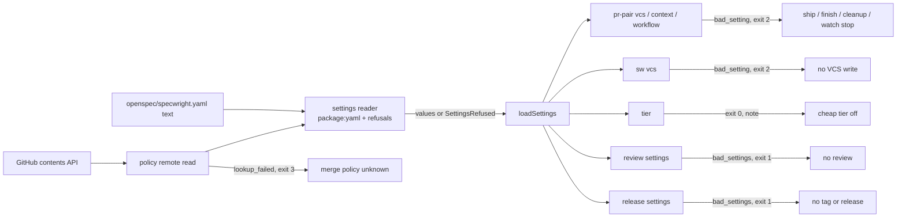

# Design

## Triage

| Trigger | Applies? | Evidence |
|---|---|---|
| T1 Components (new component, or 3+ with directed relationships) | yes | One reader module gains six directed callers: `pr-pair` settings commands, `policy`, `sw vcs`, review, release and `tier` (`cli/lib/src/pr/settings_commands.dart:61-65`, `cli/lib/src/pr/policy.dart:163-165`, `cli/lib/src/review/settings.dart:46-50`, `cli/lib/src/release/settings.dart:165-171`) |
| T2 State (persistent state, caches, 3+ state machine) | no | The reader holds nothing between calls; reviewer configs stay content-addressed by the existing code |
| T3 Concurrency (background work, workers/isolates, async, retries) | no | The read is synchronous text in, values out |
| T4 Boundaries (data format, migration, shared interface, IPC, external) | yes | `openspec/specwright.yaml` is a shared settings format; `yes`/`no` becomes an error (migration); a new third-party package enters the shipped closure |
| T5 Volume (grows without a fixed bound) | yes | A settings file's nesting depth and size are set by whoever writes it, including a PR head that `policy` reads |
| T6 Risk (security, money, data loss, unrecoverable user data) | yes | `policy` authorizes an agent merge from a remote settings file (ADR 0020) |

TIER: FULL

## Context

The proposal (`proposal.md`) states the goal, S1-S7 and the experiment. The facts the approach needs:

- **Two readers today.** `parseYaml` is a lenient line reader that skips what it cannot read (`cli/lib/src/settings/yaml.dart:395-400`). `yamlProblem` is the strict check that fails closed on what the lenient reader would misread (`cli/lib/src/settings/yaml.dart:668-675`). `loadSettings` is the lenient read every local caller uses (`cli/lib/src/settings/rules.dart:579-581`).
- **Who runs the strict check.** Review stops with `bad_settings` (`cli/lib/src/review/settings.dart:46-49`), and so does release (`cli/lib/src/release/settings.dart:165-170`). `context` reports the problem as `settings_problem` and goes on with the lenient values (`cli/lib/src/pr/settings_commands.dart:346`, `cli/lib/src/pr/settings_commands.dart:380-384`). `policy` turns it into `merge policy unknown` for a remote file (`cli/lib/src/pr/policy.dart:163-165`). `vcs`, `tier`, the GitButler pin check and the native workflow callers read only leniently (`cli/lib/src/pr/settings_commands.dart:36-38`, `cli/lib/src/pr/settings_commands.dart:178`, `cli/lib/src/pr/settings_commands.dart:273`, `cli/lib/src/pr/settings_commands.dart:295`), and so does `sw vcs` (`cli/lib/src/vcs/scripts.dart:70-86`). `identity` reads no settings: it reads the repository's remotes (`cli/lib/src/pr/identity.dart:28`, `cli/lib/src/pr/identity.dart:80-84`).
- **Booleans.** The lenient reader turns `yes` and `no` into booleans (`cli/lib/src/settings/yaml.dart:268-269`). Some consumers compare with `== true`, so a string `yes` would turn the setting off without a word (`cli/lib/src/release/settings.dart:30`, `cli/lib/src/release/settings.dart:35`). Others refuse a non-boolean (`cli/lib/src/settings/rules.dart:253-256`), and `tier` notes one (`cli/lib/src/settings/rules.dart:545-560`).
- **Shapes.** A local section that is truthy and not a mapping stops with `internal_error` (`cli/lib/src/settings/rules.dart:79-93`). `policy` reads a non-mapping section as empty (`cli/lib/src/pr/policy.dart:173-180`).
- **Empty files.** The old reader reads an empty or comment-only file as an empty mapping (`cli/lib/src/settings/yaml.dart:402`), and the strict check passes both (`cli/test/settings/yaml_test.dart:29-32`).
- **Text in.** `readSettingsText` decodes the file and turns `\r\n` and `\r` into `\n` before any read (`cli/lib/src/settings/rules.dart:567-577`), so a line the parser reports is the line in the file.
- **Stops.** `SettingsStop` carries an error, message and exit status (`cli/lib/src/settings/rules.dart:41`); `sw vcs` maps it to `VcsStop`, capping the status at 3 (`cli/lib/src/vcs/scripts.dart:84-86`). `ReviewStop` and `ReleaseStop` exit 1 by default (`cli/lib/src/review/stop.dart:3`, `cli/lib/src/release/stop.dart:5`).
- **Package.** `yaml` is already in `cli/pubspec.lock` as a transitive dev dependency (`cli/pubspec.lock:428-429`). ADR 0033 approves it only if this change's experiment passes. `cli/pubspec.yaml:11-16` states constraints C3 and C6.
- **Already gone.** A search of the tracked tree finds `yaml_problem` only in the frozen oracle `evals/pr-pair/oracle/pr-pair.sh` and in `cli/`. The shim `skills/specwright-pr/scripts/pr-pair.sh` and `evals/pr-pair/test_pr_pair.py` no longer carry it, so the proposal's items for them need no work.
- **Python-value helpers stay in use.** `pyStr`, `pyRepr`, `pyTruthy`, `pyDecimalValue`, `pySpaceClass`, `pyUtf8Decode` and `settingText` live in `cli/lib/src/settings/yaml.dart`. `feedback_pass.dart`, `policy.dart`, `reviewers.dart`, `identity.dart`, `rules.dart`, the VCS backends and `process/missing_directory.dart` import them for things other than reading YAML.

## Decisions

### D1: One reader module wraps the package

- **Choice:** One settings reader in `cli/lib/src/settings/` loads the text with `package:yaml`, applies every refusal (S6, S7, D2, D3, non-string keys, a top level that is not a mapping) and returns plain Dart maps. An empty, whitespace-only or comment-only document, which the package loads as a null root with no content, is an empty mapping; an explicit scalar or list root is refused, lists and scalars, keeping each plain scalar's text for messages (`settingText`). It throws `SettingsRefused(line, why)`. `loadSettings` and `policy`'s remote read call it, and nothing else imports `package:yaml`. The Python-value helpers move to their own file, and the old reader and `yamlProblem` are deleted.
- **Rejected:** each caller loads YAML itself and applies shared checks, because a new caller could skip a refusal and read leniently again, which is the split S3 removes.
- **Reversal cost:** low
- **Important:** yes, binds future changes
- **Chosen by:** user

### D2: A depth cap before the parse, and a stack backstop

- **Choice:** Before parsing, the reader counts open flow collections and refuses the file at the first line where more than 64 are open. A `[` or `{` opens one only where a flow collection can start: at the start of a block value (after `key:` and spaces, after `- `, or as the first character of a line's content), or anywhere inside an open flow collection, where YAML forbids those characters in plain scalars. It counts nothing inside quoted scalars, comments, the body of a `|` or `>` block scalar (the lines indented deeper than its key), or plain scalar text in block context, so a scalar holding 65 literal `[` characters is read whole. Block nesting is bounded by indentation, since each level needs a deeper indent. A `StackOverflowError` from the load is still caught and reported as a refused file (`line 1: nested too deeply`). The experiment records whether the package overflows at 100,000 levels.
- **Rejected:** walking the package's private parser events (`package:yaml/src`) with an iterative builder, because private API can change in any upgrade. Also rejected: the backstop alone, because it cannot name a line and the overflow depth differs by platform.
- **Reversal cost:** low
- **Important:** yes, weak evidence (A3); the experiment settles it
- **Chosen by:** user

### D3: Exact decimal integers, YAML for the other scalars

- **Choice:** A plain scalar whose text is a decimal integer (optional sign, ASCII digits) is read from its text, so a value beyond 64 bits reaches the existing big-integer checks instead of a rounded double. `true`/`false`, null, hex, octal and floats follow YAML 1.2 as the package reads them. Integers written with non-ASCII digits, a Python quirk, are strings.
- **Rejected:** keeping hex, octal and floats as strings, as the old reader did, because it adds a second set of scalar rules on top of YAML's. ADR 0033 drops parser quirks.
- **Reversal cost:** low
- **Important:** yes, changes what users see
- **Chosen by:** user

### D4: Each reader keeps its own stop for a refused file

- **Choice:** `loadSettings` throws `SettingsStop('bad_setting', 'openspec/specwright.yaml line N: why', code: 2)`. The `pr-pair` subcommands that read the settings (`vcs`, `context`, `policy`'s local side and the workflow commands through `workflowVcsChoices`) and `sw vcs` pass it on unchanged. `identity` reads no settings and gains no read. Review and release map it to their `bad_settings` stop (exit 1), `policy` maps it to `lookup_failed` (exit 3), and `tier` turns it into a note with the cheap tier off. A missing file is still an empty map.
- **Rejected:** one new error code for every reader, because watch, ship and the release and review skills already branch on the codes they have.
- **Reversal cost:** low
- **Important:** yes, changes what users see (follows S5)
- **Chosen by:** user (S5)

### D5: Wrong shape on a remote read is unknown

- **Choice:** When `policy` reads a remote file whose top level is not a mapping, or whose `pr` or `planning_store` section is present and not a mapping, it stops with `lookup_failed` instead of reading it as empty.
- **Rejected:** reading a wrong-shaped section as empty, as today, because an empty `pr` means `pr.merge: user` and a typo then looks like a policy instead of a broken file.
- **Reversal cost:** low
- **Important:** yes, changes what users see
- **Chosen by:** user (proposal, "has the wrong shape stops `policy` with `lookup_failed`")

### D6: The experiment runs in the change, against both readers

- **Choice:** The first task group adds `yaml` as a runtime dependency on the change branch, builds the new reader beside the old one, and runs a comparison test over the corpus: this repository's settings, every settings fixture under `evals/` and `cli/test/`, the dogfood projects' files and the failure cases. The results go into `experiment.md` in the change directory. `experiment.md` holds the proposal's acceptance matrix: each corpus file with its old and new values and outcomes, every difference tagged with the approved difference it falls under (S5, S6, S7, D3, empty file), and the failure cases with their outcomes, D2's 65 literal `[` in a block scalar and in a plain scalar (read) and 65 nested flow collections (refused) among them. An untagged difference that reaches a consumer, or any failed check, stops apply there: it reverts the group and asks the user. The old reader and the comparison test are deleted only after it passes.
- **Rejected:** a throwaway script outside the repository, because its evidence would be lost and the reviewer could not check it.
- **Reversal cost:** low
- **Important:** no
- **Chosen by:** agent

### D7: ADR 0038 records the reader contract

- **Choice:** During apply, write ADR 0038, "Settings are read by one fail-closed YAML reader". It adds to 0020 and 0033 and binds the later `native-cli-update` and `native-cli-retire-scripts` ports. The same task updates `openspec/architecture.md`'s index and its Settings contract line.
- **Rejected:** keeping the rule only in the `pr-script-runtime` spec, because a later port can add a lenient reader without meeting an architectural rule.
- **Reversal cost:** low
- **Important:** yes, binds future changes
- **Chosen by:** user

### Decision summary

| # | Decision | Choice | Rejected | Reversal cost | Important | Chosen by |
|---|---|---|---|---|---|---|
| S1 | Adopt yaml only if the experiment passes | Experiment first; stop if it fails | Adopt unconditionally | medium | yes | user |
| S2 | yes and no become an error | Stop naming `true`/`false`, with an upgrade note | Keep a local conversion | low | yes | user |
| S3 | One parser for local and remote reads | One parser; `yaml_problem` goes | Separate strict remote check | medium | yes | user |
| S4 | Write the design at this change's turn | Proposal only, then | Full artifacts early | low | yes | user |
| S5 | A refused file stops every local read | Every reader stops; `tier` notes | `context` stays soft with defaults | medium | yes | user |
| S6 | Any plain yes or no is refused | Refuse unquoted `yes`/`no` anywhere | Per-reader boolean keys | low | yes | user |
| S7 | Anchors, aliases and tags stay refused | Refuse them | Accept with a size bound | low | yes | user |
| D1 | Where the package sits | One reader module; empty document is an empty mapping | Callers use the package | low | yes | user |
| D2 | Deep nesting | Flow-collection depth cap 64 before the parse (scalar text not counted) + stack backstop | Private parser events; backstop alone | low | yes | user |
| D3 | Numbers | Exact decimal ints, YAML for the rest | Hex/octal/floats as strings | low | yes | user |
| D4 | Stop per reader | Keep each reader's code | One new code | low | yes | user |
| D5 | Remote wrong shape | `lookup_failed` | Read as empty | low | yes | user |
| D6 | Experiment | In the change, both readers, `experiment.md` | Throwaway script | low | no | agent |
| D7 | Reader contract record | ADR 0038 | Specs only | low | yes | user |

## Assumptions

These claims about `yaml` 3.1.4 were read in its source in the local pub cache, which is not tracked in this repository. The experiment checks each one against the built reader.

- **A1:** `loadYamlNode` throws `YamlException` with a span on a duplicate mapping key, and on a second document. Not checked against tracked code because the package source is outside the repository. Depends on it: D1, the duplicate-key scenarios.
- **A2:** The loader reads only `true`/`True`/`TRUE` and `false`/`False`/`FALSE` as booleans, so `yes` and `no` come through as plain-style strings. Not checked against tracked code because the package source is outside the repository. Depends on it: S6.
- **A3:** The loader builds nodes recursively, so deep nesting can overflow the stack. The parser beneath it keeps an explicit state stack. Not checked against tracked code because the package source is outside the repository. Depends on it: D2.
- **A4:** A node's span starts at its anchor or tag, and an alias returns the anchored node itself. Not checked against tracked code because the package source is outside the repository. Depends on it: S7's detection (a node whose span text starts with `&` or `!` is refused; an alias without an anchor is a parse error).
- **A5:** An integer too large for `int.tryParse` falls back to a `double`, and a `0x`/`0o` prefix reads as an integer. Not checked against tracked code because the package source is outside the repository. Depends on it: D3.
- **A6:** The package's runtime closure is `yaml`, `collection`, `source_span`, `string_scanner`, `path` and `term_glyph`, and none of them declares build hooks. Not checked because `dart pub get` with `yaml` as a runtime dependency has not run yet. Depends on it: the notice task.

## Carried constraints

- **C1:** Every read of `openspec/specwright.yaml` goes through the one reader; no lenient or partial read exists. Kind: invariant. Destination: ADR 0038
- **C2:** An unquoted `yes` or `no` value is refused anywhere in the file, and a quoted one is a string. Kind: invariant. Destination: spec: specs/pr-script-runtime/spec.md → Requirement: A boolean written yes or no is refused
- **C3:** The flow-depth cap is 64 and the reader catches a stack overflow from the package as a refused file; removing either needs the package to load without recursion first. Kind: invariant. Destination: doc comment: cli/lib/src/settings/reader.dart readSettingsYaml
- **C4:** A plain decimal integer is read from its text, not from the package's value, so a 65-bit value is never rounded. Kind: invariant. Destination: doc comment: cli/lib/src/settings/reader.dart readSettingsYaml
- **C5:** A walk of the package's private parser events was rejected (D2). Kind: rejected alternative. Destination: doc comment: cli/lib/src/settings/reader.dart readSettingsYaml

## Diagrams (FULL)

T1, the readers and their stops:



T4, one read:

```mermaid
sequenceDiagram
  participant Caller
  participant Reader
  participant Yaml as package:yaml
  Caller->>Reader: text
  Reader->>Reader: flow-collection depth scan (cap 64; scalar text not counted)
  alt too deep
    Reader-->>Caller: SettingsRefused(line, nested too deeply)
  end
  Reader->>Yaml: loadYamlNode(text)
  alt YamlException or StackOverflowError
    Reader-->>Caller: SettingsRefused(line, why)
  end
  Reader->>Reader: walk nodes: empty document = empty mapping, else top level a mapping, string keys, no &/! span, no plain yes/no, exact ints
  Reader-->>Caller: values + plain-scalar text, or SettingsRefused
```

## State & Ownership (FULL)

| State | Owner (sole writer) | Lifetime | Invalidation / rebuild | Authoritative copy |
|---|---|---|---|---|
| Settings values | The reader, per call | One command | Read again on each command | `openspec/specwright.yaml` (work tree, ref or GitHub default branch per ADR 0020) |
| Plain-scalar text for messages | The reader, per call | One command | As above | The file |
| `experiment.md` | The apply agent | The change | Rewritten if the experiment reruns | The change directory |

## Failure & Visibility (FULL)

| Component | Fails / dies mid-operation → | Recovery | Retry safe? | Who finds out |
|---|---|---|---|---|
| Reader, local read | A refused file stops the command before any write (D4) | The user fixes the named line | yes, read-only | The user, through the agent's report of the stop and line |
| Reader, remote read | `lookup_failed`; no merge request | Watch tries again at the next merge step (ADR 0020) | yes | The user, through `merge policy unknown` |
| Reader, `tier` | Cheap tier off with a note | The user fixes the file | yes | The user, through apply's report of the note |
| Upgrade with `yes`/`no` in an existing file | The first settings read stops, naming the line, `true` and `false` | The release note tells the agent to rewrite them | yes | The user and agent, at the first read after the upgrade |
| Experiment | A check fails | Apply stops, reverts the group, asks the user (S1) | yes | The user |

## Resource Bounds (FULL)

| Queue / buffer / cache / transfer | Bound | At the bound | Timeout | At 10x / 100x |
|---|---|---|---|---|
| Flow nesting depth | 64 open brackets | Refused, naming the line | none | Settings nest about 5 levels; 64 is 12x that, so a real file never reaches it |
| Block nesting depth | The indentation width of the file | A deep block needs a quadratic number of spaces, so file size bounds it first | none | A 1 MiB file allows roughly 1,400 levels; the stack backstop covers the rest |
| Remote file size | The existing bounded `gh` read in `policy` (ADR 0012) | Cut-off read is unknown, as today | The existing per-command deadline | Unchanged |
| Local file size | none new | Read whole, as today | none | A settings file is user-written text of a few KiB; unchanged by this change |

## Flow & State Gaps (FULL)

- **Upgrade before rewrite.** A project upgraded with `yes` in its file stops at its first settings read. That stop names the line and the fix. Nothing is half-written, because every reader stops before any write.
- **Different `sw` versions on main and head.** `policy` reads both files with the running `sw`, so one reader decides both sides.
- **Store-backed.** The store's settings are read by the same reader through the same callers. No path reads them another way.
- **Stale ADR 0020 wording.** ADR 0020 already counts an unparseable read as unknown. ADR 0038 adds to it, and 0020 stays unchanged.

## Mechanism Ledger (FULL)

| Mechanism | Built? | Why (harm nobody catches / expensive later) | Evidence that would change the call |
|---|---|---|---|
| Flow-depth pre-scan | yes | A deep remote file could crash `policy` mid-watch; the stack limit differs by platform | The package loading without recursion |
| `StackOverflowError` backstop | yes | Covers block nesting the pre-scan does not count | Same |
| Anchor/alias/tag refusal | yes | An alias chain in a PR head expands when `policy` compares or serialises values | None (S7) |
| Exact decimal integers | yes | A rounded 65-bit timeout would pass the 64-bit check silently | The package reading big integers exactly |
| Separate strict pre-check (old `yamlProblem`) | no | The parser itself refuses; a second check is what S3 removes | — |
| Local file size cap | no | No reader has one today, and the file is the user's own | A report of a huge local settings file |
| Per-key boolean list | no | S6 refuses `yes`/`no` everywhere | — |

## Risks / Trade-offs

- [The experiment finds a difference outside the approved list, such as an empty value read as null instead of an empty string] → The acceptance matrix (D6) tags every difference. One that reaches no consumer's output is recorded as such; an untagged one that reaches a consumer stops apply for the user (S1).
- [Projects with `yes`/`no` stop after upgrading] → The release note's specific instruction, and an error that names the line and both words.
- [Ship stops on a file that only had a soft `settings_problem` before, such as a double-quoted `\*`] → The README and template examples are already single-quoted and pass the reader (pr-evidence); the error names the line.
- [A package upgrade changes scalar rules] → `pubspec.lock` is enforced at build (ADR 0033), and the reader's tests pin the values each consumer relies on.

## ADRs

- **In force, constraining this change:** 0020 (policy from the default branch; an unknown policy merges nothing), 0027 (one hook-free binary), 0028 (shims until M8), 0032 (notices accompany `sw`), 0033 (focused packages; `yaml` only after the experiment; workflow guarantees, not Python bytes).
- **To record during apply:** 0038, "Settings are read by one fail-closed YAML reader", adding to 0020 and 0033 (D7).

## Open Questions

- Where the dogfood projects' settings files are. The experiment asks the user for them; their content changes only the corpus, not the approach.
