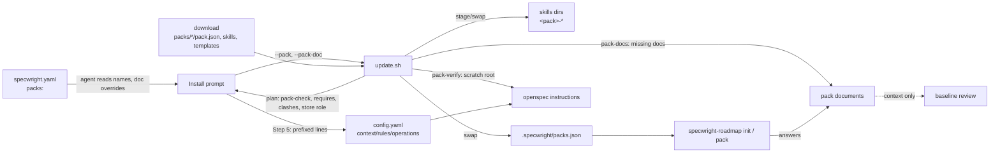
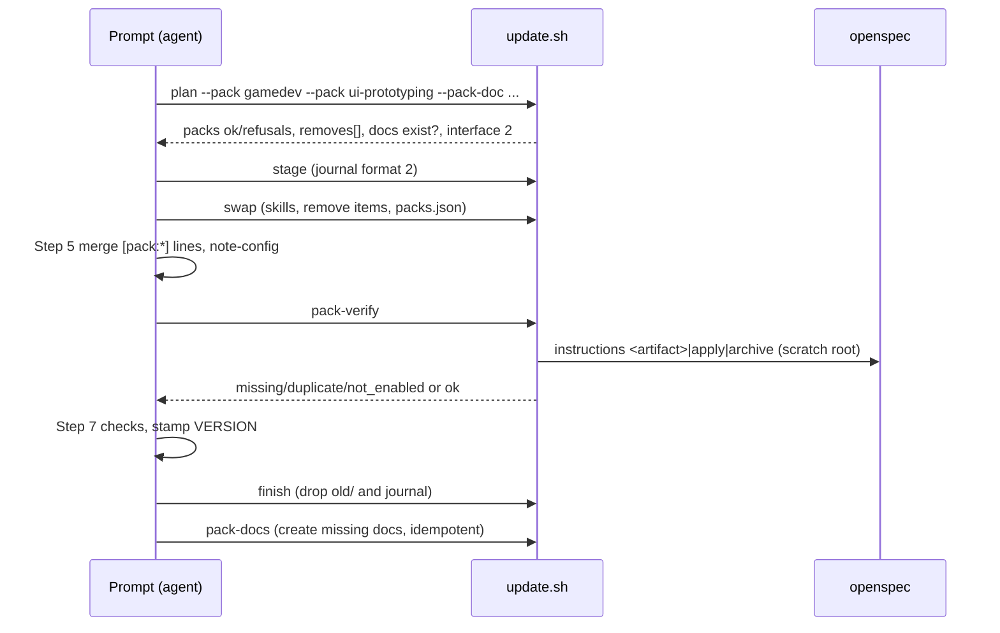
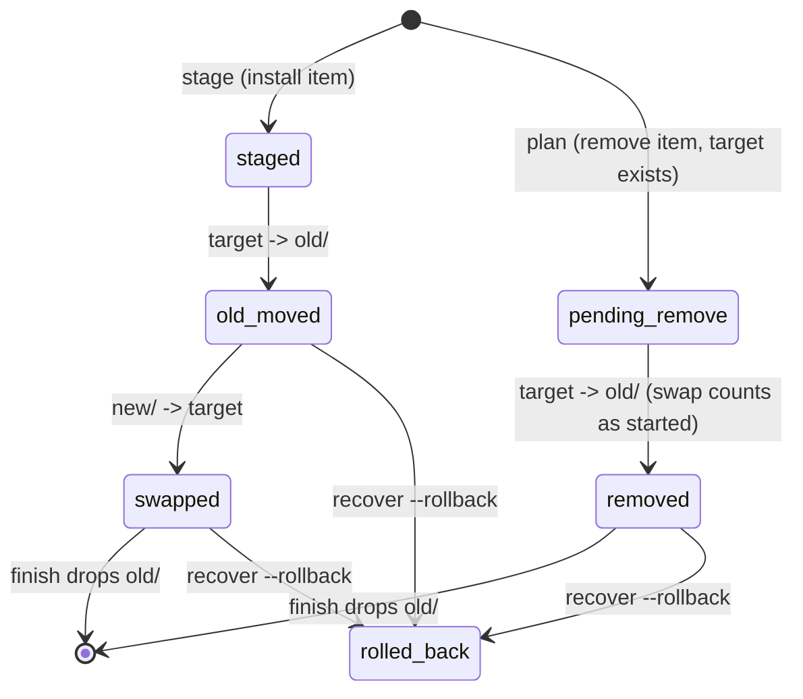

# Design

## Triage

| Trigger | Applies? | Evidence |
|---|---|---|
| T1 Components (new component, or 3+ with directed relationships) | yes | New `packs/` tree and two `update.sh` subcommands; the install prompt, `update.sh`, OpenSpec and `specwright-roadmap` all exchange pack data. |
| T2 State (persistent state, caches, 3+ state machine) | yes | New `openspec/.specwright/packs.json`; journal items gain a `remove` type; `[pack:<name>]` lines in `config.yaml` are owned state. |
| T3 Concurrency (background work, workers/isolates, async, retries) | yes | The swap and `recover` gain pack items; an interrupted install must still end at exactly the old or new state (ADR 0011). |
| T4 Boundaries (data format, migration, shared interface, IPC, external) | yes | `pack.json` format, `packs:` in `specwright.yaml`, `packs.json`, update-script interface 2, journal format 2, and OpenSpec's `rules:`/`operations:` as the delivery channel. |
| T5 Volume (grows without a fixed bound) | yes | The number of packs, lines per pack and skill descriptions grow with every pack; OpenSpec drops a `context:` over 50 KB. |
| T6 Risk (security, money, data loss, unrecoverable user data) | yes | Removing skills could delete a user's hand-copied skill; a pack line could relax a gate; pack documents are user content. |

TIER: FULL

## Context

The proposal (proposal.md) and the nine decisions agreed with the user on 2026-11-01 set the scope. The current state the approach builds on:

- **Install is a prompt plus a journaled script** (ADR 0011). `update.sh` builds one group per target directory (`scripts/update.sh:1756`); a skills group holds every `skills/specwright-*` directory of the download (`:1759`), and orphans are only `specwright-*` names (`:1769`). The interface is a constant (`:911`), checked by the prompt (README Step 3, "drives update-script interface 1").
- **The prompt owns YAML edits.** Step 5 merges `config.yaml`'s `context:` by line prefix (README Step 5, `MANDATORY: Invoke the 'specwright-` ...), and Step 6 merges `specwright.yaml` by dotted path. The script only reads YAML through a small reader (`yaml_setting`, `:1020`), the hand-rolled reader whose strictness took PR #160 fifteen rounds.
- **Changes in flight are validated in a scratch root** under `<download>/.update-scratch/` with real `openspec` runs (`inflight_entries`, `:1270`; `run_openspec`, `:1187`). The same technique can prove where pack lines land.
- **OpenSpec 1.14.1 delivers what packs need.** `config.yaml` `rules:` is keyed by artifact id and OpenSpec warns on unknown ids (`dist/core/project-config.js:380`); `operations:` takes only `apply` and `archive` (`:6`); `context:` over 50 KB is ignored whole (`:183`, `:275`). `openspec instructions <artifact>|apply|archive --change <c> --json` returns the merged rules, context and guidance.
- **Project skills already reach delegated work**: the apply packet and design reviews name "the installed project skills that apply" (schema.yaml review and apply sections), so a pack skill needs no core hook to reach the implementer or reviewer.
- **Tower of Lament** runs the prototype: three hand-copied `gamedev-*` skills and four `[pack:gamedev]` rules (its `openspec/config.yaml:46-52`), one of which names Godot MCP, which is the stack, not the domain.

## Decisions

### D1: First-party packs ship inside the Specwright download

- **Choice:** packs live in this repo as `packs/<name>/`, are installed from the same download and tag as Specwright, and are checked by the same CI. `pack.json` reserves `source`; v1 refuses it (`external_pack_unsupported`).
- **Rejected:** one repo per pack, versioned on its own, because every pack would need its own release, its own compatibility range against Specwright and its own trust story (pinning, diffs), and an artifact rename in Specwright would silently strand a pack's rules (#68's noted gap) with no CI to see it.
- **Reversal cost:** low. External sources add a resolver behind `source`; the format and the installed record do not change.

### D2: The manifest is JSON

- **Choice:** `pack.json`, read with Python's `json` module by `update.sh`.
- **Rejected:** `pack.yaml`, because the scripts have no YAML library and a second hand-written reader repeats PR #160; the Dart CLI (M7) can accept YAML later. **Rejected:** letting the agent read a YAML manifest, because the additive checks must be deterministic and testable.
- **Reversal cost:** low. A later reader can accept both.

### D3: Pack skills ride the existing groups, journal and recovery

- **Choice:** `--pack <name>` (repeatable) adds each enabled pack's skill directories as items of every skills group, sourced from `packs/<name>/skills/<skill>`. A skill recorded for a pack that is no longer enabled becomes an item of type `remove`, only in a group whose target holds it: swap moves it to `old/` and puts nothing back; finish deletes `old/`. Recovery rules for `remove` items: any one past `pending` means the swap has started (so `recover` never discards the journal while a removal sits in `old/`); on resume, an item with `old/<name>` present and no target counts as done, and `swap_loop` (`scripts/update.sh`) skips it instead of stopping as `inconsistent`; on rollback `old/<name>` is moved back, as for any other item. The journal format becomes 2 because a format-1 reader would not know `remove`; an older download then refuses a newer journal as unreadable instead of mishandling it.
- **Rejected:** a separate pack installer (its own subcommand family and journal), because two journals could disagree after an interruption and the user would have two recoveries to run.
- **Reversal cost:** medium. The journal format lives only while an update is unfinished.

### D4: Ownership comes from a record, never from a name prefix

- **Choice:** `openspec/.specwright/packs.json` (format 1) records, per enabled pack, the version, its skill names, its resolved document paths and its init questions, plus a catalogue of every pack in the download (name, description, requires, signals). It is written on every install from 0.14.0 on, with an empty `packs` when none is enabled; the catalogue is a state file no agent session loads, so a project without packs still carries no pack descriptions. It is staged and swapped as a file item of a group targeting `openspec/.specwright/`, so rollback restores it or its absence. A skill directory named like an enabled pack's skill that the record does not list is adopted when it equals the download's copy byte for byte (a clone of a project that commits its skills but ignores `.specwright/`), and otherwise stops plan (`unmanaged_skill`). Orphans are only recorded pack skills that the download no longer ships; an unrecorded skill directory of a pack that is not enabled (a hand copy) is neither listed nor touched. The README says to treat `packs.json` like `VERSION`: commit both or ignore both.
- **Rejected:** treating every `<pack>-*` directory as the pack's, because Tower of Lament already holds hand-copied `gamedev-design`: the first install would replace it and a later removal would delete it.
- **Reversal cost:** medium. The record is a local file format; its `format` field lets a later version migrate it.

### D5: The prompt merges pack lines; a script verifies them through OpenSpec

- **Choice:** the set of packs enabled before this install comes from the record as it was when the update started: `stage` writes it into the journal (format 2) as `prev_packs` before the swap replaces `packs.json`, and `plan` reports it as `packs_previous` (from the journal when one is pending, as on the documented rerun after a swap, else from `packs.json`). Step 5 and `pack-verify` use only that value, never the current `packs.json`. Step 5 removes each line starting with `[pack:<name>] ` from `context:`, every `rules.<artifact>` list and every `operations.<op>.guidance` list, but only for a `<name>` enabled now or in `packs_previous`; every other `[pack:` line (Tower of Lament's hand-written `[pack:gamedev]` rules, before and after `gamedev` ships, until the project enables it) is kept and reported as not managed. Being in the catalogue is not enough: a project that updates without enabling the pack would otherwise lose hand-written rules silently. It then appends each enabled pack's lines with the prefix `[pack:<name>] `, in pack order (dependencies first, then by name) and manifest order. List entries are written as double-quoted YAML scalars (`"` and the backslash escaped): an unquoted entry starting with `[` is a YAML flow sequence, and OpenSpec 1.14.1 then drops that artifact's whole rules list, the user's own rules included (`describeRulesShapeError`, `dist/core/project-config.js:191`). `context:` stays a block scalar. `update.sh pack-verify` builds a scratch root (the merged `config.yaml`, the download's schema, an empty change), runs `openspec instructions` for every artifact with pack rules, for `apply` and `archive`, and for one artifact's context, and checks each expected line appears exactly once and no `[pack:x] ` line of a pack in `packs_previous` and not enabled now appears (passed as `--previous <name>`, from plan's `packs_previous`). It also checks every core managed context line is still delivered, which catches a `context:` pushed over OpenSpec's 50 KB limit.
- **Rejected:** `update.sh` writing `config.yaml` itself, because writing into a user's YAML mapping without a parser is the PR #160 trap. **Rejected:** a separate pack config file, because OpenSpec reads only `config.yaml` (ADR 0001: unmodified OpenSpec).
- **Reversal cost:** low. The prefix is the contract; who writes the lines can move to the Dart CLI.

### D6: Additive-only is structural first, a crude text check second

- **Choice:** the guarantee is structural: a pack has no field that replaces an instruction, template, dependency, skill or gate; rules attach only to schema artifact ids, read from the download's `schemas/specwright/schema.yaml` (`^  - id: `); skill names must carry the pack's prefix; document templates must exist with safe default paths, and `init.questions` and `signals` must be lists of single-line strings, so a broken pack fails this repo's CI instead of a user's install after the stamp. On top, `pack-check` refuses a line matching, on word boundaries, both a **gate term** (case-insensitive: `triage`, `t1`-`t6`, `tier`, `verdict`, `review`, `verify`, `verification`, `gate`, `pre-ship`, `preship`, `test-first`; capitals only: `LIGHT`, `FULL`) and a **relaxing term** (`skip`, `skips`, `skipped`, `waive`, `waived`, `relax`, `bypass`, `exempt`, `ignore`, `omit`, `downgrade`, `optional`, `not required`, `need not`, `no need`, and `trip` only after `not`, `never` or `n't`). So `must trip T4` and `full-screen effects` pass, and `do not trip T2` is refused. The lists live in `packs/README.md` and in the script, and an eval keeps them equal.
- **Rejected:** a thorough linter (negation scope, synonyms), because every review would find another phrasing, the class of finding that took PR #160 fifteen rounds. A false positive costs a first-party author a rewording; a false negative is caught by the structural rules and by review of the pack's PR.
- **Reversal cost:** low.

### D7: Composition through `requires`, never auto-enabled

- **Choice:** `requires` lists pack names. Plan refuses an enabled pack whose requirement is not enabled (`pack_requires`) and any cycle (`pack_cycle`), and it computes the install order (dependencies first) used by D5.
- **Rejected:** auto-enabling requirements, because the user chose that nothing is enabled without their yes. **Rejected:** a stack parameter inside a domain pack, because it turns one pack into a switchboard of every stack.
- **Reversal cost:** low.

### D8: Documents are created by an idempotent step after the stamp and never overwritten

- **Choice:** the prompt passes each document's path (`specwright.yaml` override, else the manifest default) as `--pack-doc <pack>.<id>=<path>`; `plan` refuses a path that is absolute, contains `..`, leaves the code toplevel or names a directory (`pack_doc_path`) and reports which exist. After the stamp the prompt runs `update.sh pack-docs`, which needs no journal, creates each missing document from `packs/<name>/<template>` and reports `created` or `kept`; a rerun completes an interrupted run. Removal keeps them.
- **Rejected:** creating them in swap, because rollback would then have to delete files the user may already have edited. **Rejected:** creating them in `finish`, because `finish` returns early once the journal is gone, so an interrupted creation could never be completed. **Rejected:** creating them in roadmap init, because a project enabling a pack without running init would get none.
- **Reversal cost:** low.

### D9: Packs are refused wherever several projects would share them

- **Choice:** plan refuses `--pack`, before any write, when the role is `claim`, `owner` or `other` (`packs_on_store`), and when any `--skills` directory is outside the code toplevel (`packs_user_level`): GitButler projects (ADR 0019) and any user-level "Other" target. One issue tracks both.
- **Rejected:** owner-only pack lines in the store's `config.yaml` (as for the schema in ADR 0011), and per-directory reference counts for user-level skills, because both are a second ownership protocol, more lock code in the scripts M7 replaces. Without the refusal, one project's removal deletes skills another project uses, and a project without packs loads another's pack skills.
- **Reversal cost:** low.

### D10: Roadmap reads packs from the record

- **Choice:** roadmap **init** reads the catalogue in `packs.json` to match `signals` (glob patterns relative to the code toplevel, checked with `git ls-files --cached --others --exclude-standard`, so a new uncommitted `project.godot` counts) and suggests each match together with the packs it requires, and offers nothing on a store or under `vcs: gitbutler`, where plan would refuse. It reads enabled packs' questions and document paths from the record. **pack** commits the documents it wrote through the roadmap's "Committing project files" procedure on `docs/pack-<name>`, like init and close, so main stays clean for the next change. A new **pack** `<name>` mode asks one batched round and writes the answers. Pack documents are review context, never gated content: init's baseline review request names them so the reviewer checks the architecture against them, but editing a GDD never voids the baseline, and **pack** runs no review round. A GDD is a living design document, edited by most gameplay proposals; gating it would void the baseline on every such change.
- **Rejected:** roadmap reading the download, because the download is deleted at the end of the install (Step 7).
- **Reversal cost:** low.

### D11: Interface 2 and a new eval suite

- **Choice:** `INTERFACE = 2`, journal format 2. The prompt accepts interface 2, and interface 1 only when `specwright.yaml` enables no pack and the installed `packs.json` lists none, so it can still install a release before 0.14.0 (a downgrade, or the version a store `other` refusal names) without leaving pack skills or lines that the older release does not know. A new `evals/packs` suite unit-tests `pack-check` and `pack-verify` against fixture packs under `evals/packs/fixtures/`, and runs `pack-check` over the real `packs/` tree so every first-party pack is checked on every PR. `evals/update` gains install, update, remove, clash, store-refusal and interruption cases. `evals/suites.json` maps `packs/**` to `packs` and `update`.
- **Rejected:** testing through the prompt only, because prompt runs are not deterministic (ADR 0011 D1).
- **Reversal cost:** low.

## Diagrams (FULL)

Components and data flow (T1, T4):

Install sequence with packs (T3):

Pack item states inside one swap (T2):

## State & Ownership (FULL)

| State | Owner (sole writer) | Lifetime | Invalidation / rebuild | Authoritative copy |
|---|---|---|---|---|
| `packs:` in `specwright.yaml` | the user (roadmap init adds an entry only on the user's yes) | project | edited by the user | this file |
| `packs/<name>/` in the download | this repo's PRs | per release | next release | the release tag |
| Installed pack skill dirs | `update.sh` swap/recover | until the pack is removed | next install replaces them | the download, via the record |
| `openspec/.specwright/packs.json` | `update.sh` swap/recover | until the next install | rewritten every install | this file |
| `[pack:<name>] ` lines in `config.yaml` | install prompt Step 5 | until the next install | removed and re-added each install | the enabled packs' manifests |
| Pack documents | the user (created once by `pack-docs`; filled and committed by roadmap) | project | never rebuilt | the project file |
| Journal (format 2) | `update.sh` | while an update is unfinished | recover | the journal |

## Failure & Visibility (FULL)

| Component | Fails / dies mid-operation → | Recovery | Retry safe? | Who finds out |
|---|---|---|---|---|
| `pack-check` | refusal, exit 1 | fix the pack (first-party: in the PR) | yes, read-only | the PR's CI (`evals/packs`) or the user at plan |
| plan with packs | refusal before any write | user edits `packs:` or removes the clashing directory | yes | the user, refusal named |
| swap with pack items | stops mid-rename | `recover` resumes or rolls back skills, removals and `packs.json` together | yes | the user (next run's `recovered` message) |
| Step 5 merge | lines wrong or missing | `pack-verify` names each; rerun the prompt | yes | the user, `VERSION` not stamped |
| `openspec` in pack-verify | missing or failing CLI | the prompt reports it and does not stamp | yes | the user |
| pack-docs | stops part-way | rerun `pack-docs` (no journal needed); existing files kept | yes, idempotent | the user (report lists created/kept) |
| Roadmap **pack** | stops part-way | rerun; documents keep what was written | yes | the user |

## Resource Bounds (FULL)

| Queue / buffer / cache / transfer | Bound | At the bound | Timeout | At 10x / 100x |
|---|---|---|---|---|
| Line length | 500 characters | `line_invalid` | n/a | n/a |
| Lines per pack (context + rules + operations) | 40 | `too_many_lines` | n/a | 10 packs ≈ 400 lines ≈ 100-200 KB of rules: within OpenSpec, which bounds only `context:` |
| A pack's `context` lines | 2048 bytes | `context_too_large` | n/a | 20 packs = 40 KB plus about 2 KB of core lines: under OpenSpec's 50 KB |
| Merged `context:` | OpenSpec's 50 KB | OpenSpec ignores it whole; pack-verify fails because the core lines are missing; an `evals/packs` test sums the core lines and every shipped pack's context so this repo's CI finds it first | n/a | see the row above |
| Skill descriptions in every session | none enforced | README guideline: a pack's skills load on demand; keep descriptions short | n/a | the cost the user opted in to; a project without packs carries none |
| `openspec` runs in pack-verify | one per artifact with rules + 3 | n/a | the existing `run_openspec` deadline | about 8 runs whatever the pack count |
| `requires` graph | packs in the download | cycle refused | n/a | linear in packs |

## Flow & State Gaps (FULL)

- **Interrupted swap:** pack items are journal items; recover resumes or rolls back them with the rest (D3). A rollback restores `packs.json` or its absence.
- **Swapped but Step 5 not run:** skills and record are new, the lines are old; pack-verify fails, `VERSION` stays unstamped, and a rerun goes straight to Steps 5-7 (the existing `swapped` path). The journal is still pending then, so plan takes `packs_previous` from its `prev_packs`, not from the new `packs.json`, and Step 5 still removes a removed pack's lines.
- **A user edits a `[pack:` line by hand:** for a pack enabled now or before (`packs_previous`) the next install removes and re-adds it (README: pack lines are managed); for any other name it is kept and reported.
- **A clone without `packs.json`:** identical pack skills are adopted; differing ones stop plan with `unmanaged_skill` (D4).
- **Settings merge:** `packs.` keys are user data in Step 6, like `pr.reviewers.`, so an update never offers to delete them.
- **A pack renamed or dropped upstream:** the recorded skills appear as orphans and the enabled name as `pack_unknown`; the user edits `packs:`.
- **Two installs at once in one checkout:** unchanged from today (the journal refuses a second stage while one is pending).
- **Enabling a pack in roadmap init before the install:** init records it and tells the user to run the install then roadmap **pack**; nothing else waits on it.
- **Store-backed project:** refused at plan (D9).

## Mechanism Ledger (FULL)

| Mechanism | Built? | Why (harm nobody catches / expensive later) | Evidence that would change the call |
|---|---|---|---|
| Ownership record `packs.json` | yes | without it a removal deletes user skills (ToL) | none |
| Journal format 2 | yes | an older recover would mishandle `remove` items | none |
| pack-verify through OpenSpec | yes | a rule keyed wrong, or a context over 50 KB, is dropped silently | none |
| Structural additive checks | yes | the guarantee; cheap | none |
| Text gate check | yes, crude | exit criterion; catches the obvious case (#68's T2 example) | false positives blocking real first-party packs |
| Adoption of identical unrecorded skills | yes | without it a clone that commits skills but ignores `.specwright/` can never install | none |
| `packs_user_level` refusal | yes | shared skills dirs would let one project delete another's skills | a request for packs in a GitButler project (issue) |
| Pack version ranges / resolver | no | all packs ship in one release | external packs (`source`) |
| External sources, SHA pinning, diff on update | no | v1 has no external packs | a third-party pack request |
| Packs on stores | no | refused at plan, nobody harmed | a store-backed project asking for packs (issue) |
| Signals beyond file globs (dependency names in package.json) | no | suggestion only, user decides | gamedev/web packs showing globs miss common layouts |
| Pack scripts, hooks, agents, MCP | no | structural packs wait for a real need (#68) | a pack that cannot be expressed in rules and skills |
| Description budget check | no | a guideline is enough while all packs are first-party | measured session bloat from packs |

## Risks / Trade-offs

- [The crude text check refuses a legitimate strict rule] → reword it; the list and its false positives are documented, and an eval proves the shipped packs pass.
- [A pack's rules contradict another's] → packs are first-party and reviewed together; order is deterministic (D5). Conflict declarations wait for evidence.
- [Pack lines bloat every artifact's instructions] → 40 lines per pack, conditional wording ("A change to gameplay ..."), most guidance in skills loaded on demand.
- [More bash/Python just before M7] → the contract (manifest, record, JSON outputs, evals) is what M7 keeps; the code stays thin.
- [Tower of Lament migration: hand-copied skills and lines] → until the project enables `gamedev`, Step 5 keeps its hand-written `[pack:gamedev]` lines (never enabled, so not managed), whether or not `gamedev` ships in the download. Once it ships and is enabled, `unmanaged_skill` stops the first install on the differing hand copies and says to remove them, and Step 5 replaces the lines. Documented in the README.

## ADRs

- **In force, constraining this change:** 0001 (unmodified OpenSpec: packs use `rules:`/`operations:`/`context:` only), 0002 (thin scripts, one JSON document per call), 0003 (state in git/GitHub; `packs.json` is a new departure, recorded by ADR 0021), 0011 (staged, journaled updates; store ownership).
- **To record during apply:** 0021 "Packs are additive bundles shipped in the Specwright release": D1, D2, D4, D5, D6, D9 and D10, with the architecture index row and a Components note. It names `packs.json` as a third departure from ADR 0003 (after ADR 0011's journal and `STORE`): a durable per-project ownership record, needed because which skill directories Specwright installed cannot be derived from git or the directory names.

## Open Questions

- The exact recommended defaults for each pack's init questions are pack content, settled in `gamedev-pack`.
