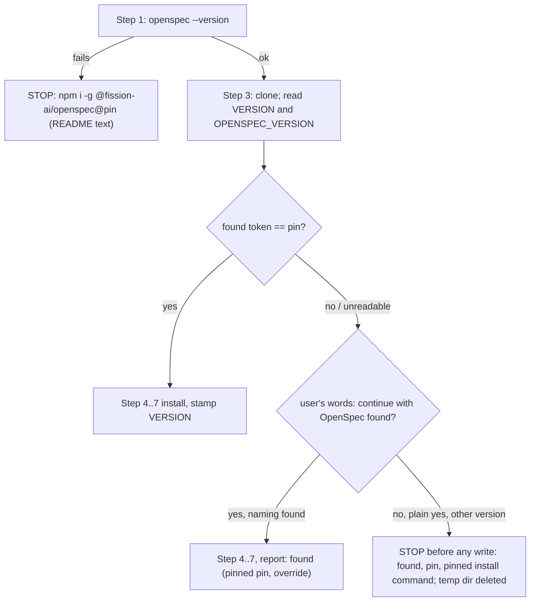

# Design

## Triage

| Trigger | Applies? | Evidence |
|---|---|---|
| T1 Components (new component, or 3+ with directed relationships) | No | No new skill, agent or script. The install prompt (README) already exists (`openspec/architecture.md:73`). `OPENSPEC_VERSION` is a data file next to `VERSION`, not a component |
| T2 State (persistent state, caches, 3+ state machine) | No | Nothing new is stored in a project. `openspec/.specwright/VERSION` keeps its format and its single writer (README Step 7, `README.md:177`). The override is not persisted |
| T3 Concurrency (background work, workers/isolates, async, retries) | No | The install is one interactive, sequential prompt |
| T4 Boundaries (data format, migration, shared interface, IPC, external) | Yes | New shipped file format (`OPENSPEC_VERSION`). The install prompt is the public interface adopters paste. The check reads an external tool's output (`openspec --version`) |
| T5 Volume (grows without a fixed bound) | No | One version string |
| T6 Risk (security, money, data loss, unrecoverable user data) | No | The check only stops writes. It deletes nothing and sends nothing anywhere |

TIER: FULL

## Context

- The pin exists only as prose: the README badge (`README.md:3`), `CONTRIBUTING.md:7` (`npm i -g @fission-ai/openspec@1.14.1`) and the upgrade rule (`CONTRIBUTING.md:51`). The public prerequisite (`README.md:44`) and install Step 1 (`README.md:57-58`) install OpenSpec without a version. The architecture records the gap (`openspec/architecture.md:105`, `:143`).
- Install Step 1 runs before anything is downloaded (`README.md:56`). Step 3 clones the repo and reads its `VERSION` (`README.md:91-97`). Step 4 is the first step that writes (`README.md:99`). Step 7 stamps `openspec/.specwright/VERSION` only when every check passes (`README.md:177-179`).
- The README has two "1.14.1 or later" notes about stores (`README.md:75`, `:322`). They contradict an exact pin.
- The tests read README text by step: `step()` (`evals/git-workflow/test_instructions.py:65`), `prerequisites` and `install_bullet()` (`:479-490`), with existing Step 1 tests at `:492-521`. Install agent evals build their fixture in `install_base` (`evals/git-workflow/fixtures.py:828`), dispatched by name at `:1096`. Fakes go first on `PATH` through `<dest>/bin` and `eval.env` (`fixtures.py:91-104`, the fake `gh` pattern).
- `openspec --version` prints a bare `1.14.1` today (checked locally). The format is not a documented contract.

## Decisions

### D1: The pin ships as a data file and is checked after download

- **Choice:** Add `OPENSPEC_VERSION` (one line, `1.14.1`) at the repo root. Step 3 reads the downloaded copy's `OPENSPEC_VERSION` next to `VERSION`, and a new check at the end of Step 3, before Step 4 writes anything, compares it with `openspec --version`. Step 1 keeps the presence check and records the `openspec --version` output, and its install hint names the pin written in the README text. When the Step 1 root check (`openspec list --json`) then fails or returns no `root`, and the recorded version differs from the README's pin, the stop names the version found and `npm i -g @fission-ai/openspec@<pin>` first, and does not tell the user to run `openspec init`: an older CLI cannot resolve a store, and `openspec init` in the code checkout would create a root that overrides it (`README.md:81-82`).
- **Rejected:** Hard-code the pin only in the prompt text and compare in Step 1. A user who pastes an old copy of the prompt would then check against an old pin while installing the current release. The version being installed is the one that has to match, and only the downloaded copy knows it.
- **Reversal cost:** low. It is one file and one bullet.

### D2: Exact match, pre-releases included

- **Choice:** Take the first token matching `\d+\.\d+\.\d+(-[0-9A-Za-z.-]+)?` in the `--version` output and compare the whole token with the pin as strings. A newer patch release, a pre-release of the pin, and output without a version number are all mismatches.
- **Rejected:** Accept any patch release at or above the pin (`~1.14.1`). Specwright parses OpenSpec's JSON output (`list`, `status`, `instructions`, `context`) and forks its schema, and a patch release can change either. The exit criterion asks for "until the pinned version is installed". A range would also need semver comparison in prompt prose, which agents get wrong on cases like `1.14.10` against `1.14.9`.
- **Reversal cost:** low. Loosening later is a prompt edit plus tests.

### D3: The override is a stated sentence, not a setting

- **Choice:** On a mismatch the install stops. The message names the found version, the pin and the pinned install command, and it says the documented override exists (`continue with OpenSpec <found>`) without recommending it. The install continues only when the user's own words name the found version. A plain "yes" is not an override, and neither is a different version. The override covers this one run: nothing is stored, and the next update checks again. The Step 8 report records `OpenSpec <found> (pinned <pin>, override)`.
- **Rejected:** A `specwright.yaml` key such as `openspec.allow_version: 1.15.0`. It is a new configuration key, which makes the release a minor version against the roadmap's 0.4.2. It is persistent, so a stale value would silently allow the next mismatch. It also needs the settings merge in Step 6 to learn it. An environment variable was rejected for the same persistence reason, and because the agent running the prompt may not see the user's shell.
- **Reversal cost:** low. A key can be added later without breaking the sentence form.

### D4: Text tests are the regression gate, agent evals prove behavior

- **Choice:** Deterministic tests in `test_instructions.py` check that every install command and the badge agree with `OPENSPEC_VERSION`, that no unversioned `npm i -g @fission-ai/openspec` remains, that the Step 3 check sits before Step 4 and stops, that the override bullet requires the found version and rejects a general confirmation, and that no "or later" OpenSpec claim remains. Two graded agent evals reuse `install_base(..., "store")` and add a fake `bin/openspec`: a sh script that prints `1.15.0` for `--version` and otherwise `exec`s the real `openspec`, whose absolute path is resolved when the fixture is built. One eval is the refusal (no override in the prompt). The other is the override (the prompt says `continue with OpenSpec 1.15.0`).
- **Rejected:** A script (`check-openspec-version.sh`) that the prompt runs. At Step 3 the downloaded copy exists, so a script could run, but it adds a component and a bash dependency for one comparison the agent can do. The spec's behavior is what the agent says and writes, and the agent evals test exactly that.
- **Reversal cost:** low.

## Diagrams (FULL)

T4: data flow of the check.

## State & Ownership (FULL)

| State | Owner (sole writer) | Lifetime | Invalidation / rebuild | Authoritative copy |
|---|---|---|---|---|
| `OPENSPEC_VERSION` (repo) | The change that upgrades OpenSpec (`CONTRIBUTING.md` rule) | Until the next OpenSpec upgrade | Upgraded together with the badge, the install commands and the schema fork note; the text test fails on drift | The file at the downloaded release |
| Override decision | The user, by stating it | One install run | Not stored; re-asked on every run | The user's message |
| `openspec/.specwright/VERSION` (project) | Install Step 7 (unchanged) | Until the next install | Not written on a refused mismatch | The project file |

## Failure & Visibility (FULL)

| Component | Fails / dies mid-operation → | Recovery | Retry safe? | Who finds out |
|---|---|---|---|---|
| Version check (Step 3) | Mismatch or unreadable output → stop before Step 4 | Install the pin, or rerun with the override | Yes. Nothing was written, and the temp clone is deleted on the stop | The user, from the stop message naming both versions |
| Interrupted after the check, before Step 7 | As today: a partial install with no stamp | Rerun the prompt (every step is repeatable, `README.md:52-53`); the check runs again | Yes | The user, from the missing stamp |
| Downloaded copy has no `OPENSPEC_VERSION` (an old release, or a fork) | The check cannot run | Treat it as a mismatch with pin `unknown` and stop, so the copy is never installed unchecked | Yes | The user |

## Resource Bounds (FULL)

| Queue / buffer / cache / transfer | Bound | At the bound | Timeout | At 10x / 100x |
|---|---|---|---|---|
| `openspec --version` output | First version token only | The rest is ignored | The agent's own command timeout | n/a |

## Flow & State Gaps (FULL)

- **Root check fails on an unpinned CLI (Step 1, before the Step 3 check):** an OpenSpec older than the pin may not resolve a store and report no `root`. When the version Step 1 recorded differs from the README's pin, Step 1 stops naming that version and the pinned install command, never `openspec init`, and writes no file (D1). With the pinned version, the existing `openspec init` advice stands.
- **Override before the stop:** the user may put the sentence in the original request (the eval does). It counts like a reply.
- **OpenSpec changed between Step 1 and Step 3:** the Step 3 check reruns `openspec --version` itself, so it reads the current version.
- **Update of a project installed before this change:** its installed `VERSION` says nothing about OpenSpec, and it does not need to, because the check reads only the live CLI and the downloaded pin.
- **A different `openspec` binary on `PATH` from the one the skills will use:** out of scope. The check and the skills resolve the same `PATH` in the same session.

## Mechanism Ledger (FULL)

| Mechanism | Built? | Why (harm nobody catches / expensive later) | Evidence that would change the call |
|---|---|---|---|
| Exact-match check before writes | Yes | Without it a mismatched CLI installs silently (#37) | — |
| Text drift test against `OPENSPEC_VERSION` | Yes | A pin bumped in one place yields a prompt that refuses its own documented version, and only adopters would notice | — |
| Runtime version check in each skill | No | The install gate covers adopters. A later `npm i -g` upgrade is the user's deliberate act | Reports of skills breaking after an OpenSpec upgrade done after install (would belong to #36's lifecycle) |
| Persisted override | No | A stale override would hide the next mismatch (D3) | Users asking to silence the stop on every update |
| Patch-range acceptance | No | D2 | A run of OpenSpec patch releases that change nothing Specwright reads |

## Risks / Trade-offs

- [An OpenSpec security patch forces adopters onto the override until Specwright re-pins] → The override is one sentence and is documented. An upgrade is its own small change under the `CONTRIBUTING.md` rule.
- [`openspec --version` output format changes] → The token regex tolerates surrounding text. With no token found, the install stops with the raw output shown, so it fails closed and visibly.
- [Agents may treat "yes" as an override anyway] → The spec scenario, a text test on the bullet, and the refusal eval with its graded assertion "no file written".

## ADRs

- **In force, constraining this change:** 0001 (extend OpenSpec only through a schema, skills, agents and templates installed as copies: this change keeps OpenSpec unmodified and only pins it), 0002 (agent instructions with thin scripts: the comparison stays in the prompt, with no new script, D4).
- **To record during apply:** none. The pin policy follows the strategy's existing rule ("OpenSpec stays pinned ... upgraded deliberately", `openspec/strategy.md:34`). The apply task updates `openspec/architecture.md:105` (pin enforced at install), the install row (`:73`, which also reads `OPENSPEC_VERSION`) and removes the #37 gap row (`:143`).
