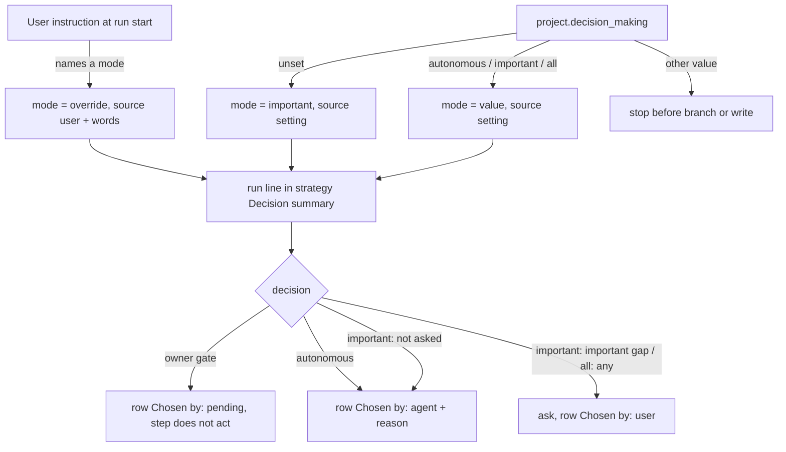
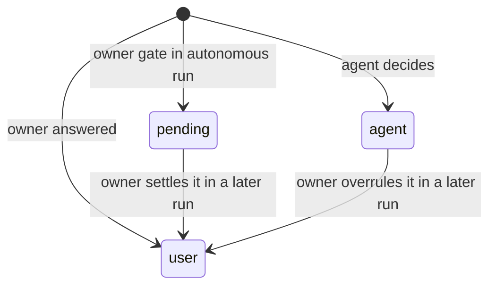

# Design

## Triage

| Trigger | Applies? | Evidence |
|---|---|---|
| T1 Components (new component, or 3+ with directed relationships) | no | No new skill, agent or script. The behaviour is instruction text in `skills/specwright-roadmap/SKILL.md` plus a reference template. |
| T2 State (persistent state, caches, 3+ state machine) | yes | The strategy's `## Decision summary` holds run lines and rows that later runs (close, pack, the owner) read back. Each row has a `pending` → `user`/`agent` lifecycle. |
| T3 Concurrency (background work, workers/isolates, async, retries) | no | A roadmap run is one session. Concurrent roadmap branches are already serialized by the store gate lock or by one checkout holding one branch. |
| T4 Boundaries (data format, migration, shared interface, IPC, external) | yes | New key `project.decision_making`. A new strategy section format that later runs parse. A change to the baseline gate's voiding rule. |
| T5 Volume (grows without a fixed bound) | yes | The table gains rows at every init, close and pack run, with no cap. |
| T6 Risk (security, money, data loss, unrecoverable user data) | no | No credentials, network or user data. The gates the owner holds are kept (S4, D5). |

TIER: FULL

## Context

The current behaviour lives in `skills/specwright-roadmap/SKILL.md`:

- **init interview** (`SKILL.md:45`):
  - pack offers that change nothing until the user answers;
  - gaps "that would change the architecture or the first milestone";
  - pack questions;
  - "at most two batched rounds (no third round), each question with a recommended default";
  - "everything else becomes a stated assumption", written into the strategy's free-form `## Assumptions` list (`skills/specwright-roadmap/references/strategy.md`, last section).
- **Baseline review rule** (`SKILL.md:48`): after 2 consecutive REVISE rounds, "stop and ask the user". Any later edit to the strategy, architecture or ADRs voids a pass, except the acceptance edit. Pack documents are never gated.
- **close** (`SKILL.md:74`, `:78`):
  - asks whether an unagreed Next split is agreed;
  - "never re-plan an agreed split silently";
  - "publish nothing without the user's yes".
- **pack** (`SKILL.md:95`): one batched round with recommended defaults.

Precedents:

- **Reading the setting.** The agent reads a setting itself when a wrong read cannot cause harm: `commit_granularity` (`skills/specwright-commit/SKILL.md:24`), and `decision_making` in #182 (archived `2026-11-03-decision-making` design, D3). An unknown value stops the run.
- **Asking.** #182 fixed how questions are asked (ask tool, batches of at most 4 or the tool's lower limit, options, a recommended one, a way to discuss). The importance test is in `schemas/specwright/schema.yaml` (proposal and design instructions).
- **Section-only edits.** ADR 0015 already lets a section-only edit (`## Release Notes`) leave the design review standing. Pack documents are an ungated precedent in the same file.
- **Settings template.** `templates/openspec/specwright.yaml:57-61` documents `decision_making` above the `project:` block that this change extends.

For scope, see `proposal.md`.

## Decisions

The scope decisions (S1-S5) are in `proposal.md`'s Decision Making section.

### D1: How the mode is read and enforced

- **Choice:**
  - The roadmap skill tells the agent to read `project.decision_making` once at the start of init, close and pack, before any branch or write.
  - An unknown value stops the run, naming the value and the three valid ones.
  - A run started by **next** reads no roadmap mode; propose handles the change's own mode.
- **Rejected:**
  - A `pr-pair.sh` reader, because a wrong read only changes who is asked, never what is merged, and the scripts move to the `sw` CLI in M7.
  - Falling back to `important` on an unknown value, because a user who set a value meant something by it.
- **Reversal cost:** low. A reader script can be added later without changing the key.
- **Important:** no. It is tactical and follows the #182 precedent.
- **Chosen by:** agent

### D2: Decision summary format

- **Choice:** `## Decision summary` in the strategy, in place of `## Assumptions` in the reference template. Under it:
  - one line per run: `- <run> <YYYY-MM-DD>: <mode> (source: setting)`, or `(source: user, "<words>")`. `<run>` is `init`, `close M<n>` or `pack <name>`.
  - one table with the columns #, Run, Decision, Choice, Rejected, Reason, Important, Chosen by. Ids are `R1`, `R2`... and continue across runs.
  - `Chosen by` is `agent`, `user`, or `pending` (awaiting the owner).
  - Rows are written in every mode.
  - A `pending` row the owner later settles is updated in place to `user` with the answer. Rows are never deleted.
- **Rejected:**
  - Agent and pending rows only, because an important-mode run would then leave no trace of which answers came from the owner.
  - A sub-table per run, because pending rows would be spread over many blocks.
- **Reversal cost:** medium. Later runs parse it.
- **Important:** yes. It binds a format later runs read.
- **Chosen by:** user

### D3: The summary section is not gated

- **Choice:** an edit confined to the strategy's `## Decision summary` never voids a baseline verdict. It is the same kind of exemption as pack documents and ADR 0015's Release Notes. Init's rows are still part of the content the baseline review reads, because they are written before the review runs. An edit outside the section voids the verdict as before. The same exception applies on every path that re-runs the baseline review: init step 5, close, and `specwright-pr` feedback step 7 (`skills/specwright-pr/SKILL.md:114`), which today re-runs it for any strategy edit on `docs/project-baseline` or `docs/close-*`. The architecture's design-review rule row (`openspec/architecture.md:159`) gains it too.
- **Rejected:**
  - Gating it, because every close would cost a review round even when nothing in the architecture changed.
  - Close rows in the roadmap's Done line, because the record would be split over two files.
- **Reversal cost:** low. It is instruction text.
- **Important:** yes. It changes the baseline gate rule users see.
- **Chosen by:** user

### D4: Autonomous close and Next's split

- **Choice:**
  - A Next with a `Split agreed` line is promoted unchanged; any amendment the milestone suggests becomes a `pending` row.
  - A Next listing changes without the line is promoted as listed, in order, with an `agent` row recording that choice.
  - A Next with no changes is split by the agent, with an `agent` row.
  - The new Next is always a paragraph with no `Split agreed` line.
- **Rejected:** re-splitting an unagreed listing from scratch, because it throws away the owner's own listing.
- **Reversal cost:** low
- **Important:** yes. It changes behaviour users see.
- **Chosen by:** user

### D5: Owner gates in autonomous mode

- **Choice:** each step that today waits on the owner's yes records a `pending` row instead and does not act:
  - a pack offer: not enabled, `packs:` unchanged, and init goes on;
  - an unverified user criterion: recorded unverified, and close stops as today;
  - untagged versions: nothing published, and close goes on;
  - an amendment to an agreed split: not applied;
  - the baseline escalation: no roadmap, ADRs stay proposed, no `USER_OVERRIDE`, and the run stops.
- **Escalation history:** `review-run.sh` replaces `openspec/architecture-review.md` with the latest validated review (`skills/specwright-review/scripts/review-run.sh:1345`, `:1460`), so only the last round stays in the file. Before an autonomous run starts a new baseline round, it copies the previous round's findings, each with its severity and one line, into its summary rows. The escalation row then names round 1's findings, and the file holds round 2's review. The script is unchanged. (Review round 1, finding 3.)
- **Rejected:**
  - Writing an escalation note into `openspec/architecture-review.md`, because that file is written only by `review-run.sh run`/`record`, whose validation expects exactly one `VERDICT:` line.
  - Copying the review file per round (new files pile up).
  - Committing after every round (it breaks the one commit per run).
- **Reversal cost:** low
- **Important:** yes. It changes behaviour users see.
- **Chosen by:** user (the principle, S4, and the escalation history). The application to each gate is the agent's.

### D6: Asking in `all` mode

- **Choice:**
  - The gap interview keeps its two-round cap, and pack keeps its one round.
  - A round is one set of questions put together before any of its answers is written. It may take several ask-tool calls when the usable tool takes fewer questions per call (Codex takes 3). No question is dropped to fit a tool's limit. (Review round 1, finding 2.)
  - The foundational ADR choices (init step 4) and close's re-plan choices go in further batches of at most 4, or the usable ask tool's lower limit. Each batch is asked before the file that holds its choices is written.
  - The ask tool, options, recommended option, discuss and "you decide" rules are #182's. The skill points to the schema's proposal instruction rather than restating them.
- **Rejected:** folding everything into two rounds, because a five-ADR baseline plus pack questions would not fit, and choices would be silently taken by the agent in `all` mode.
- **Reversal cost:** low
- **Important:** yes. It changes behaviour users see.
- **Chosen by:** user

### D7: Install template and docs

- **Choice:**
  - `templates/openspec/specwright.yaml` gains a commented `# decision_making: important` line inside `project:`, with a comment naming the three values and saying that unset means `important`. A commented line keeps an installed project on today's behaviour, and the user sees the key.
  - The README settings block gains the key, and the roadmap section gets one paragraph.
  - `openspec/architecture.md` Boundaries gains a contract bullet for the key, the summary format and the gate exemption.
  - Init asks nothing new.
  - There is no ADR, because no boundary or technology changes and the format is a contract bullet, as in #182.
- **Rejected:** an active `decision_making: important` line, because the install merge would write a value into every updated project.
- **Reversal cost:** low
- **Important:** no
- **Chosen by:** agent

### Decision summary

| # | Decision | Choice | Rejected | Reversal cost | Important | Chosen by |
|---|---|---|---|---|---|---|
| S1 | Setting shape and default | `project.decision_making`, unset = `important` | map form; top-level sibling; inherit `decision_making` | medium | yes | user |
| S2 | Modes covered | init, close, pack | init and close only | low | yes | user |
| S3 | Where answers are recorded | decision summary in `strategy.md` | top of `roadmap.md`; own file | medium | yes | user |
| S4 | Escalation in autonomous | stop, record, park; gate never passed by the agent | agent override; more rounds | low | yes | user |
| S5 | Per-run override; changes untouched | spoken override for one run, recorded | no override | low | yes | user |
| D1 | Read and enforce | skill text, read once per run; unknown value stops | reader script; silent fallback | low | no | agent |
| D2 | Summary format | run lines + one table with Run column, `R` ids, `pending`; rows in every mode | agent rows only; sub-table per run | medium | yes | user |
| D3 | Gate and the summary | summary-only edits never void a verdict, on every baseline re-run path incl. PR feedback | gated; rows in Done line | low | yes | user |
| D4 | Autonomous Next split | agreed: kept, amendments pending; unagreed: promoted as listed | re-split | low | yes | user |
| D5 | Owner gates when autonomous | `pending` row, step does not act; round 1 findings copied into the summary before round 2 | escalation note in the review file; file per round; commit per round | low | yes | user |
| D6 | `all` mode batches | interview capped at 2 rounds, pack at 1, a round may span several tool calls; ADR and re-plan choices in further batches | fold into two rounds | low | yes | user |
| D7 | Template and docs | commented key in `project:`, README, contract bullet, no ADR | active key | low | no | agent |

## Diagrams (FULL)

T2 and T4: how a run resolves its mode and where each answer goes.

T2: the life of a summary row.

## State & Ownership (FULL)

| State | Owner (sole writer) | Lifetime | Invalidation / rebuild | Authoritative copy |
|---|---|---|---|---|
| `project.decision_making` | The user | Project | Read once per roadmap run | `openspec/specwright.yaml` in the code repo |
| Run line (mode, source) | The roadmap run that it names, on its own `docs/*` branch | Project, merged with the run's branch | Never rewritten | The strategy's `## Decision summary` |
| Summary rows | The roadmap run that adds them. A later run updates a `pending` or `agent` row to `user` only with the owner's answer. | Project | Never deleted. Settled in place. | The strategy's `## Decision summary` |
| Baseline verdict | `review-run.sh` (unchanged) | Until a gated edit | Voided by an edit outside the summary section | `openspec/architecture-review.md` |

## Failure & Visibility (FULL)

| Component | Fails / dies mid-operation → | Recovery | Retry safe? | Who finds out |
|---|---|---|---|---|
| Setting read | Unknown value | The user fixes it and reruns | yes, nothing written | User, from the stop message |
| Autonomous init | Baseline escalates (2 REVISE) | The owner reads the `pending` row (with round 1's findings) and round 2's review file, then edits, overrides or reruns | yes. The ADRs stay proposed and no roadmap exists. | User, from the end-of-run rows and the missing roadmap |
| `all`-mode batch | Session ends before the answer | The choices were never written, so the next run asks them again | yes | User |
| Run interrupted after the run line, before the commit | Uncommitted edits on the `docs/*` branch | Existing roadmap recovery: the branch is resumed or discarded by the user | yes | User |
| Agent skips a row | An agent choice goes unrecorded | The baseline reviewer reads the summary at init. At close, a row is missing from the PR diff. | yes | Reviewer or owner |

## Resource Bounds (FULL)

| Queue / buffer / cache / transfer | Bound | At the bound | Timeout | At 10x / 100x |
|---|---|---|---|---|
| Questions per batch | 4, or the ask tool's lower limit | Next batch | none (interactive) | Unchanged |
| Rows per run | One per decision. An init has about 6 gaps plus about 5 ADRs plus pack questions; a close has a few. | No cap | none | 10x milestones gives about 100-200 rows, a few pages. Still one file. At 100x the owner may move old rows out by hand, which is not automated. |

## Flow & State Gaps (FULL)

- **Mode changed between runs:** each run reads the key afresh. Earlier run lines keep their mode.
- **Override mid-run:** applies from then on. The run line is updated in the same turn. Rows already written stay.
- **Older strategy without the section:** the `## Assumptions` list is left as is, and the run adds a `## Decision summary` after it.
- **Strategy held elsewhere:** `project.strategy` points to an adopted document. The section is added to that file, and nothing else in it is rewritten.
- **Pending rows at the next run:** close lists open `pending` rows at its start and, in `important`/`all` mode, puts them to the owner. In `autonomous` mode it leaves them pending.
- **Store-backed planning:** the strategy lives where `project.strategy` points. The key is read from the code repo, like every setting.

## Mechanism Ledger (FULL)

| Mechanism | Built? | Why (harm nobody catches / expensive later) | Evidence that would change the call |
|---|---|---|---|
| Script reader for the key | no | A wrong read changes who is asked, nothing merged | A harness that keeps misreading it |
| Validator for the summary table | no | The reviewer and the PR diff catch drift | Reviews missing unrecorded agent choices |
| Migrating `## Assumptions` into the table | no | Free-form lists have no columns to map. A rewrite would be an edit nobody asked for. | Owners asking for one table |
| Stop on unknown value | yes | Cheap. A silent fallback would ignore a value set on purpose. | — |

## Risks / Trade-offs

- [An autonomous init stops at the escalation and the owner returns to no roadmap] → The owner chose that in S4. The `pending` row names both rounds, so the next step is clear.
- [Instruction-only enforcement drifts between harnesses] → Wording evals pin the skill text. The summary makes a skipped question or row visible.
- [The ungated section is used to slip a real decision past the review] → Only rows and run lines may change there. Any decision that changes the architecture is in architecture or ADR files, which stay gated.

## ADRs

- **In force, constraining this change:**
  - ADR 0001: extend through skills and templates only.
  - ADR 0002: agent instructions, thin scripts.
  - ADR 0007: review files are written only by `review-run.sh`.
  - ADR 0015: the precedent for section-only edits.
  - ADR 0023: packs are never enabled by the agent.
- **To record during apply:** none. The key, the summary format and the gate exemption go into a contract bullet in `openspec/architecture.md` (D7).

## Open Questions

None.
