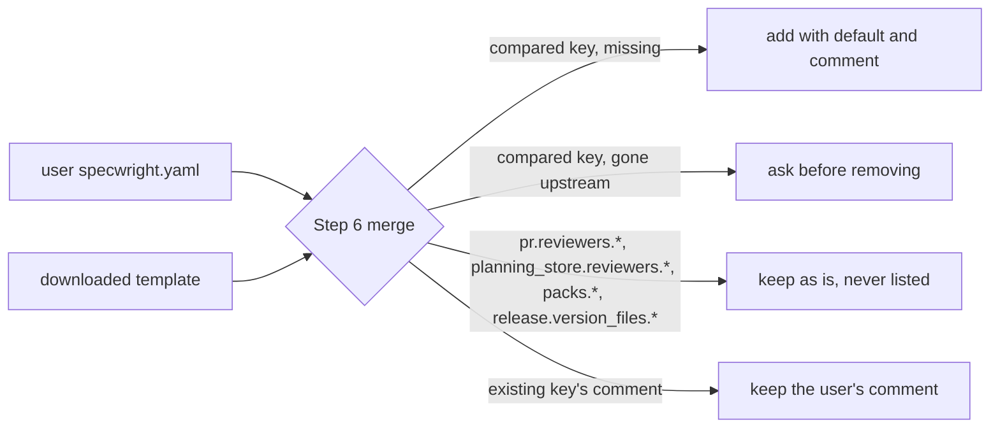

# Design

## Triage

| Trigger | Applies? | Evidence |
|---|---|---|
| T1 Components (new component, or 3+ with directed relationships) | no | One new eval module. The README prompt and the specs are existing text. |
| T2 State (persistent state, caches, 3+ state machine) | no | No state. The guard's allowlist is a constant in the test. |
| T3 Concurrency (background work, workers/isolates, async, retries) | no | None. |
| T4 Boundaries (data format, migration, shared interface, IPC, external) | yes | The settings merge's user-data rule is a contract with every project's `openspec/specwright.yaml`: README.md:432-436, openspec/specs/install-update/spec.md:347-348. |
| T5 Volume (grows without a fixed bound) | no | The guard reads the fixed set of main specs. |
| T6 Risk (security, money, data loss, unrecoverable user data) | no | Treating `release.version_files` entries as user data removes a prompt that could delete them. No new write. |

TIER: FULL

## Context

- **The name map.** The native-cli requirement "Retired script names map to sw commands" gives each retired script its `sw` command: openspec/specs/native-cli/spec.md:799-812. ADR 0040 calls it the reference for people who scripted the old names: docs/adr/0040-skills-call-the-projects-sw-directly.md:33.
- **Scale.** Before this change, 109 requirements in 21 capabilities named a retired script, about 292 times (counted with the same regex the guard uses). The deltas rewrite 77 of them in 20 capabilities. `install-update` changes one more (its update-completion scenario now allows kept orphans) and adds 4 requirements, and `native-cli` adds 1. `eval-runner` changes one: its removed-script check exempts the sweep guard (D1, S8).
- **The removed-script check.** evals/runner/test_oracle_migration.py fails on any eval file whose string literals name a removed script, and skips only itself (eval-runner "Frozen-oracle evals are migrated before the cutover"). The sweep guard has to hold the retired names as literals. The first PR CI run of this change failed the `runner` suite on all three OSes for that reason.
- **Strings `sw` still prints.** Some retired names are part of the output contract and are not stale wording:
  - `as.sh: unrepresentable …`: cli/lib/src/fence/fence.dart:588
  - `fit-subject.sh: could not rewrite …`: cli/lib/src/commit/fit_subject.dart:111
  - the `reviewers.py:` stderr prefix: cli/lib/src/pr/reviewers.dart:26
- **Header names are match keys.** `openspec validate` matches MODIFIED requirements and their scenarios by header. Renaming a `#### Scenario:` header failed validation during drafting, so every header keeps its old text, script names included.
- **Step 6 user data.** The README lists `pr.reviewers.`, `planning_store.reviewers.` and `packs.` as user data (README.md:432-436). The real key is `release.version_files`, not the `release.files` that #242 names. The template ships the entry `VERSION` (templates/openspec/specwright.yaml:216-217), and this repository adds `README.md` and `skills/*/SKILL.md` (openspec/specwright.yaml:136-139).
- **Step 7 skills check.** It requires that "nothing else is in them" (README.md:457-460). OpenSpec installs its own `openspec-*` skills into the same directories.
- **Step 8 interface line.** The line already exists, holding only `interface 3` (skills/specwright-pr/SKILL.md:14). The build and the evals read it as the single `interface <n>` line: evals/cli/test_sw_interface_pin.py:22, evals/cli/test_skill_probe.py:61. The README names "the `interface <n>` line" (README.md:520), and evals/git-workflow/test_install_sw_warning.py:37 pins that phrase.
- **The `vcs.sh` warning.** README.md:129-130 and README.md:549 describe what an older user-level copy does. The README tests pin the sentence: evals/git-workflow/test_instructions.py:2437 and :2449-2470, which also strips the exact phrase at :2466.
- **Pinned Step 6 and Step 7 wording.** Only the README evals pin the wording this change edits: test_instructions.py:2591-2594 pins "never compared, added or listed as removed" for `packs.`, and :1295-1298 pins the Step 7 uncommented-path wording. The tasks revise both so they check the general compared-path rule and its user-data and consent exemptions.
- **CI.** README edits run the `git-workflow`, `release` and `update/test_bootstrap.py` suites (evals/suites.json:17).

## Decisions

### D1: Guard the sweep with an allowlist eval that overlays active deltas

- **Choice:** a new eval, `evals/runner/test_spec_retired_names.py`, works like this:
  - It reads every `openspec/specs/*/spec.md`.
  - It lays the requirement blocks of each active change under `openspec/changes/*/specs/<cap>/spec.md` over them, in the order OpenSpec applies them at archive: RENAMED, REMOVED, MODIFIED, ADDED. Archived changes are excluded, and so are parked changes (a `review.md` line exactly `VERDICT: DEFERRED`), whose deltas never sync to main; the overlay fixture covers a parked change. A RENAMED entry moves a block to its `TO:` header, a REMOVED header drops the block, a MODIFIED block replaces the same-header block, and an ADDED block is added.
  - It finds retired names with one regex over the 14 names in the name map. Headers count too.
  - It asserts that the blocks naming one equal a fixed allowlist: the 43 entries in **Allowlist inventory** below. Each entry is keyed by capability, requirement header and scenario header (or the requirement's description) and lists the exact lines that hold a name, so a mention that moves to another line or changes its wording fails, as does one that is added or removed.
  - Two active changes that touch the same block fail the test, which names both changes: MODIFIED, REMOVED, or RENAMED as its source or its destination, in any pair. No delta is chosen silently. A fixture test applies one change with RENAMED and MODIFIED entries and compares the overlay with the text archive would write.

  A new mention fails, even a second mention of a name the block already allows. So does a removed mention, which tells the next change to shrink the list. The inventory below gives counts for review; the test holds the lines.
  - `evals/suites.json` adds the test to the `openspec/**` rule, so a spec-only change runs it on `--changed`.
  - The removed-script check in evals/runner/test_oracle_migration.py skips the guard's file, as it skips itself, and a test there pins that the guard's file is the only exemption. The eval-runner delta names the exception (S8). The guard runs no retired script, so the check's goal holds.
- **Rejected:** reading only `openspec/specs`, because that goes green only after archive and the task could not be verified during apply. No guard, because the names would creep back with no check in CI.
- **Reversal cost:** low. It is one test file.
- **Important:** yes, it binds future changes: a later spec that names a retired script must update the allowlist.
- **Chosen by:** user

### D2: Fix #242 in the README prompt and keep its pinned phrases

- **Choice:**
  - Step 6 adds `release.version_files.` to the user-data list, keeping the entries' order. It also says the merge keeps the user's values and the comments of every key it keeps.
  - Step 7's key check names the user-data prefixes. It checks `release.version_files` by the rules of any compared key and none of its entries, so a project that maps only `package.json` passes (README.md:472-474), and so does one that declined the default in Step 6.
  - Step 7's skills check replaces "nothing else is in them" with the per-directory rule from the install-update delta. An orphan the user chose to keep in Step 4 (README.md:341-343) passes and is reported in Step 8 (README.md:490-493).
  - Step 4 asks about the plan's `specwright-*` skill orphans that this update does not install, on every path: after a new swap, and on a rerun that confirms a completed swap and skips `stage` and `swap`. It does so before Step 5, so an orphan the user now agrees to remove is gone before Step 7. Both resume directions change: README.md:322-325 (go on with Steps 5-7) and README.md:484-485 ("it goes straight to Steps 5-7") now go through the orphan question first.
  - The completion scenario of "Update stages the new version before it swaps it in" allows the orphans the user kept, so it no longer contradicts the Step 7 rule.
  - Step 8 says the interface is the line that holds only `interface <n>` and nothing else, below the paragraph in the installed `specwright-pr/SKILL.md`. It gives no number as an example, because evals/git-workflow/test_install_sw_warning.py:68-73 refuses a hard-coded `interface 3` in the check. The pinned phrase "`interface <n>` line in the installed `specwright-pr/SKILL.md`" stays as a substring.
  - The README evals add checks for the coupled rules:
    - a custom `release.version_files` mapping passes Step 7 without the template's entry;
    - a missing `release.version_files` gets the default, and a declined default still passes Step 7;
    - a kept key's comment is unchanged;
    - an obsolete key still needs consent before removal;
    - a kept orphan passes Step 7;
    - both swap paths, a new swap and a confirmed completed one, reach the orphan question before Step 5;
    - an orphan approved for removal that is still present blocks the stamp.
  - Two existing pins change with this wording, and the tasks revise them in the same commit: test_instructions.py:2591-2594 ("never compared, added or listed as removed" for `packs.`) and :1295-1298 (the Step 7 uncommented-path wording).
  - Both `vcs.sh` sentences say this happens with an older user-level copy from before 0.14.0, a version that still had `vcs.sh`. The phrase "older user-level copy stops every `vcs.sh` call with `scripts_in_workspace`" stays, because test_instructions.py:2466 strips it.
- **Rejected:** a second interface line or a changed format in `specwright-pr/SKILL.md`, because the build, the install and two evals read the current line.
- **Reversal cost:** low
- **Important:** yes, it changes behaviour users see in the install prompt.
- **Chosen by:** agent, carrying out S3 to S6

### D3: File the five requirements that cannot be swept as issues

- **Choice:** one issue each for the five requirements whose meaning would change. Their mentions stay on the allowlist until those issues are fixed.
  - change-finish "finish.sh runs no network command": it scans a file `sw` does not have.
  - eval-runner "Changed paths select the suites": it uses example paths under `skills/*/scripts/`, which no longer exist.
  - pr-script-runtime "sw pr snapshot and sw pr reply keep the scripts' contracts": it runs the commands through shims that are gone.
  - vcs-backends "The archive undo plan uses jj on a jj repo" and "The archive undo plan uses GitButler on a GitButler repo": they assert commands that `finish.sh` ran, while `sw finish` prints `steps` and `after_rerun_steps` for the agent to run (openspec/specs/change-finish/spec.md:394-403). Saying steps changes what they assert, so they leave the sweep (D6).
- **Rejected:** rewriting them here, which would turn a wording sweep into behaviour changes that the proposal's S2 rules out.
- **Reversal cost:** low
- **Important:** no. Nothing changes for users, and the five are tracked.
- **Chosen by:** agent

### D4: Release as a patch

- **Choice:** bump to 0.39.1. The wording is unchanged in meaning, and the install prompt changes are fixes.
- **Rejected:** a minor bump. No feature, setting or workflow is added.
- **Reversal cost:** low
- **Important:** no. It follows the project's recorded versioning rule.
- **Chosen by:** agent

### D5: Where swept wording no longer matched sw, say what sw does

- **Choice:** some blocks named a script whose replacement differs in a way the old wording hides. Those blocks now state `sw`'s behaviour, which exists today and is tested:
  - The undo plan prints `steps` and `after_rerun_steps` (openspec/specs/change-finish/spec.md:394-403), so the touched change-finish block says steps.
  - The subcommands that read the download need `--download` (cli/lib/src/commands/update.dart:18-29).
  - The JSON error contract covers only the `sw pr` subcommands that `pr-pair.sh` carried (cli/lib/src/commands/pr.dart:49-70).
  - `--dir` comes before the `sw release` subcommand (cli/lib/src/release/commands.dart:127-134).
- **Rejected:** a literal name swap. It would make those requirements describe commands `sw` refuses, or a contract it never had.
- **Reversal cost:** low
- **Important:** no. It describes what `sw` already does, and users see no change.
- **Chosen by:** agent

### D6: Read a shortened command as the workflow's call, and narrow the sweep

- **Choice:** two rounds of the design review found reworded scenarios that show an `sw` command without an option it needs, so read literally they assert a usage stop. Each fix turned up the next. The change adds one `native-cli` requirement instead: a command shown without its required options (`--download`, `--code`, `--repo`/`--role`, the task and change options) means the call the workflow makes with them, and a usage stop is meant only where the text says the option is missing. The jj and GitButler undo blocks leave the sweep (D3).
- **Rejected:** spelling every option out in every reworded block, which grows the delta, drifts from the main text and kept finding new gaps. Rewriting the undo blocks here, which changes what they assert.
- **Reversal cost:** low. It is one requirement, and spelling the options out later stays possible.
- **Important:** yes, it binds future changes: every spec that shows a shortened `sw` call is read by it.
- **Chosen by:** user ("Narrow + map")

### Decision summary

| # | Decision | Choice | Rejected | Reversal cost | Important | Chosen by |
|---|---|---|---|---|---|---|
| S1 | Name-map requirement | Keep it and the history it records | Remove it | low | yes | agent |
| S2 | Sweep boundary | Current-component mentions only; keep history, output strings, real and example file names | Blind replace; fixing changed-meaning requirements | low | no | agent |
| S3 | Widen to #242 | Take all five items | A separate change | low | yes | user |
| S4 | Stale settings comments | Step 6 says comments are never rewritten | A comment refresh; a separate issue | low | yes | user |
| S5 | Specify #242 in install-update | README plus install-update requirements | README only | low | yes | user |
| S6 | Step 8 interface line | Reword the README only | Change the skill | low | no | agent |
| S7 | Narrow the sweep | Add a reading rule; move the undo blocks out | Spell every option out | low | yes | user |
| S8 | Guard vs removed-script check | Exempt the sweep guard's file; eval-runner delta | Move the names to JSON data | low | yes | user |
| D1 | Sweep guard | Allowlist eval with active-delta overlay | Main specs only; no guard | low | yes | user |
| D2 | README #242 wording | Edit Steps 6-8 and the warnings, keeping pinned phrases | A new interface line in the skill | low | yes | agent |
| D3 | Unsweepable requirements | File five issues and allowlist them | Rewrite them here | low | no | agent |
| D4 | Release | Patch 0.39.1 | Minor | low | no | agent |
| D5 | Swept wording that hid a difference | State sw's actual behaviour | Literal name swap | low | no | agent |
| D6 | Shortened commands | native-cli reading rule; undo blocks out of the sweep | Spell every option out; rewrite the undo blocks | low | yes | user |

## Assumptions

None. The pins on the edited Step 6 and Step 7 wording were checked by searching the repository (see Context).

## Carried constraints

- **C1:** Retired script names may stay in the main specs only in the allowlisted blocks: history, the name map, output strings `sw` still prints, and headers kept as match keys. Five entries are deferred contract work, not history: change-finish "finish.sh runs no network command", eval-runner "Changed paths select the suites", pr-script-runtime "sw pr snapshot and sw pr reply keep the scripts' contracts", and vcs-backends "The archive undo plan uses jj on a jj repo" and "The archive undo plan uses GitButler on a GitButler repo". Their entries name the issue filed for them (D3), and they leave the list when that issue is fixed. A new mention needs an allowlist entry and a reason. Kind: invariant. Destination: doc comment: evals/runner/test_spec_retired_names.py ALLOWED
- **C2:** Entries under `release.version_files.` are user data in the settings merge, while the `release.version_files` key itself is still compared. Kind: invariant. Destination: spec: specs/install-update/spec.md → Requirement: The settings merge treats version-file entries as user data

<!-- ===== LIGHT tier ends here. ===== -->

## Diagrams (FULL)

## State & Ownership (FULL)

| State | Owner (sole writer) | Lifetime | Invalidation / rebuild | Authoritative copy |
|---|---|---|---|---|
| The guard's allowlist | The change that edits a listed block or adds a mention | Until that change | Edited in the same change as the spec | evals/runner/test_spec_retired_names.py |
| The user's `openspec/specwright.yaml` | The user, plus the Step 6 merge for added keys only | Permanent | Never rebuilt | The user's file |

## Failure & Visibility (FULL)

| Component | Fails / dies mid-operation → | Recovery | Retry safe? | Who finds out |
|---|---|---|---|---|
| Sweep guard | A spec gains or loses a retired name | Update the spec or the allowlist | yes | CI, through the failing test, which names the block and the names |
| Step 6 merge | The agent lists a user-data entry as removed | The user declines the removal | yes | The user, at the Step 6 question |
| Step 7 check | A stale `specwright-*` file or directory is found | The install stops before the stamp | yes | The user, in the Step 7 report |

## Resource Bounds (FULL)

| Queue / buffer / cache / transfer | Bound | At the bound | Timeout | At 10x / 100x |
|---|---|---|---|---|
| Guard input | The main specs (about 30 files) plus the active changes' deltas | Not applicable | Unit test default | Reading 300 or 3,000 spec files is still under a second |

## Flow & State Gaps (FULL)

- **Two active changes MODIFY or REMOVE the same block.** The guard fails, naming both changes (D1). The second change rebases on the first once it merges.
- **An active change REMOVEs a listed block.** The guard drops the block, and the allowlist entry then fails as a removed mention. The removing change shrinks the list.
- **After archive.** The change directory moves under `changes/archive/`, which the guard skips. The main specs hold the new text, so the result is the same.

## Mechanism Ledger (FULL)

| Mechanism | Built? | Why (harm nobody catches / expensive later) | Evidence that would change the call |
|---|---|---|---|
| Allowlist guard | yes | Without it, names come back unnoticed, and the sweep is costly to repeat | none |
| Overlay of ADDED blocks | yes | A new requirement in an active change could add a retired name | none |
| Check of README, skills and archived changes for retired names | no | History and upgrade notes are meant to name them; the scope is the main specs | A retired name reported as a current part outside the specs |
| Check of the Step 7 wording in code | no | The install prompt is text an agent follows, and the README evals pin it | An `sw update` subcommand that runs the Step 7 check |

## Allowlist inventory

The guard's allowlist (D1): each block that keeps a retired name after this change, with the number of times each name occurs in it, headers included. `kept` entries are history, the name map, an output string `sw` still prints, a real file name, or a header kept as a match key.

| Capability | Requirement | Names (count) | Kind |
|---|---|---|---|
| change-finish | finish.sh runs no network command | as.sh 1, finish.sh 5 | deferred (D3 issue) |
| change-finish | The undo plan runs in the project's sw | finish.sh 1 | kept |
| change-finish | finish.sh finds the project from --code, then --dir | finish.sh 1 | kept |
| change-finish | Undo steps do what the old script did | vcs.sh 1 | kept |
| change-finish | Fixed undo-plan defects are exceptions to the script's refusals | finish.sh 5 | kept |
| eval-runner | Changed paths select the suites | finish.sh 1, release.sh 1 | deferred (D3 issue) |
| eval-runner | A stopped test file's nested sessions are stopped too | bounded.py 2 | kept |
| eval-runner | Frozen-oracle evals are migrated before the cutover | as.sh 1, bounded.py 1, sw-path.sh 1, vcs.sh 1 | kept |
| github-identity | sw as keeps as.sh's contract | as.sh 5 | kept |
| github-identity | sw as verifies the token for its login | as.sh 1 | kept |
| install-update | An install whose VCS steps need a missing sw says so | sw-path.sh 1, vcs.sh 1 | kept |
| install-update | sw update recovers journals that older update scripts left | update.sh 3 | kept |
| native-cli | sw run --bounded keeps bounded.py's command-line contract | bounded.py 2 | kept |
| native-cli | Arguments reach native executables unchanged | bounded.py 1 | kept |
| native-cli | JSON input that is not plain JSON is refused | reviewers.py 1 | kept |
| native-cli | A launch-site allowlist guards process starts | as.sh 2, pr-pair.sh 1, pr-reply.sh 1, pr-snapshot.sh 1, release.sh 1, review-run.sh 1, update.sh 1, vcs.sh 2 | kept |
| native-cli | Long Windows arguments reach native tools whole | as.sh 1 | kept |
| native-cli | Skills run sw directly | as.sh 1, finish.sh 1, fit-subject.sh 1, pr-pair.sh 1, pr-reply.sh 1, pr-snapshot.sh 1, release.sh 1, review-run.sh 1, sw-path.sh 1, task-cover.sh 1, update.sh 1, vcs.sh 1 | kept |
| native-cli | Retired script names map to sw commands | as.sh 1, bounded.py 1, finish.sh 1, fit-subject.sh 1, pr-pair.sh 1, pr-reply.sh 1, pr-snapshot.sh 1, release.sh 1, review-run.sh 1, reviewers.py 1, task-cover.sh 1, update.sh 1, vcs.sh 2 | kept |
| native-cli | Printed commands name sw | as.sh 1, vcs.sh 2 | kept |
| pr-evidence | A snapshot names the reviewer rules it used | reviewers.py 1 | kept |
| pr-script-runtime | Unexpected failures keep the JSON error contract | pr-pair.sh 1 | kept |
| pr-script-runtime | Network commands have a deadline | as.sh 1, pr-pair.sh 1 | kept |
| pr-script-runtime | sw pr snapshot and sw pr reply keep the scripts' contracts | pr-reply.sh 1, pr-snapshot.sh 1, reviewers.py 2 | deferred (D3 issue) |
| pr-script-runtime | Watch claims and head records stay shared across implementations | pr-snapshot.sh 2 | kept |
| pr-script-runtime | The ported pr-pair subcommands keep the script's contracts | as.sh 1, pr-pair.sh 2, vcs.sh 1 | kept |
| pr-script-runtime | sw pr reviewers keeps the evaluator's contract | reviewers.py 4 | kept |
| pr-script-runtime | Snapshots evaluate reviewers through sw | reviewers.py 4 | kept |
| pr-script-runtime | sw pr ignores an inherited GH_REPO | pr-pair.sh 1 | kept |
| pr-script-runtime | Fixed snapshot defects are exceptions to the scripts' contract | pr-snapshot.sh 1 | kept |
| releases | The release summary comes from the bumping change | release.sh 3 | kept |
| releases | Release operations run in the project's sw | release.sh 2 | kept |
| review-routes | Review operations run in the project's sw | review-run.sh 2 | kept |
| task-commits | Commit tooling runs in the project's sw | fit-subject.sh 1, task-cover.sh 1 | kept |
| task-commits | task-cover.sh finds the project from --code | task-cover.sh 1 | kept |
| task-commits | sw commit task-cover keeps task-cover.sh's contract | task-cover.sh 4 | kept |
| task-commits | sw commit fit-subject keeps fit-subject.sh's contract | fit-subject.sh 4 | kept |
| vcs-backends | sw vcs keeps vcs.sh's output and exit-code contract | vcs.sh 2 | kept |
| vcs-backends | sw vcs reads settings and fences identity in process | as.sh 1, pr-pair.sh 1 | kept |
| vcs-backends | sw vcs documents keep their values and refuse non-UTF-8 names | vcs.sh 1 | kept |
| vcs-backends | Fixed commit defects are exceptions to the backends' unchanged outputs | vcs.sh 1 | kept |
| vcs-backends | The archive undo plan uses jj on a jj repo | finish.sh 2 | deferred (D3 issue) |
| vcs-backends | The archive undo plan uses GitButler on a GitButler repo | finish.sh 1 | deferred (D3 issue) |

## Risks / Trade-offs

- [The swept wording drifts from what `sw` accepts] → Every rewritten command was checked against cli/lib/src during drafting. Pre-ship review sees the whole delta.
- [78 MODIFIED blocks make a large diff] → Wording only. The guard and `openspec validate --strict` cover structure, and `review.max_diff_kb` is 1400.
- [README phrase pins break] → D2 keeps the pinned phrases, and the README tasks update the regexes in the same group.

## ADRs

- **In force, constraining this change:** 0040 (skills call `sw` directly; the name map), 0027 (one native binary), 0042 (interface 3).
- **To record during apply:** none.
